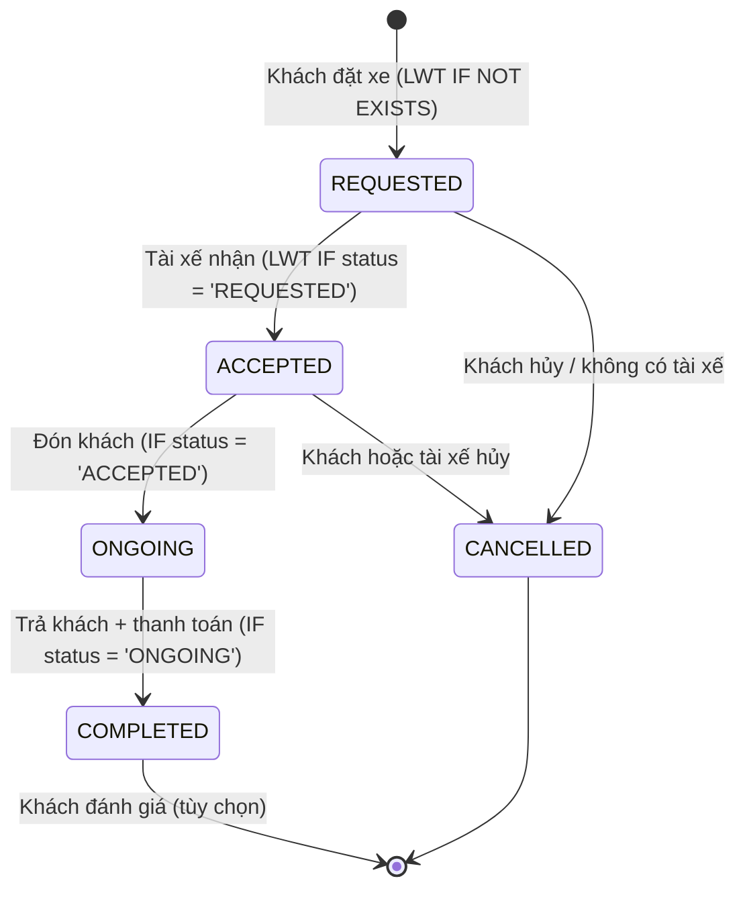
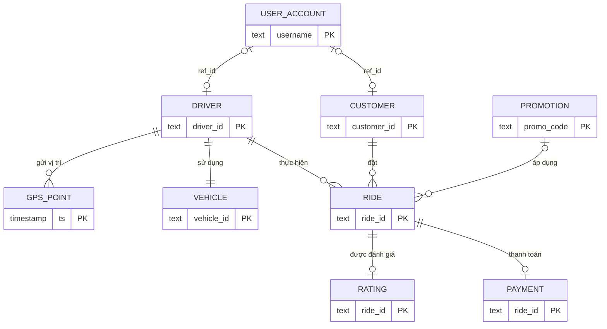
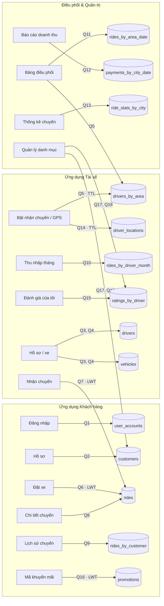

# CASSANDRA.MD — Xây dựng CSDL Cassandra cho hệ thống "Quản lý dữ liệu đặt xe công nghệ"

> **Đề tài:** Tìm hiểu công cụ DbSchema để quản trị và khai thác CSDL Cassandra "Quản lý dữ liệu đặt xe công nghệ" và xây dựng ứng dụng minh họa — Môn NoSQL (14DH), HUIT.
> **Keyspace:** `ride_booking` · **Cassandra:** 4.1 (image `cassandra:4.1` trong `docker-compose.yml`, container `nosql-cassandra`) · **GUI Tool:** DbSchema 10.5.2.
> **Trạng thái:** mọi lệnh trong tài liệu đã được chạy thử trên Cassandra 4.1.12 ngày 04/10/2026. Kết quả in trong tài liệu là kết quả thật của lần chạy đó.

---

## Mục lục

0. [Đọc nhanh: tài liệu này gồm những gì và chạy thế nào](#0-đọc-nhanh)
1. [Môi trường — giữ đúng như báo cáo giữa kỳ](#1-môi-trường--giữ-đúng-như-báo-cáo-giữa-kỳ)
2. [Phân tích nghiệp vụ](#2-phân-tích-nghiệp-vụ)
3. [Thiết kế CSDL theo truy vấn (Query-First Design)](#3-thiết-kế-csdl-theo-truy-vấn-query-first-design)
4. [Tạo Database — `01_schema.cql`](#4-tạo-database--01_schemacql)
5. [Insert dữ liệu mẫu — `02_data.cql`](#5-insert-dữ-liệu-mẫu--02_datacql)
6. [Truy vấn cơ bản — `03_queries_basic.cql`](#6-truy-vấn-cơ-bản--03_queries_basiccql)
7. [Truy vấn nâng cao — `04_queries_advanced.cql`](#7-truy-vấn-nâng-cao--04_queries_advancedcql)
8. [Luồng ghi nghiệp vụ: LWT, BATCH, Counter, TTL — `05_transactions.cql`](#8-luồng-ghi-nghiệp-vụ-lwt-batch-counter-ttl--05_transactionscql)
9. [Import / Export dữ liệu](#9-import--export-dữ-liệu)
10. [Backup và Restore dữ liệu](#10-backup-và-restore-dữ-liệu)
11. [Kết nối từ ứng dụng (chuẩn bị cho phần demo)](#11-kết-nối-từ-ứng-dụng-chuẩn-bị-cho-phần-demo)
12. [Xử lý sự cố thường gặp trên Windows](#12-xử-lý-sự-cố-thường-gặp-trên-windows)
13. [Tài liệu tham khảo](#13-tài-liệu-tham-khảo)

---

## 0. Đọc nhanh

### 0.1. Các file đi kèm (thư mục `DoAn/cassandra/`)

| File | Nội dung | Thang điểm |
|---|---|---|
| `01_schema.cql` | Tạo keyspace, 2 UDT, 14 bảng (4 bảng cũ giữ nguyên + 10 bảng mới), 2 secondary index | Mục 5 – Tạo Database |
| `02_data.cql` | 285 dòng dữ liệu mẫu nhất quán giữa các bảng: 10 khách, 10 tài xế, 10 xe, 22 tài khoản, 36 chuyến đi | Mục 5 – Insert dữ liệu |
| `03_queries_basic.cql` | 20 truy vấn cơ bản B01–B20 (đọc theo khóa, khoảng ngày, CRUD) | Mục 5, 7 – Truy vấn cơ bản |
| `04_queries_advanced.cql` | 18 truy vấn nâng cao A01–A18 (GROUP BY, aggregate, PER PARTITION LIMIT, token, UDT, collection, TTL, JSON…) | Mục 5, 7 – Truy vấn nâng cao |
| `05_transactions.cql` | 12 luồng ghi T01–T12 (đăng ký, đặt xe, nhận chuyến, hoàn thành, hủy, đánh giá, khuyến mãi) bằng LWT, BATCH, counter, TTL | Mục 5, 7, 9 |
| `99_reset_data.cql` | TRUNCATE cả 14 bảng (giữ cấu trúc) để nạp lại từ đầu | Tiện ích |
| `scripts/backup_snapshot.sh`, `scripts/restore_snapshot.sh` | Sao lưu và khôi phục vật lý bằng `nodetool snapshot` / `nodetool import` | Mục 6 – Backup/Restore |
| `scripts/export_csv.sh`, `scripts/import_csv.sh` | Xuất và nhập toàn bộ keyspace dạng CSV bằng `COPY TO/FROM` | Mục 6 – Import/Export |
| `csv/customers_import.csv` | 5 khách hàng mới để minh họa nhập CSV | Mục 6 |
| `cqlshrc` | Cấu hình hiển thị của cqlsh (in đủ chữ số kiểu `double`) | Tiện ích |
| `tools/gen_data.py` | Script Python sinh `02_data.cql` và file CSV (sửa dữ liệu ở đây rồi chạy lại) | Tiện ích |

### 0.2. Chạy toàn bộ trong 7 lệnh (PowerShell, tại `D:\Documents\Homework\NoSQL`)

```powershell
docker compose up -d cassandra                     # bật Cassandra (chờ 60–90 giây)
docker exec nosql-cassandra nodetool status        # thấy dòng "UN" là sẵn sàng
docker cp DoAn\cassandra nosql-cassandra:/tmp/     # chép thư mục script vào container
docker exec nosql-cassandra sh -c "mkdir -p /root/.cassandra && cp /tmp/cassandra/cqlshrc /root/.cassandra/cqlshrc"
docker exec nosql-cassandra cqlsh -f /tmp/cassandra/01_schema.cql
docker exec nosql-cassandra cqlsh -f /tmp/cassandra/02_data.cql
docker exec nosql-cassandra cqlsh -f /tmp/cassandra/03_queries_basic.cql
```

Sau đó chạy tiếp `04_queries_advanced.cql` và `05_transactions.cql` theo cùng cú pháp. Nếu keyspace đang chứa dữ liệu ngẫu nhiên của DbSchema Data Generator (xem [§5.2](#52-bước-0--dọn-dữ-liệu-ngẫu-nhiên-của-data-generator-tùy-chọn)), hãy chạy `99_reset_data.cql` trước `02_data.cql`.

### 0.3. Đối chiếu với thang điểm

| Mục thang điểm | Nội dung đáp ứng | Vị trí |
|---|---|---|
| 5. Tạo Database | Keyspace, UDT, 14 bảng thiết kế theo 18 truy vấn, lý do chọn khóa | §3, §4 |
| 5. Insert dữ liệu đầy đủ | 285 dòng, nhất quán giữa các bảng phi chuẩn hóa nhờ logged BATCH | §5 |
| 5. Dữ liệu đáp ứng truy vấn cơ bản / nâng cao | Mỗi truy vấn B/A/T đều có dữ liệu trả về (kết quả in kèm) | §6, §7, §8 |
| 6. Import/Export | `COPY TO/FROM`, CSV, JSON, xuất toàn keyspace | §9 |
| 6. Backup/Restore | Schema, snapshot, incremental, `nodetool import`, `sstableloader`; kịch bản sự cố có số liệu | §10 |
| 7. Truy vấn trên GUI Tool | Cách chạy từng truy vấn trong DbSchema (SQL Editor, Query Builder) | §6.1 |
| 9. Quản trị người dùng / thao tác CSDL | Bảng `user_accounts`, đăng ký bằng LWT, khóa/mở khóa; CRUD; backup | §5, §6 (B18–B20), §8 (T01–T02), §10 |

---

## 1. Môi trường — giữ đúng như báo cáo giữa kỳ

### 1.1. Cấu hình hiện có và đối chiếu

Toàn bộ thiết kế dưới đây **không đổi bất kỳ cấu hình nào** đã dùng trong báo cáo giữa kỳ. Cấu hình local hiện tại đã khớp với báo cáo nên không cần chỉnh gì.

| Thành phần | Trong báo cáo giữa kỳ (Word) | Trên máy (repo) | Kết luận |
|---|---|---|---|
| Kết nối DbSchema | Method **Standard**, *This computer, default port* → `localhost:9042` (Hình 2.6, 3.19) | `docker-compose.yml` mở cổng `9042:9042` | Khớp |
| Tài khoản DbSchema | User `cassandra`, ô **DataCenter để trống** (Hình 2.6) | Cassandra không bật xác thực (`AllowAllAuthenticator`), nên user/password được bỏ qua | Khớp. Nếu DbSchema yêu cầu DataCenter thì nhập `datacenter1` |
| Phiên bản DbSchema | 10.5.2 build 261002.402, bản Trial (Hình 2.7) | — | Giữ nguyên |
| Keyspace | `ride_booking` | `CREATE KEYSPACE IF NOT EXISTS` không ghi đè | Khớp |
| Bảng đã có | `customers`, `drivers`, `rides_by_customer`, `vehicles` (Hình 3.5, 3.11, 4.1, 4.4) | Định nghĩa lại **y hệt** bằng `CREATE TABLE IF NOT EXISTS` (không đụng tới bảng đang có) | Khớp |
| Cassandra | Kết nối `localhost/127.0.0.1:9042` (Hình 3.19) | `cassandra:4.1`, container `nosql-cassandra`, cluster `NoSQLLab`, DC `datacenter1`, heap 1 GB | Khớp |
| File model DbSchema | `D:\NOSQL\test1.dbs` | — | Dùng tiếp để Refresh/Synchronize (§4.3) |

> **Một điểm không đọc được từ ảnh chụp:** thứ tự sắp xếp (ASC/DESC) của hai clustering column `ride_date`, `ride_id` trong bảng `rides_by_customer` và kiểu chính xác của cột `fare` (biểu tượng Σ là kiểu số; dữ liệu mẫu `85000.0`). Tài liệu dùng định nghĩa mặc định (ASC, `double`). Mọi truy vấn đều ghi rõ `ORDER BY ride_date DESC, ride_id DESC` và mọi giá trị `fare` đều viết dạng `85000.0`. Nhờ vậy script chạy đúng với **cả hai** trường hợp ASC/DESC và với cả `double`/`decimal`; cả hai biến thể đã được chạy thử. Kiểm tra bảng thật trên máy bằng:
>
> ```powershell
> docker exec nosql-cassandra cqlsh -e "DESCRIBE TABLE ride_booking.rides_by_customer"
> ```

### 1.2. Kiểm tra nhanh môi trường

```powershell
cd D:\Documents\Homework\NoSQL
docker compose up -d cassandra
docker exec nosql-cassandra nodetool status
docker exec nosql-cassandra cqlsh -e "SHOW VERSION; SELECT cluster_name, data_center, release_version FROM system.local;"
```

Kết quả mẫu:

```text
Datacenter: datacenter1
UN  172.17.0.2  ...  rack1

[cqlsh 6.1.0 | Cassandra 4.1.12 | CQL spec 3.4.6 | Native protocol v5]
 cluster_name | data_center | release_version
--------------+-------------+-----------------
     NoSQLLab | datacenter1 |          4.1.12
```

> Tag `cassandra:4.1` luôn trỏ tới bản vá mới nhất của nhánh 4.1 (4.1.12 tại thời điểm chạy thử). Khi ghi phiên bản trong báo cáo, hãy lấy đúng số in ra từ lệnh `SHOW VERSION` trên máy.

### 1.3. Quy ước dùng trong tài liệu

- **Mã định danh** giữ đúng kiểu đã dùng trong báo cáo: `CUST001`, `DRV_555`, `RIDE_1001`, `VEH_555` (kiểu `text`). Dòng `RIDE_1001` của khách `CUST001` trong báo cáo (Hình 3.4, 4.4) được giữ nguyên giá trị trong dữ liệu mẫu.
- **Khu vực** gồm thành phố + quận, dùng mã ASCII làm khóa: `city` ∈ {`HCM`, `HN`}, `district` ∈ {`Q1`, `Q3`, `TAN_PHU`, `BINH_THANH`, `GO_VAP`, `TAN_BINH`, `HOAN_KIEM`, `CAU_GIAY`, `DONG_DA`, `NAM_TU_LIEM`, …}.
  - Khóa không dấu tránh lỗi gõ/encoding khi truyền tham số từ PowerShell, Query Builder và ứng dụng.
  - Tên hiển thị có dấu nằm ở các cột địa chỉ.
- **Thời gian** ghi kèm múi giờ Việt Nam `+0700`, ví dụ `'2026-10-03 08:15:00+0700'`. Cassandra lưu theo UTC.
  - **cqlsh hiển thị theo UTC** (`+0000`) vì image không có thư viện `pytz`, nên 08:15 giờ VN hiện thành `01:15:00.000000+0000`.
  - DbSchema hiển thị theo giờ máy tính.
- **Tiền** là `double` (VND, số nguyên như `85000.0`), cùng kiểu với cột `fare` của bảng cũ `rides_by_customer`.
- **Ký hiệu Chebotko** dùng trong §3 theo sách *Cassandra: The Definitive Guide*, chương 5:
  - **K** = partition key.
  - **C↑ / C↓** = clustering column tăng / giảm dần.
  - **S** = cột static.
  - **IDX** = secondary index.
  - **{} [] <>** = set, list, map.
  - **UDT** = kiểu người dùng định nghĩa.

### 1.4. (Tùy chọn) Cho cqlsh hiển thị đủ chữ số

Mặc định cqlsh in số `double` từ 6 chữ số trở lên dạng khoa học: `110000` hiện thành `1.1e+05`. File `cqlshrc` đi kèm đặt `double_precision = 12`. Chỉ cần cài một lần vào container (mất khi container bị xóa và tạo lại):

```powershell
docker cp DoAn\cassandra nosql-cassandra:/tmp/
docker exec nosql-cassandra sh -c "mkdir -p /root/.cassandra && cp /tmp/cassandra/cqlshrc /root/.cassandra/cqlshrc"
```

---

## 2. Phân tích nghiệp vụ

### 2.1. Tác nhân và chức năng

| Tác nhân | Chức năng chính | Truy vấn liên quan |
|---|---|---|
| **Khách hàng** | Đăng ký/đăng nhập, xem hồ sơ, đặt xe, áp mã khuyến mãi, xem lịch sử chuyến, hủy chuyến, đánh giá tài xế | Q1, Q2, Q6, Q8, Q9, Q16 |
| **Tài xế** | Đăng nhập, bật/tắt trạng thái nhận chuyến, gửi vị trí GPS, nhận chuyến, bắt đầu/kết thúc chuyến, xem thu nhập tháng và đánh giá | Q1, Q3, Q4, Q5, Q7, Q10, Q14, Q15 |
| **Điều phối viên** | Xem chuyến trong ngày theo khu vực, tìm tài xế rảnh quanh khu vực, theo dõi vị trí tài xế | Q5, Q11, Q14 |
| **Quản trị viên** | Quản lý tài khoản (khóa/mở), danh mục khách/tài xế/xe, khuyến mãi, báo cáo doanh thu và thống kê chuyến, sao lưu/khôi phục | Q1, Q2–Q4, Q12, Q13, Q16, Q17, Q18 |

### 2.2. Vòng đời một chuyến đi



### 2.3. Mô hình khái niệm (thực thể – quan hệ)

Mô hình này chỉ dùng để **hiểu nghiệp vụ**. Cassandra không có JOIN hay khóa ngoại, nên mô hình được chuyển thành các bảng theo truy vấn ở §3. Trong DbSchema, các quan hệ này được biểu diễn bằng **Virtual Foreign Key** (báo cáo giữa kỳ §3.6).



---

## 3. Thiết kế CSDL theo truy vấn (Query-First Design)

### 3.1. Nguyên tắc áp dụng

Theo slide Chương 3 (mục "Truy vấn dữ liệu trên Cassandra") và sách *Cassandra: The Definitive Guide* (chương 5 "Data Modeling"):

1. **Không JOIN, không toàn vẹn tham chiếu, chấp nhận phi chuẩn hóa.** Mỗi màn hình của ứng dụng đọc **đúng một bảng**, và thường chỉ đọc **một partition**.
2. **Liệt kê truy vấn trước, rồi mới tạo bảng.** 18 truy vấn Q1–Q18 ở §3.2 sinh ra 14 bảng ở §3.4.
3. **Partition key = các cột luôn có trong `WHERE ... =`** của truy vấn. Partition key phải phân tán đều và không để partition phình vô hạn: thêm "bucket" thời gian như `yyyymm` hay `day` khi dữ liệu tăng theo thời gian.
4. **Thứ tự sắp xếp là quyết định lúc thiết kế** (clustering column + `CLUSTERING ORDER BY`). Ví dụ "mới nhất trước" → `DESC`.
5. **Không đặt cột hay thay đổi vào khóa chính.** Cassandra không cho `UPDATE` cột thuộc PRIMARY KEY (lỗi `PRIMARY KEY part status found in SET part`). Muốn đổi thì phải DELETE + INSERT. Vì vậy trạng thái chuyến và điểm đánh giá là **cột thường**.
6. **Giới hạn kích thước partition.** Sách khuyến nghị dưới **100.000 ô (cells)** mỗi partition (giới hạn cứng là 2 tỷ). Số ô được ước lượng bằng công thức `Nv = Nr × (Nc − Npk − Ns) + Ns` (§3.5).
7. **Ghi nhiều bảng cho một sự kiện** bằng **logged BATCH**: hoặc tất cả bảng có dữ liệu, hoặc không bảng nào có. Bước có tranh chấp dùng **LWT** (`IF NOT EXISTS`, `IF status = ...`).

### 3.2. Danh sách truy vấn của ứng dụng (Q1–Q18)

| Mã | Truy vấn nghiệp vụ | Tác nhân | Điều kiện truy vấn | Bảng phục vụ |
|---|---|---|---|---|
| Q1 | Đăng nhập; đăng ký tài khoản không trùng username | Mọi người dùng | `username =` | `user_accounts` |
| Q2 | Xem hồ sơ khách hàng | Khách, Admin | `customer_id =` | `customers` *(cũ)* |
| Q3 | Xem hồ sơ tài xế (điểm, trạng thái) | Tài xế, Admin | `driver_id =` | `drivers` *(cũ)* |
| Q4 | Xem xe theo mã, theo biển số, theo tài xế | Admin | `vehicle_id =` / `license_plate =` / `driver_id =` | `vehicles` *(cũ)* + 2 index |
| Q5 | Tìm tài xế đang rảnh trong một khu vực (quận) | Hệ thống ghép chuyến, Điều phối | `city =, district =` | `drivers_by_area` |
| Q6 | Đặt chuyến mới, không tạo trùng khi gửi lại | Khách | `ride_id =` (IF NOT EXISTS) | `rides` |
| Q7 | Nhận chuyến: chỉ một tài xế thắng | Tài xế | `ride_id =` (IF status) | `rides` |
| Q8 | Xem chi tiết một chuyến | Khách, Tài xế, Admin | `ride_id =` | `rides` |
| Q9 | Lịch sử chuyến của khách, mới nhất trước, lọc theo khoảng ngày | Khách | `customer_id =`, `ride_date` trong khoảng | `rides_by_customer` *(cũ)* |
| Q10 | Lịch sử chuyến và thu nhập tháng của tài xế | Tài xế | `driver_id =, yyyymm =` | `rides_by_driver_month` |
| Q11 | Các chuyến trong ngày của một khu vực; số chuyến theo giờ | Điều phối | `city =, district =, ride_date =` | `rides_by_area_date` |
| Q12 | Doanh thu ngày theo phương thức thanh toán; doanh thu nhiều ngày | Admin | `city =, pay_date =` | `payments_by_city_date` |
| Q13 | Số chuyến đặt / hoàn thành / hủy theo ngày trong tháng | Admin | `city =, yyyymm =` | `ride_stats_by_city` |
| Q14 | Vị trí GPS mới nhất và lộ trình trong ngày của tài xế | Điều phối, Khách (theo dõi xe) | `driver_id =, day =` | `driver_locations` |
| Q15 | Đánh giá của tài xế, mới nhất trước; điểm trung bình | Tài xế, Admin | `driver_id =` | `ratings_by_driver` |
| Q16 | Kiểm tra mã khuyến mãi còn hạn và còn lượt; tăng lượt dùng an toàn | Khách, Admin | `promo_code =` | `promotions` |
| Q17 | Đánh giá mới nhất của **mỗi** tài xế | Admin | toàn bảng, `PER PARTITION LIMIT 1` | `ratings_by_driver` |
| Q18 | Duyệt toàn bộ danh sách khách hàng theo trang | Admin | `token(customer_id) >` | `customers` *(cũ)* |

### 3.3. Luồng truy cập (sơ đồ logic Chebotko rút gọn)

Mỗi mũi tên là một truy vấn đi vào đúng một bảng. Bảng không có mũi tên đi vào nghĩa là không có truy vấn nào cần nó, nên không được tạo; ví dụ không có bảng "rides_by_status" vì không màn hình nào cần.



### 3.4. Thiết kế vật lý từng bảng và lý do

#### Nhóm 1 — Bốn bảng đã có trong báo cáo giữa kỳ (giữ nguyên)

Cassandra **không cho đổi khóa chính** của bảng đã tạo; muốn đổi phải DROP rồi CREATE lại. Làm vậy sẽ mất dữ liệu và làm sai các hình đã chụp trong báo cáo (Hình 3.4, 3.5, 4.4). Vì vậy bốn bảng được giữ nguyên, và các bảng mới được bổ sung xung quanh chúng.

**`customers` — Q2, Q18**

| Cột | Kiểu | Vai trò |
|---|---|---|
| customer_id | text | **K** |
| address, email, full_name, phone | text | |
| created_at | timestamp | |

Mỗi partition chỉ có một dòng: tra hồ sơ theo mã rất nhanh. Q18 (duyệt toàn bộ khách) dùng phân trang theo `token(customer_id)`, không dùng `ALLOW FILTERING`.

**`drivers` — Q3**

| Cột | Kiểu | Vai trò |
|---|---|---|
| driver_id | text | **K** |
| full_name, license_number, phone, status | text | |
| rating | double | |

`status` (AVAILABLE/BUSY/OFFLINE) và `rating` là **cột thường**, nên cập nhật trực tiếp bằng `UPDATE` sau mỗi chuyến hoặc mỗi đánh giá.

**`vehicles` — Q4**

| Cột | Kiểu | Vai trò |
|---|---|---|
| vehicle_id | text | **K** |
| driver_id | text | IDX `vehicles_driver_id_idx` |
| license_plate | text | IDX `vehicles_license_plate_idx` |
| model, color | text | |

Thêm 2 **secondary index** để tra xe theo biển số và theo tài xế. Điều này chấp nhận được vì bảng nhỏ (một xe một tài xế), truy vấn ít và chỉ dùng ở màn hình quản trị.

**`rides_by_customer` — Q9**

| Cột | Kiểu | Vai trò |
|---|---|---|
| customer_id | text | **K** |
| ride_date | date | **C** (thứ tự theo bảng đang có) |
| ride_id | text | **C** |
| destination_address, pickup_address, driver_id, status | text | |
| fare | double | |

Lịch sử chuyến của một khách nằm trọn trong một partition. Lọc theo khoảng ngày bằng range trên `ride_date`, sắp xếp mới nhất trước bằng `ORDER BY ride_date DESC, ride_id DESC`. Câu này hợp lệ với cả bảng ASC lẫn DESC vì Cassandra cho phép đảo ngược toàn bộ thứ tự clustering.

> Nếu làm lại từ đầu, nên khai báo `WITH CLUSTERING ORDER BY (ride_date DESC, ride_id DESC)` để "mới nhất trước" là mặc định. Đây là nhận xét để trình bày trong báo cáo, **không** áp dụng lên bảng đang có.

#### Nhóm 2 — Tài khoản

**`user_accounts` — Q1**

| Cột | Kiểu | Vai trò |
|---|---|---|
| username | text | **K** |
| password_hash, role, ref_id, full_name | text | |
| is_active | boolean | |
| created_at, last_login_at | timestamp | |

- Đăng nhập là tra theo một khóa duy nhất.
- Đăng ký dùng `INSERT ... IF NOT EXISTS` (LWT) để hai người không thể lấy cùng username, kể cả khi bấm cùng lúc.
- `role` ∈ {ADMIN, OPERATOR, CUSTOMER, DRIVER}. `ref_id` trỏ sang `customer_id`/`driver_id`; đây là liên kết logic, vẽ bằng Virtual FK trong DbSchema.
- Mật khẩu chỉ lưu dạng băm (SHA-256 của `123456` trong dữ liệu demo).
- Đây là phần **quản trị người dùng ở tầng ứng dụng** (thang điểm mục 9). Không cần bật xác thực của Cassandra nên không đổi cấu hình đang dùng.

#### Nhóm 3 — Chuyến đi

**`rides` — Q6, Q7, Q8 (bảng gốc của chuyến)**

| Cột | Kiểu | Vai trò |
|---|---|---|
| ride_id | text | **K** |
| customer_id, customer_name, customer_phone, driver_id, driver_name | text | |
| vehicle | frozen<vehicle_info> | UDT |
| city, district, pickup_address, destination_address | text | |
| pickup_point, dropoff_point | frozen<geo_point> | UDT |
| distance_km, fare, discount | double | |
| promo_code, payment_method, status, cancel_reason | text | |
| ride_date | date | |
| requested_at, accepted_at, started_at, completed_at | timestamp | |
| status_history | map<timestamp, text> | <> |

- Đây là "nguồn sự thật" của trạng thái chuyến.
- Mọi chuyển trạng thái đều là **LWT trên bảng này**: `IF status = 'REQUESTED'` khi nhận chuyến bảo đảm hai tài xế bấm cùng lúc thì chỉ một người thắng. Chuyển trạng thái thành công rồi mới cập nhật các bảng phi chuẩn hóa.
- Tên khách, tên tài xế và thông tin xe được **chép sẵn** (phi chuẩn hóa) để màn hình chi tiết chuyến chỉ đọc một dòng.
- `status_history` (map) ghi lại thời điểm từng trạng thái.

**`rides_by_driver_month` — Q10**

| Cột | Kiểu | Vai trò |
|---|---|---|
| driver_id | text | **K** |
| yyyymm | int | **K** |
| requested_at | timestamp | **C↓** |
| ride_id | text | **C↑** |
| driver_name, vehicle_plate | text | **S** |
| customer_id, pickup_address, destination_address, status | text | |
| distance_km, fare | double | |

- **Bucket theo tháng** (`yyyymm` trong partition key) để partition của tài xế không phình mãi theo thời gian; màn hình "thu nhập tháng này" cũng đọc đúng một partition.
- `requested_at DESC` cho "mới nhất trước".
- **Cột static** `driver_name`, `vehicle_plate`: một giá trị dùng chung cho cả partition, chỉ lưu một lần thay vì lặp lại ở mỗi chuyến.
- `ride_id` có trong clustering key để hai chuyến cùng thời điểm không ghi đè nhau.

**`rides_by_area_date` — Q11**

| Cột | Kiểu | Vai trò |
|---|---|---|
| city | text | **K** |
| district | text | **K** |
| ride_date | date | **K** |
| requested_at | timestamp | **C↓** |
| ride_id | text | **C↑** |
| customer_id, driver_id, pickup_address, destination_address, status, payment_method | text | |
| fare | double | |

- Màn hình điều phối xem theo **khu vực + ngày**. Partition key gồm cả quận và ngày, nên một partition chỉ chứa các chuyến của một quận trong một ngày. Kích thước có giới hạn, và tránh "điểm nóng" khi cả thành phố ghi vào một partition.
- `GROUP BY floor(requested_at, 1h)` cho số chuyến theo giờ (A04).
- Tên bảng dùng "area" = city + district thống nhất với `drivers_by_area`.

#### Nhóm 4 — Tài xế trực tuyến và GPS

**`drivers_by_area` — Q5**

| Cột | Kiểu | Vai trò |
|---|---|---|
| city | text | **K** |
| district | text | **K** |
| driver_id | text | **C↑** |
| full_name, phone | text | |
| rating | double | |
| vehicle | frozen<vehicle_info> | UDT |
| location | frozen<geo_point> | UDT |
| last_seen | timestamp | |

- Bảng chỉ chứa **tài xế đang rảnh**:
  - Bật nhận chuyến → INSERT.
  - Nhận chuyến → DELETE.
  - Xong chuyến → INSERT ở khu vực mới.
- Mỗi lần ứng dụng tài xế gửi tín hiệu, nó ghi lại dòng kèm `USING TTL 300`. Mất kết nối quá 5 phút thì dòng **tự biến mất**, nên hệ thống không ghép chuyến cho tài xế "ma".
- `status` và `rating` **không** nằm trong khóa chính (nguyên tắc 5), vì vậy không phải DELETE + INSERT mỗi khi điểm thay đổi. Hệ thống đọc cả partition của quận (vài trăm dòng) và sắp xếp theo `rating`/khoảng cách ở tầng ứng dụng.
- Cần tìm rộng hơn thì dùng `district IN (...)` (A08).

**`driver_locations` — Q14**

| Cột | Kiểu | Vai trò |
|---|---|---|
| driver_id | text | **K** |
| day | date | **K** |
| ts | timestamp | **C↓** |
| location | frozen<geo_point> | UDT |
| speed_kmh | double | |

Tùy chọn bảng: `default_time_to_live = 86400`, `compaction = TimeWindowCompactionStrategy (1 giờ)`.

- Dữ liệu chuỗi thời gian ghi liên tục.
- **Bucket theo ngày** để partition có giới hạn.
- `ts DESC` để `LIMIT 1` trả về vị trí mới nhất.
- **TTL mặc định 24 giờ ở mức bảng** (không phải nhớ ghi `USING TTL` từng câu).
- **TWCS**: tài liệu Cassandra 4.1 khuyến nghị TWCS cho dữ liệu chuỗi thời gian/có TTL, vì cả SSTable hết hạn cùng lúc và được xóa nguyên khối. Cửa sổ 1 giờ cho 24 cửa sổ trong một chu kỳ TTL, nằm trong khoảng 20–30 cửa sổ mà tài liệu đề nghị.

#### Nhóm 5 — Đánh giá, thanh toán, khuyến mãi, thống kê

**`ratings_by_driver` — Q15, Q17**

| Cột | Kiểu | Vai trò |
|---|---|---|
| driver_id | text | **K** |
| rated_at | timestamp | **C↓** |
| ride_id | text | **C↑** |
| customer_id, comment | text | |
| stars | int | |
| tags | list<text> | [] |

- Mới nhất trước.
- `AVG(CAST(stars AS double))` trong một partition cho điểm trung bình; ứng dụng ghi lại kết quả vào `drivers.rating`.
- `PER PARTITION LIMIT 1` lấy đánh giá mới nhất của **mỗi** tài xế (Q17).
- `tags` (list) giữ thứ tự nhãn khách chọn.

**`payments_by_city_date` — Q12**

| Cột | Kiểu | Vai trò |
|---|---|---|
| city | text | **K** |
| pay_date | date | **K** |
| payment_method | text | **C↑** |
| paid_at | timestamp | **C↓** |
| ride_id | text | **C↑** |
| customer_id, driver_id, district | text | |
| amount, discount | double | |

- Mỗi giao dịch chỉ **ghi một lần, không sửa** (immutable). Đây là mẫu ghi lý tưởng của Cassandra.
- `payment_method` là **clustering column đầu tiên**, nên `GROUP BY payment_method` tính được doanh thu theo phương thức ngay trong CSDL (A02). GROUP BY chỉ nhận cột khóa chính theo đúng thứ tự khai báo.
- Doanh thu lấy từ tổng các giao dịch thật, **không dùng counter cho tiền** (xem §3.6).

**`promotions` — Q16**

| Cột | Kiểu | Vai trò |
|---|---|---|
| promo_code | text | **K** |
| description | text | |
| discount_percent, usage_limit, used_count | int | |
| max_discount, min_fare | double | |
| cities | set<text> | {} |
| valid_from, valid_to | timestamp | |

- Ghi với `USING TTL`: mã **tự biến mất khi hết hạn**.
- Tăng `used_count` bằng LWT `IF used_count = <giá trị vừa đọc>` (optimistic locking). Hai khách dùng mã cùng lúc không thể làm vượt `usage_limit`.
- `cities` (set) không trùng phần tử, thêm/bớt bằng `+ {}` / `- {}`.

**`ride_stats_by_city` — Q13**

| Cột | Kiểu | Vai trò |
|---|---|---|
| city | text | **K** |
| yyyymm | int | **K** |
| ride_date | date | **C↑** |
| rides_requested, rides_completed, rides_cancelled | counter | |

- Bảng **counter** cho số đếm: mỗi sự kiện chỉ cần `UPDATE ... SET x = x + 1`, không phải đọc trước.
- Cả tháng nằm trong một partition (≤ 31 dòng), nên biểu đồ tháng chỉ cần một truy vấn.

#### Hai kiểu dữ liệu người dùng định nghĩa (UDT)

```sql
CREATE TYPE geo_point    (lat double, lng double);
CREATE TYPE vehicle_info (vehicle_id text, license_plate text, model text, color text);
```

Dùng ở dạng `frozen<...>`, tức cả giá trị được ghi một lần như một khối. Vẫn đọc được từng trường bằng `vehicle.license_plate`, `pickup_point.lat` (A11).

### 3.5. Ước lượng kích thước partition

Công thức trong sách: **Nv = Nr × (Nc − Npk − Ns) + Ns**.
- Nv: số ô (cell) trong một partition.
- Nr: số dòng trong partition.
- Nc: số cột.
- Npk: số cột khóa chính.
- Ns: số cột static.

Ngưỡng khuyến nghị: Nv < 100.000.

Giả định quy mô (một hãng đặt xe giai đoạn đầu ở một thành phố lớn):
- 10.000 chuyến/ngày/thành phố; khu vực đông nhất chiếm 20% (2.000 chuyến/ngày).
- 1.000 tài xế; mỗi tài xế tối đa 40 chuyến/ngày, trực tuyến 16 giờ/ngày, GPS 5 giây/lần.
- Khách tối đa 4 chuyến/ngày; tài xế nhận tối đa 20 đánh giá/ngày.

| Bảng | Nr (dòng/partition) | Nc | Npk | Ns | Nv (ô/partition) | Nhận xét |
|---|---|---|---|---|---|---|
| customers, drivers, vehicles, user_accounts, rides, promotions | 1 | 5–26 | 1 | 0 | < 50 | Một dòng mỗi partition |
| rides_by_customer | 4 × 365 × 5 năm = 7.300 | 8 | 3 | 0 | 36.500 | An toàn ~10 năm với khách dùng nhiều nhất |
| rides_by_driver_month | 40 × 31 = 1.240 | 12 | 4 | 2 | 7.442 | Bucket tháng |
| rides_by_area_date | 2.000 | 12 | 5 | 0 | 14.000 | Bucket khu vực + ngày |
| drivers_by_area | ≤ 1.000 | 9 | 3 | 0 | 6.000 | Chỉ tài xế đang rảnh |
| driver_locations | 16 h × 720 = 11.520 | 5 | 3 | 0 | 23.040 | Bucket ngày, TTL 24 h |
| ratings_by_driver | 20 × 365 = 7.300/năm | 7 | 3 | 0 | ≈ 29.200/năm (+ phần tử list) | Sau khoảng 3 năm nên thêm bucket năm vào partition key |
| payments_by_city_date | 10.000 | 10 | 5 | 0 | 50.000 | Vượt ~20.000 giao dịch/ngày/thành phố thì thêm `district` hoặc giờ vào partition key |
| ride_stats_by_city | 31 | 6 | 3 | 0 | 93 | Counter |

### 3.6. Những phương án đã cân nhắc và không chọn

| Phương án | Vì sao không chọn |
|---|---|
| **Materialized View** (slide Chương 3 có giới thiệu) | Trong 4.1 bị **tắt mặc định** (`materialized_views_enabled: false`, lỗi *"Materialized views are disabled"*) và là tính năng **thử nghiệm**. Bật lên phải sửa `cassandra.yaml`, tức đổi cấu hình đang dùng. Thay bằng bảng phi chuẩn hóa ghi trong logged BATCH. |
| **SAI index** | Chỉ có từ Cassandra 5.0. SASI trong 4.1 cũng bị tắt và là thử nghiệm. Chỉ dùng secondary index thường trên bảng nhỏ `vehicles`. |
| **Counter cho doanh thu (tiền)** | Counter **không idempotent**: thử lại sau timeout có thể cộng trùng. Counter cũng không đặt lại được giá trị, không có TTL, không dùng chung BATCH với bảng thường. Tiền lấy từ `payments_by_city_date`; counter chỉ dùng cho **số đếm** chuyến. |
| **`status` hoặc `rating` trong khóa chính** (ví dụ `PRIMARY KEY ((area, status), rating DESC, driver_id)`) | Không UPDATE được cột khóa chính. Mỗi lần đổi trạng thái/điểm phải đọc giá trị cũ, DELETE dòng cũ, INSERT dòng mới, và partition `(area, 'AVAILABLE')` dễ thành điểm nóng. |
| **Lịch sử GPS theo `((driver_id), ts)`** không có bucket | Partition mỗi tài xế phình mãi, và dữ liệu hết hạn TTL thành tombstone tồn tại ít nhất `gc_grace_seconds` (10 ngày). |
| **`ALLOW FILTERING` trên toàn bảng** | Quét toàn cụm. Chỉ dùng khi **đã cố định partition key** (A01, A16). |
| **Đổi `ride_id` sang `uuid`** | Báo cáo giữa kỳ đã dùng `text` (`RIDE_1001`); giữ nguyên để đồng bộ. Ứng dụng tự sinh mã tăng dần, và `IF NOT EXISTS` chặn trùng. |

### 3.7. Ma trận ghi: mỗi sự kiện ghi vào những bảng nào

| Sự kiện | rides | rides_by_customer | rides_by_area_date | rides_by_driver_month | payments_by_city_date | ratings_by_driver | drivers | drivers_by_area | driver_locations | ride_stats_by_city | Cơ chế |
|---|---|---|---|---|---|---|---|---|---|---|---|
| Đăng ký | | | | | | | | | | | `user_accounts` LWT + `customers` |
| Tài xế bật nhận chuyến | | | | | | | status | INSERT TTL | INSERT | | BATCH |
| Đặt xe | INSERT (LWT) | INSERT | INSERT | | | | | | | requested +1 | LWT → BATCH → counter |
| Nhận chuyến | UPDATE (LWT) | UPDATE | UPDATE | INSERT | | | status | DELETE | | | LWT → BATCH |
| Bắt đầu | UPDATE (LWT) | UPDATE | UPDATE | UPDATE | | | | | INSERT | | LWT → BATCH |
| Hoàn thành | UPDATE (LWT) | UPDATE | UPDATE | UPDATE | INSERT | | status | INSERT TTL | | completed +1 | LWT → BATCH → counter |
| Hủy | UPDATE (LWT) | UPDATE | UPDATE | (UPDATE) | | | (status) | (INSERT) | | cancelled +1 | LWT → BATCH → counter |
| Đánh giá | | | | | | INSERT | rating | | | | INSERT → AVG → UPDATE |

Trình tự cho mọi luồng có tranh chấp:
1. **LWT trên `rides`** quyết định ai thắng.
2. Nếu `[applied] = True`, chạy **một logged BATCH** cập nhật mọi bảng phi chuẩn hóa.
3. Cập nhật **counter** bằng lệnh riêng: counter không được nằm chung BATCH với bảng thường, và BATCH có điều kiện `IF` không được trải trên nhiều partition.

---

## 4. Tạo Database — `01_schema.cql`

### 4.1. Chạy script

```powershell
docker cp DoAn\cassandra nosql-cassandra:/tmp/
docker exec nosql-cassandra cqlsh -f /tmp/cassandra/01_schema.cql
docker exec nosql-cassandra cqlsh -e "USE ride_booking; DESCRIBE TABLES;"
```

```text
customers         payments_by_city_date  rides                  user_accounts
driver_locations  promotions             rides_by_area_date     vehicles
drivers           ratings_by_driver      rides_by_customer
drivers_by_area   ride_stats_by_city     rides_by_driver_month
```

Mọi câu lệnh đều có `IF NOT EXISTS`, nên chạy lại nhiều lần không lỗi và **không thay đổi** bốn bảng đã có.

### 4.2. Toàn văn `01_schema.cql`

```sql
-- =====================================================================
-- 01_schema.cql  —  Keyspace ride_booking (Quản lý dữ liệu đặt xe công nghệ)
-- Cassandra 4.1 (image cassandra:4.1 trong docker-compose.yml)
-- Chạy:  docker exec nosql-cassandra cqlsh -f /tmp/cassandra/01_schema.cql
-- Mọi lệnh đều dùng IF NOT EXISTS nên chạy lại nhiều lần không lỗi và
-- KHÔNG thay đổi 4 bảng đã tạo trong báo cáo giữa kỳ.
-- =====================================================================

CREATE KEYSPACE IF NOT EXISTS ride_booking
  WITH replication = {'class': 'SimpleStrategy', 'replication_factor': 1}
  AND durable_writes = true;

USE ride_booking;

-- ---------------------------------------------------------------------
-- Kiểu dữ liệu do người dùng định nghĩa (UDT)
-- ---------------------------------------------------------------------
CREATE TYPE IF NOT EXISTS geo_point (
  lat double,
  lng double
);

CREATE TYPE IF NOT EXISTS vehicle_info (
  vehicle_id    text,
  license_plate text,
  model         text,
  color         text
);

-- ---------------------------------------------------------------------
-- NHÓM 1. Bốn bảng đã có trong báo cáo giữa kỳ (giữ nguyên cấu trúc)
-- ---------------------------------------------------------------------
CREATE TABLE IF NOT EXISTS customers (
  customer_id text PRIMARY KEY,
  address     text,
  created_at  timestamp,
  email       text,
  full_name   text,
  phone       text
);

CREATE TABLE IF NOT EXISTS drivers (
  driver_id      text PRIMARY KEY,
  full_name      text,
  license_number text,
  phone          text,
  rating         double,
  status         text
);

CREATE TABLE IF NOT EXISTS vehicles (
  vehicle_id    text PRIMARY KEY,
  driver_id     text,
  license_plate text,
  model         text,
  color         text
);

CREATE TABLE IF NOT EXISTS rides_by_customer (
  customer_id         text,
  ride_date           date,
  ride_id             text,
  destination_address text,
  driver_id           text,
  fare                double,
  pickup_address      text,
  status              text,
  PRIMARY KEY ((customer_id), ride_date, ride_id)
);

-- Chỉ mục phụ (secondary index) trên bảng nhỏ vehicles: tra xe theo tài xế / biển số
CREATE INDEX IF NOT EXISTS vehicles_driver_id_idx     ON vehicles (driver_id);
CREATE INDEX IF NOT EXISTS vehicles_license_plate_idx ON vehicles (license_plate);

-- ---------------------------------------------------------------------
-- NHÓM 2. Tài khoản đăng nhập (quản trị người dùng)
-- ---------------------------------------------------------------------
CREATE TABLE IF NOT EXISTS user_accounts (
  username      text PRIMARY KEY,
  password_hash text,
  role          text,        -- ADMIN | OPERATOR | CUSTOMER | DRIVER
  ref_id        text,        -- customer_id hoặc driver_id tương ứng
  full_name     text,
  is_active     boolean,
  created_at    timestamp,
  last_login_at timestamp
) WITH comment = 'Q1. Đăng nhập: tìm tài khoản theo username (LWT IF NOT EXISTS khi đăng ký)';

-- ---------------------------------------------------------------------
-- NHÓM 3. Chuyến đi (bảng gốc + các bảng phi chuẩn hóa theo truy vấn)
-- ---------------------------------------------------------------------
CREATE TABLE IF NOT EXISTS rides (
  ride_id             text PRIMARY KEY,
  customer_id         text,
  customer_name       text,
  customer_phone      text,
  driver_id           text,
  driver_name         text,
  vehicle             frozen<vehicle_info>,
  city                text,
  district            text,
  pickup_address      text,
  destination_address text,
  pickup_point        frozen<geo_point>,
  dropoff_point       frozen<geo_point>,
  distance_km         double,
  fare                double,
  discount            double,
  promo_code          text,
  payment_method      text,  -- CASH | MOMO | ZALOPAY | CARD
  status              text,  -- REQUESTED | ACCEPTED | ONGOING | COMPLETED | CANCELLED
  ride_date           date,
  requested_at        timestamp,
  accepted_at         timestamp,
  started_at          timestamp,
  completed_at        timestamp,
  cancel_reason       text,
  status_history      map<timestamp, text>
) WITH comment = 'Q6 đặt xe (LWT IF NOT EXISTS), Q7 nhận chuyến (LWT IF status), Q8 chi tiết chuyến theo ride_id';

CREATE TABLE IF NOT EXISTS rides_by_driver_month (
  driver_id           text,
  yyyymm              int,
  requested_at        timestamp,
  ride_id             text,
  driver_name         text static,
  vehicle_plate       text static,
  customer_id         text,
  pickup_address      text,
  destination_address text,
  distance_km         double,
  fare                double,
  status              text,
  PRIMARY KEY ((driver_id, yyyymm), requested_at, ride_id)
) WITH CLUSTERING ORDER BY (requested_at DESC, ride_id ASC)
  AND comment = 'Q10. Lịch sử chuyến và thu nhập của tài xế theo tháng, mới nhất trước';

CREATE TABLE IF NOT EXISTS rides_by_area_date (
  city                text,
  district            text,
  ride_date           date,
  requested_at        timestamp,
  ride_id             text,
  customer_id         text,
  driver_id           text,
  pickup_address      text,
  destination_address text,
  fare                double,
  status              text,
  payment_method      text,
  PRIMARY KEY ((city, district, ride_date), requested_at, ride_id)
) WITH CLUSTERING ORDER BY (requested_at DESC, ride_id ASC)
  AND comment = 'Q11. Điều phối: các chuyến trong một khu vực (thành phố + quận) theo ngày';

-- ---------------------------------------------------------------------
-- NHÓM 4. Tài xế trực tuyến và vị trí GPS
-- ---------------------------------------------------------------------
CREATE TABLE IF NOT EXISTS drivers_by_area (
  city      text,
  district  text,
  driver_id text,
  full_name text,
  phone     text,
  rating    double,
  vehicle   frozen<vehicle_info>,
  location  frozen<geo_point>,
  last_seen timestamp,
  PRIMARY KEY ((city, district), driver_id)
) WITH comment = 'Q5. Tài xế đang rảnh trong một khu vực; ứng dụng ghi lại mỗi lần tài xế gửi tín hiệu (USING TTL)';

CREATE TABLE IF NOT EXISTS driver_locations (
  driver_id text,
  day       date,
  ts        timestamp,
  location  frozen<geo_point>,
  speed_kmh double,
  PRIMARY KEY ((driver_id, day), ts)
) WITH CLUSTERING ORDER BY (ts DESC)
  AND default_time_to_live = 86400
  AND compaction = {'class': 'TimeWindowCompactionStrategy',
                    'compaction_window_unit': 'HOURS',
                    'compaction_window_size': 1}
  AND comment = 'Q14. Vị trí GPS mới nhất và lộ trình trong ngày của tài xế (tự xóa sau 24 giờ)';

-- ---------------------------------------------------------------------
-- NHÓM 5. Đánh giá, thanh toán, khuyến mãi, thống kê
-- ---------------------------------------------------------------------
CREATE TABLE IF NOT EXISTS ratings_by_driver (
  driver_id   text,
  rated_at    timestamp,
  ride_id     text,
  customer_id text,
  stars       int,
  comment     text,
  tags        list<text>,
  PRIMARY KEY ((driver_id), rated_at, ride_id)
) WITH CLUSTERING ORDER BY (rated_at DESC, ride_id ASC)
  AND comment = 'Q15. Đánh giá của một tài xế, mới nhất trước; AVG(stars)';

CREATE TABLE IF NOT EXISTS payments_by_city_date (
  city           text,
  pay_date       date,
  payment_method text,
  paid_at        timestamp,
  ride_id        text,
  customer_id    text,
  driver_id      text,
  district       text,
  amount         double,
  discount       double,
  PRIMARY KEY ((city, pay_date), payment_method, paid_at, ride_id)
) WITH CLUSTERING ORDER BY (payment_method ASC, paid_at DESC, ride_id ASC)
  AND comment = 'Q12. Doanh thu theo ngày của thành phố, nhóm theo phương thức thanh toán (GROUP BY)';

CREATE TABLE IF NOT EXISTS promotions (
  promo_code       text PRIMARY KEY,
  description      text,
  discount_percent int,
  max_discount     double,
  min_fare         double,
  cities           set<text>,
  usage_limit      int,
  used_count       int,
  valid_from       timestamp,
  valid_to         timestamp
) WITH comment = 'Q16. Kiểm tra và áp dụng mã khuyến mãi (TTL tự hết hạn, LWT trên used_count)';

CREATE TABLE IF NOT EXISTS ride_stats_by_city (
  city            text,
  yyyymm          int,
  ride_date       date,
  rides_requested counter,
  rides_completed counter,
  rides_cancelled counter,
  PRIMARY KEY ((city, yyyymm), ride_date)
) WITH comment = 'Q13. Số chuyến đặt / hoàn thành / hủy theo ngày trong tháng (counter)';
```

### 4.3. Đưa 10 bảng mới vào model DbSchema (`test1.dbs`)

Làm giống báo cáo giữa kỳ §3.4 (Schema Refresh / Synchronization):

1. Mở `D:\NOSQL\test1.dbs`, kết nối `Cassandra_002` như cũ (không đổi thông số).
2. Chọn **Refresh From Database / Synchronize Model and Database**. DbSchema liệt kê 10 bảng mới ở trạng thái *present* trong Database, *absent* trong Model. Chọn **Create** về phía Model cho các bảng này, cùng 2 UDT và 2 index.
3. Kéo các bảng vào diagram. Nên tách thành 3 diagram: *Chuyến đi*, *Tài xế & GPS*, *Tài khoản – Khuyến mãi – Thống kê*.
4. Tạo **Virtual Foreign Key** theo các liên kết logic:
   - `rides.customer_id → customers.customer_id`
   - `rides.driver_id → drivers.driver_id`
   - `ratings_by_driver.driver_id → drivers.driver_id`
   - `payments_by_city_date.ride_id → rides.ride_id`
   - `user_accounts.ref_id → customers.customer_id`
5. **Generate Documentation (HTML5)**: phần mô tả từng bảng lấy từ `comment` (Q-mã) đã khai báo trong `WITH comment = '...'`, tiện chụp làm minh chứng.

---

## 5. Insert dữ liệu mẫu — `02_data.cql`

### 5.1. Tổng quan bộ dữ liệu

Kịch bản: một tuần hoạt động **28/09 – 04/10/2026** tại **TP.HCM** (28 chuyến) và **Hà Nội** (8 chuyến). "Thời điểm hiện tại" của dữ liệu là 10:00 sáng 04/10/2026. Lúc này có:
- 1 chuyến đang chờ tài xế (`RIDE_1024`);
- 1 chuyến đã được nhận (`RIDE_1023`);
- 2 chuyến đang chạy (`RIDE_1022`, `RIDE_1032`);
- 6 tài xế đang rảnh.

| Bảng | Số dòng sau `02_data.cql` | Ghi chú |
|---|---:|---|
| customers | 10 | CUST001–CUST010 |
| drivers | 10 | DRV_551–DRV_560 (có DRV_555 như trong báo cáo); rating = trung bình thật của các đánh giá |
| vehicles | 10 | VEH_551–VEH_560, mỗi tài xế một xe; biển số 51/59 (HCM), 29/30 (HN) |
| user_accounts | 22 | `admin`, `dieuphoi`, `cust001`–`cust010`, `drv551`–`drv560`; mật khẩu demo `123456` |
| rides | 36 | 27 COMPLETED, 5 CANCELLED, 2 ONGOING, 1 ACCEPTED, 1 REQUESTED |
| rides_by_customer | 36 | Có dòng `RIDE_1001` y hệt báo cáo giữa kỳ |
| rides_by_area_date | 36 | |
| rides_by_driver_month | 34 | 2 chuyến chưa/không có tài xế không xuất hiện |
| payments_by_city_date | 27 | Một giao dịch cho mỗi chuyến COMPLETED |
| ratings_by_driver | 23 | |
| promotions | 3 | GIAM20, HCMXANH, HANOI10 (TTL 90 ngày); `used_count` khớp số chuyến đã dùng mã |
| ride_stats_by_city | 14 | Counter, khớp số chuyến theo ngày |
| drivers_by_area | 6 | Tài xế đang rảnh lúc 10:00 |
| driver_locations | 18 | 3 tài xế × 6 điểm GPS (tự xóa sau 24 giờ) |
| **Tổng** | **285** | |

Dữ liệu được sinh bởi `tools/gen_data.py` từ một danh sách chuyến viết tay. Script tự kiểm tra:
- tài xế không có hai chuyến chồng giờ;
- mã khuyến mãi đúng thành phố và đủ cước tối thiểu;
- điểm `drivers.rating` bằng trung bình các đánh giá;
- `used_count` khớp số lần dùng mã.

Chạy `python DoAn\cassandra\tools\gen_data.py` sau khi sửa danh sách để sinh lại.

### 5.2. Bước 0 — Dọn dữ liệu ngẫu nhiên của Data Generator (tùy chọn)

Báo cáo giữa kỳ (Hình 3.15, 3.16) đã cho DbSchema Data Generator sinh 100 dòng ngẫu nhiên vào `drivers` và `vehicles` (ví dụ `vehicle_id = 'John is shopping. Tony is shopping.'`). Nếu giữ, các truy vấn theo khóa vẫn đúng, nhưng các truy vấn quét nhiều partition (A07, A14, A15) sẽ lẫn dữ liệu rác. Nên dọn trước khi nạp:

```powershell
docker exec nosql-cassandra nodetool snapshot -t truoc_khi_nap ride_booking   # sao lưu phòng khi cần
docker exec nosql-cassandra cqlsh -f /tmp/cassandra/99_reset_data.cql         # TRUNCATE 14 bảng
docker exec nosql-cassandra cqlsh -f /tmp/cassandra/02_data.cql
```

`TRUNCATE` còn tự tạo snapshot `truncated-...` vì `auto_snapshot: true`, nên luôn có đường lui (xem §10).

### 5.3. Danh mục: khách hàng, tài xế, xe, tài khoản, khuyến mãi

```sql
INSERT INTO customers (customer_id, full_name, phone, email, address, created_at)
VALUES ('CUST001', 'Nguyễn Văn An', '0901000001', 'an.nguyen@gmail.com', '12 Lê Lợi, Quận 1, TP.HCM', '2026-08-01 09:00:00+0700');

INSERT INTO drivers (driver_id, full_name, license_number, phone, rating, status)
VALUES ('DRV_555', 'Nguyễn Hữu Thắng', '790112345605', '0912000555', 4.5, 'OFFLINE');

INSERT INTO vehicles (vehicle_id, driver_id, license_plate, model, color)
VALUES ('VEH_555', 'DRV_555', '51K-567.89', 'Toyota Innova', 'Xám');

-- Tài khoản: IF NOT EXISTS để không ghi đè tài khoản đã có (LWT)
INSERT INTO user_accounts (username, password_hash, role, ref_id, full_name, is_active, created_at)
VALUES ('cust001', '8d969eef6ecad3c29a3a629280e686cf0c3f5d5a86aff3ca12020c923adc6c92', 'CUSTOMER', 'CUST001', 'Nguyễn Văn An', true, '2026-09-01 08:00:00+0700') IF NOT EXISTS;

-- Khuyến mãi: set<text> + TTL 90 ngày
INSERT INTO promotions (promo_code, description, discount_percent, max_discount, min_fare, cities, usage_limit, used_count, valid_from, valid_to)
VALUES ('GIAM20', 'Giảm 20% tối đa 30.000đ cho mọi chuyến', 20, 30000.0, 50000.0, {'HCM', 'HN'}, 500, 5,
        '2026-09-01 00:00:00+0700', '2026-12-31 23:59:59+0700') USING TTL 7776000;
```

### 5.4. Mỗi chuyến đi là một logged BATCH

Một chuyến được ghi vào **tối đa 6 bảng** trong cùng một `BEGIN BATCH ... APPLY BATCH`. Logged BATCH bảo đảm cả 6 bảng cùng có chuyến đó hoặc không bảng nào có, để các bảng phi chuẩn hóa không lệch nhau. Ví dụ chuyến `RIDE_1001` của báo cáo giữa kỳ:

```sql
-- RIDE_1001: Nguyễn Văn An | 456 Lê Duẩn, Q1 -> 123 Nguyễn Huệ, Q1 | COMPLETED
BEGIN BATCH
  INSERT INTO rides (ride_id, customer_id, customer_name, customer_phone, city, district, pickup_address, destination_address,
                     pickup_point, dropoff_point, distance_km, fare, discount, payment_method, status, ride_date, requested_at,
                     status_history, driver_id, driver_name, vehicle, accepted_at, started_at, completed_at)
  VALUES ('RIDE_1001', 'CUST001', 'Nguyễn Văn An', '0901000001', 'HCM', 'Q1', '456 Lê Duẩn, Q1', '123 Nguyễn Huệ, Q1',
          {lat: 10.782, lng: 106.699}, {lat: 10.774, lng: 106.704}, 8.6, 85000.0, 0.0, 'CASH', 'COMPLETED', '2026-10-03',
          '2026-10-03 08:15:00+0700',
          {'2026-10-03 08:15:00+0700': 'REQUESTED', '2026-10-03 08:17:00+0700': 'ACCEPTED',
           '2026-10-03 08:23:00+0700': 'ONGOING', '2026-10-03 08:49:00+0700': 'COMPLETED'},
          'DRV_555', 'Nguyễn Hữu Thắng',
          {vehicle_id: 'VEH_555', license_plate: '51K-567.89', model: 'Toyota Innova', color: 'Xám'},
          '2026-10-03 08:17:00+0700', '2026-10-03 08:23:00+0700', '2026-10-03 08:49:00+0700');
  INSERT INTO rides_by_customer (customer_id, ride_date, ride_id, pickup_address, destination_address, driver_id, fare, status)
  VALUES ('CUST001', '2026-10-03', 'RIDE_1001', '456 Lê Duẩn, Q1', '123 Nguyễn Huệ, Q1', 'DRV_555', 85000.0, 'COMPLETED');
  INSERT INTO rides_by_area_date (city, district, ride_date, requested_at, ride_id, customer_id, driver_id, pickup_address,
                                  destination_address, fare, status, payment_method)
  VALUES ('HCM', 'Q1', '2026-10-03', '2026-10-03 08:15:00+0700', 'RIDE_1001', 'CUST001', 'DRV_555', '456 Lê Duẩn, Q1',
          '123 Nguyễn Huệ, Q1', 85000.0, 'COMPLETED', 'CASH');
  INSERT INTO rides_by_driver_month (driver_id, yyyymm, requested_at, ride_id, driver_name, vehicle_plate, customer_id,
                                     pickup_address, destination_address, distance_km, fare, status)
  VALUES ('DRV_555', 202610, '2026-10-03 08:15:00+0700', 'RIDE_1001', 'Nguyễn Hữu Thắng', '51K-567.89', 'CUST001',
          '456 Lê Duẩn, Q1', '123 Nguyễn Huệ, Q1', 8.6, 85000.0, 'COMPLETED');
  INSERT INTO payments_by_city_date (city, pay_date, payment_method, paid_at, ride_id, customer_id, driver_id, district, amount, discount)
  VALUES ('HCM', '2026-10-03', 'CASH', '2026-10-03 08:49:00+0700', 'RIDE_1001', 'CUST001', 'DRV_555', 'Q1', 85000.0, 0.0);
  INSERT INTO ratings_by_driver (driver_id, rated_at, ride_id, customer_id, stars, comment, tags)
  VALUES ('DRV_555', '2026-10-03 08:52:00+0700', 'RIDE_1001', 'CUST001', 5, 'Tài xế thân thiện, xe sạch', ['Lịch sự', 'Xe sạch']);
APPLY BATCH;
```

- Mỗi BATCH khoảng 1–2 KB, dưới ngưỡng cảnh báo `batch_size_warn_threshold = 5KiB` của Cassandra 4.1. Lần chạy thử không phát sinh cảnh báo nào.
- `INSERT` trong Cassandra là **upsert**: chạy lại `02_data.cql` không tạo dòng trùng, riêng counter (§5.5) sẽ cộng thêm.

### 5.5. Counter và tài xế trực tuyến

```sql
-- Counter: chỉ UPDATE + / -, đặt trong COUNTER BATCH riêng
BEGIN COUNTER BATCH
  UPDATE ride_stats_by_city SET rides_requested = rides_requested + 9, rides_completed = rides_completed + 5,
         rides_cancelled = rides_cancelled + 1 WHERE city = 'HCM' AND yyyymm = 202610 AND ride_date = '2026-10-04';
  -- ... một dòng cho mỗi (thành phố, ngày)
APPLY BATCH;

-- Tài xế đang rảnh (dữ liệu mẫu không đặt TTL để demo không bị mất; ứng dụng thật ghi kèm USING TTL 300)
INSERT INTO drivers_by_area (city, district, driver_id, full_name, phone, rating, vehicle, location, last_seen)
VALUES ('HCM', 'TAN_PHU', 'DRV_551', 'Lý Văn Phúc', '0912000551', 4.8,
        {vehicle_id: 'VEH_551', license_plate: '51F-123.45', model: 'Toyota Vios', color: 'Trắng'},
        {lat: 10.8036, lng: 106.6303}, '2026-10-04 09:59:30+0700');

-- Điểm GPS: bảng có default_time_to_live = 86400 nên không cần USING TTL
INSERT INTO driver_locations (driver_id, day, ts, location, speed_kmh)
VALUES ('DRV_552', '2026-10-04', '2026-10-04 09:48:00+0700', {lat: 10.795, lng: 106.7218}, 12.5);
```

> **Lưu ý:** `driver_locations` tự xóa sau 24 giờ **kể từ lúc chạy script**. Nếu trình bày vào ngày khác, chạy lại riêng phần D của `02_data.cql` (hoặc cả file sau `99_reset_data.cql`) trước buổi demo.

### 5.6. Kiểm tra sau khi nạp

```powershell
docker exec nosql-cassandra cqlsh -e "SELECT COUNT(*) FROM ride_booking.rides; SELECT COUNT(*) FROM ride_booking.rides_by_customer;"
```

Mỗi bảng cho đúng số dòng ở bảng §5.1. Lệnh `COUNT(*)` không có partition key là truy vấn quét toàn bảng; chỉ dùng để kiểm tra trên dữ liệu nhỏ.

### 5.7. Toàn văn `02_data.cql`

<details>
<summary>Bấm để mở toàn bộ 432 dòng của 02_data.cql (sinh tự động bởi tools/gen_data.py)</summary>

```sql
-- =====================================================================
-- 02_data.cql — Dữ liệu mẫu cho keyspace ride_booking
-- SINH TỰ ĐỘNG bởi tools/gen_data.py — sửa dữ liệu trong gen_data.py rồi chạy lại.
-- 10 khách hàng, 10 tài xế, 10 xe, 22 tài khoản, 36 chuyến đi (28/09–04/10/2026), 3 mã khuyến mãi.
-- Chạy sau 01_schema.cql:  docker exec nosql-cassandra cqlsh -f /tmp/cassandra/02_data.cql
-- INSERT trong Cassandra là upsert: chạy lại nhiều lần không tạo bản ghi trùng,
-- riêng bảng counter ride_stats_by_city sẽ cộng dồn — chỉ chạy phần counter một lần
-- (hoặc TRUNCATE ride_stats_by_city trước khi chạy lại).
-- =====================================================================
USE ride_booking;

-- ---------------------------------------------------------------------
-- A. Danh mục: khách hàng, tài xế, xe, tài khoản, khuyến mãi
-- ---------------------------------------------------------------------
INSERT INTO customers (customer_id, full_name, phone, email, address, created_at) VALUES ('CUST001', 'Nguyễn Văn An', '0901000001', 'an.nguyen@gmail.com', '12 Lê Lợi, Quận 1, TP.HCM', '2026-08-01 09:00:00+0700');
INSERT INTO customers (customer_id, full_name, phone, email, address, created_at) VALUES ('CUST002', 'Trần Thị Bình', '0901000002', 'binh.tran@gmail.com', '25 Lũy Bán Bích, Tân Phú, TP.HCM', '2026-08-03 10:30:00+0700');
INSERT INTO customers (customer_id, full_name, phone, email, address, created_at) VALUES ('CUST003', 'Lê Hoàng Cường', '0901000003', 'cuong.le@gmail.com', '208 Xô Viết Nghệ Tĩnh, Bình Thạnh, TP.HCM', '2026-08-05 14:00:00+0700');
INSERT INTO customers (customer_id, full_name, phone, email, address, created_at) VALUES ('CUST004', 'Phạm Thu Dung', '0901000004', 'dung.pham@gmail.com', '41 Nguyễn Thị Minh Khai, Quận 3, TP.HCM', '2026-08-10 08:45:00+0700');
INSERT INTO customers (customer_id, full_name, phone, email, address, created_at) VALUES ('CUST005', 'Hoàng Minh Đức', '0901000005', 'duc.hoang@gmail.com', '99 Quang Trung, Gò Vấp, TP.HCM', '2026-08-12 19:20:00+0700');
INSERT INTO customers (customer_id, full_name, phone, email, address, created_at) VALUES ('CUST006', 'Võ Ngọc Hân', '0901000006', 'han.vo@gmail.com', '140 Lê Trọng Tấn, Tân Phú, TP.HCM', '2026-08-20 07:10:00+0700');
INSERT INTO customers (customer_id, full_name, phone, email, address, created_at) VALUES ('CUST007', 'Đặng Quốc Huy', '0901000007', 'huy.dang@gmail.com', '144 Xuân Thủy, Cầu Giấy, Hà Nội', '2026-08-22 16:00:00+0700');
INSERT INTO customers (customer_id, full_name, phone, email, address, created_at) VALUES ('CUST008', 'Bùi Lan Hương', '0901000008', 'huong.bui@gmail.com', '15 Hàng Bài, Hoàn Kiếm, Hà Nội', '2026-09-01 11:15:00+0700');
INSERT INTO customers (customer_id, full_name, phone, email, address, created_at) VALUES ('CUST009', 'Ngô Thanh Khoa', '0901000009', 'khoa.ngo@gmail.com', '58 Tôn Đức Thắng, Đống Đa, Hà Nội', '2026-09-05 13:40:00+0700');
INSERT INTO customers (customer_id, full_name, phone, email, address, created_at) VALUES ('CUST010', 'Đỗ Mai Linh', '0901000010', 'linh.do@gmail.com', '22 Trần Thái Tông, Cầu Giấy, Hà Nội', '2026-09-10 20:05:00+0700');

INSERT INTO drivers (driver_id, full_name, license_number, phone, rating, status) VALUES ('DRV_551', 'Lý Văn Phúc', '790112345601', '0912000551', 4.8, 'AVAILABLE');
INSERT INTO drivers (driver_id, full_name, license_number, phone, rating, status) VALUES ('DRV_552', 'Trương Minh Quang', '790112345602', '0912000552', 3.0, 'BUSY');
INSERT INTO drivers (driver_id, full_name, license_number, phone, rating, status) VALUES ('DRV_553', 'Huỳnh Tấn Sang', '790112345603', '0912000553', 4.75, 'AVAILABLE');
INSERT INTO drivers (driver_id, full_name, license_number, phone, rating, status) VALUES ('DRV_554', 'Phan Văn Tài', '790112345604', '0912000554', 5.0, 'AVAILABLE');
INSERT INTO drivers (driver_id, full_name, license_number, phone, rating, status) VALUES ('DRV_555', 'Nguyễn Hữu Thắng', '790112345605', '0912000555', 4.5, 'OFFLINE');
INSERT INTO drivers (driver_id, full_name, license_number, phone, rating, status) VALUES ('DRV_556', 'Mai Xuân Trường', '790112345606', '0912000556', 4.0, 'BUSY');
INSERT INTO drivers (driver_id, full_name, license_number, phone, rating, status) VALUES ('DRV_557', 'Đinh Công Vinh', '010112345607', '0913000557', 5.0, 'AVAILABLE');
INSERT INTO drivers (driver_id, full_name, license_number, phone, rating, status) VALUES ('DRV_558', 'Tạ Quang Vũ', '010112345608', '0913000558', 3.5, 'AVAILABLE');
INSERT INTO drivers (driver_id, full_name, license_number, phone, rating, status) VALUES ('DRV_559', 'Lương Thế Anh', '010112345609', '0913000559', 5.0, 'BUSY');
INSERT INTO drivers (driver_id, full_name, license_number, phone, rating, status) VALUES ('DRV_560', 'Kiều Văn Bảo', '010112345610', '0913000560', 5.0, 'AVAILABLE');

INSERT INTO vehicles (vehicle_id, driver_id, license_plate, model, color) VALUES ('VEH_551', 'DRV_551', '51F-123.45', 'Toyota Vios', 'Trắng');
INSERT INTO vehicles (vehicle_id, driver_id, license_plate, model, color) VALUES ('VEH_552', 'DRV_552', '51G-234.56', 'Kia Morning', 'Bạc');
INSERT INTO vehicles (vehicle_id, driver_id, license_plate, model, color) VALUES ('VEH_553', 'DRV_553', '59X1-345.67', 'Honda Vision', 'Đỏ');
INSERT INTO vehicles (vehicle_id, driver_id, license_plate, model, color) VALUES ('VEH_554', 'DRV_554', '51H-456.78', 'Hyundai Grand i10', 'Xanh dương');
INSERT INTO vehicles (vehicle_id, driver_id, license_plate, model, color) VALUES ('VEH_555', 'DRV_555', '51K-567.89', 'Toyota Innova', 'Xám');
INSERT INTO vehicles (vehicle_id, driver_id, license_plate, model, color) VALUES ('VEH_556', 'DRV_556', '59T2-678.90', 'Yamaha Sirius', 'Đen');
INSERT INTO vehicles (vehicle_id, driver_id, license_plate, model, color) VALUES ('VEH_557', 'DRV_557', '30H-111.22', 'Toyota Vios', 'Đen');
INSERT INTO vehicles (vehicle_id, driver_id, license_plate, model, color) VALUES ('VEH_558', 'DRV_558', '29B1-222.33', 'Honda Wave Alpha', 'Xanh lá');
INSERT INTO vehicles (vehicle_id, driver_id, license_plate, model, color) VALUES ('VEH_559', 'DRV_559', '30K-333.44', 'Mazda 2', 'Đỏ');
INSERT INTO vehicles (vehicle_id, driver_id, license_plate, model, color) VALUES ('VEH_560', 'DRV_560', '30G-444.55', 'VinFast VF 5', 'Trắng');

-- password_hash = SHA-256 của mật khẩu demo '123456' (chỉ dùng cho môi trường học tập)
INSERT INTO user_accounts (username, password_hash, role, ref_id, full_name, is_active, created_at) VALUES ('admin', '8d969eef6ecad3c29a3a629280e686cf0c3f5d5a86aff3ca12020c923adc6c92', 'ADMIN', null, 'Quản trị hệ thống', true, '2026-09-01 08:00:00+0700') IF NOT EXISTS;
INSERT INTO user_accounts (username, password_hash, role, ref_id, full_name, is_active, created_at) VALUES ('dieuphoi', '8d969eef6ecad3c29a3a629280e686cf0c3f5d5a86aff3ca12020c923adc6c92', 'OPERATOR', null, 'Nhân viên điều phối', true, '2026-09-01 08:00:00+0700') IF NOT EXISTS;
INSERT INTO user_accounts (username, password_hash, role, ref_id, full_name, is_active, created_at) VALUES ('cust001', '8d969eef6ecad3c29a3a629280e686cf0c3f5d5a86aff3ca12020c923adc6c92', 'CUSTOMER', 'CUST001', 'Nguyễn Văn An', true, '2026-09-01 08:00:00+0700') IF NOT EXISTS;
INSERT INTO user_accounts (username, password_hash, role, ref_id, full_name, is_active, created_at) VALUES ('cust002', '8d969eef6ecad3c29a3a629280e686cf0c3f5d5a86aff3ca12020c923adc6c92', 'CUSTOMER', 'CUST002', 'Trần Thị Bình', true, '2026-09-01 08:00:00+0700') IF NOT EXISTS;
INSERT INTO user_accounts (username, password_hash, role, ref_id, full_name, is_active, created_at) VALUES ('cust003', '8d969eef6ecad3c29a3a629280e686cf0c3f5d5a86aff3ca12020c923adc6c92', 'CUSTOMER', 'CUST003', 'Lê Hoàng Cường', true, '2026-09-01 08:00:00+0700') IF NOT EXISTS;
INSERT INTO user_accounts (username, password_hash, role, ref_id, full_name, is_active, created_at) VALUES ('cust004', '8d969eef6ecad3c29a3a629280e686cf0c3f5d5a86aff3ca12020c923adc6c92', 'CUSTOMER', 'CUST004', 'Phạm Thu Dung', true, '2026-09-01 08:00:00+0700') IF NOT EXISTS;
INSERT INTO user_accounts (username, password_hash, role, ref_id, full_name, is_active, created_at) VALUES ('cust005', '8d969eef6ecad3c29a3a629280e686cf0c3f5d5a86aff3ca12020c923adc6c92', 'CUSTOMER', 'CUST005', 'Hoàng Minh Đức', true, '2026-09-01 08:00:00+0700') IF NOT EXISTS;
INSERT INTO user_accounts (username, password_hash, role, ref_id, full_name, is_active, created_at) VALUES ('cust006', '8d969eef6ecad3c29a3a629280e686cf0c3f5d5a86aff3ca12020c923adc6c92', 'CUSTOMER', 'CUST006', 'Võ Ngọc Hân', true, '2026-09-01 08:00:00+0700') IF NOT EXISTS;
INSERT INTO user_accounts (username, password_hash, role, ref_id, full_name, is_active, created_at) VALUES ('cust007', '8d969eef6ecad3c29a3a629280e686cf0c3f5d5a86aff3ca12020c923adc6c92', 'CUSTOMER', 'CUST007', 'Đặng Quốc Huy', true, '2026-09-01 08:00:00+0700') IF NOT EXISTS;
INSERT INTO user_accounts (username, password_hash, role, ref_id, full_name, is_active, created_at) VALUES ('cust008', '8d969eef6ecad3c29a3a629280e686cf0c3f5d5a86aff3ca12020c923adc6c92', 'CUSTOMER', 'CUST008', 'Bùi Lan Hương', true, '2026-09-01 08:00:00+0700') IF NOT EXISTS;
INSERT INTO user_accounts (username, password_hash, role, ref_id, full_name, is_active, created_at) VALUES ('cust009', '8d969eef6ecad3c29a3a629280e686cf0c3f5d5a86aff3ca12020c923adc6c92', 'CUSTOMER', 'CUST009', 'Ngô Thanh Khoa', true, '2026-09-01 08:00:00+0700') IF NOT EXISTS;
INSERT INTO user_accounts (username, password_hash, role, ref_id, full_name, is_active, created_at) VALUES ('cust010', '8d969eef6ecad3c29a3a629280e686cf0c3f5d5a86aff3ca12020c923adc6c92', 'CUSTOMER', 'CUST010', 'Đỗ Mai Linh', true, '2026-09-01 08:00:00+0700') IF NOT EXISTS;
INSERT INTO user_accounts (username, password_hash, role, ref_id, full_name, is_active, created_at) VALUES ('drv551', '8d969eef6ecad3c29a3a629280e686cf0c3f5d5a86aff3ca12020c923adc6c92', 'DRIVER', 'DRV_551', 'Lý Văn Phúc', true, '2026-09-01 08:00:00+0700') IF NOT EXISTS;
INSERT INTO user_accounts (username, password_hash, role, ref_id, full_name, is_active, created_at) VALUES ('drv552', '8d969eef6ecad3c29a3a629280e686cf0c3f5d5a86aff3ca12020c923adc6c92', 'DRIVER', 'DRV_552', 'Trương Minh Quang', true, '2026-09-01 08:00:00+0700') IF NOT EXISTS;
INSERT INTO user_accounts (username, password_hash, role, ref_id, full_name, is_active, created_at) VALUES ('drv553', '8d969eef6ecad3c29a3a629280e686cf0c3f5d5a86aff3ca12020c923adc6c92', 'DRIVER', 'DRV_553', 'Huỳnh Tấn Sang', true, '2026-09-01 08:00:00+0700') IF NOT EXISTS;
INSERT INTO user_accounts (username, password_hash, role, ref_id, full_name, is_active, created_at) VALUES ('drv554', '8d969eef6ecad3c29a3a629280e686cf0c3f5d5a86aff3ca12020c923adc6c92', 'DRIVER', 'DRV_554', 'Phan Văn Tài', true, '2026-09-01 08:00:00+0700') IF NOT EXISTS;
INSERT INTO user_accounts (username, password_hash, role, ref_id, full_name, is_active, created_at) VALUES ('drv555', '8d969eef6ecad3c29a3a629280e686cf0c3f5d5a86aff3ca12020c923adc6c92', 'DRIVER', 'DRV_555', 'Nguyễn Hữu Thắng', true, '2026-09-01 08:00:00+0700') IF NOT EXISTS;
INSERT INTO user_accounts (username, password_hash, role, ref_id, full_name, is_active, created_at) VALUES ('drv556', '8d969eef6ecad3c29a3a629280e686cf0c3f5d5a86aff3ca12020c923adc6c92', 'DRIVER', 'DRV_556', 'Mai Xuân Trường', true, '2026-09-01 08:00:00+0700') IF NOT EXISTS;
INSERT INTO user_accounts (username, password_hash, role, ref_id, full_name, is_active, created_at) VALUES ('drv557', '8d969eef6ecad3c29a3a629280e686cf0c3f5d5a86aff3ca12020c923adc6c92', 'DRIVER', 'DRV_557', 'Đinh Công Vinh', true, '2026-09-01 08:00:00+0700') IF NOT EXISTS;
INSERT INTO user_accounts (username, password_hash, role, ref_id, full_name, is_active, created_at) VALUES ('drv558', '8d969eef6ecad3c29a3a629280e686cf0c3f5d5a86aff3ca12020c923adc6c92', 'DRIVER', 'DRV_558', 'Tạ Quang Vũ', true, '2026-09-01 08:00:00+0700') IF NOT EXISTS;
INSERT INTO user_accounts (username, password_hash, role, ref_id, full_name, is_active, created_at) VALUES ('drv559', '8d969eef6ecad3c29a3a629280e686cf0c3f5d5a86aff3ca12020c923adc6c92', 'DRIVER', 'DRV_559', 'Lương Thế Anh', true, '2026-09-01 08:00:00+0700') IF NOT EXISTS;
INSERT INTO user_accounts (username, password_hash, role, ref_id, full_name, is_active, created_at) VALUES ('drv560', '8d969eef6ecad3c29a3a629280e686cf0c3f5d5a86aff3ca12020c923adc6c92', 'DRIVER', 'DRV_560', 'Kiều Văn Bảo', true, '2026-09-01 08:00:00+0700') IF NOT EXISTS;

-- Mã khuyến mãi tự hết hạn sau 90 ngày (USING TTL 7776000 giây); ứng dụng thật tính TTL = valid_to - now
INSERT INTO promotions (promo_code, description, discount_percent, max_discount, min_fare, cities, usage_limit, used_count, valid_from, valid_to) VALUES ('GIAM20', 'Giảm 20% tối đa 30.000đ cho mọi chuyến', 20, 30000.0, 50000.0, {'HCM', 'HN'}, 500, 5, '2026-09-01 00:00:00+0700', '2026-12-31 23:59:59+0700') USING TTL 7776000;
INSERT INTO promotions (promo_code, description, discount_percent, max_discount, min_fare, cities, usage_limit, used_count, valid_from, valid_to) VALUES ('HCMXANH', 'Giảm 15% tối đa 20.000đ tại TP.HCM', 15, 20000.0, 30000.0, {'HCM'}, 200, 3, '2026-09-01 00:00:00+0700', '2026-12-31 23:59:59+0700') USING TTL 7776000;
INSERT INTO promotions (promo_code, description, discount_percent, max_discount, min_fare, cities, usage_limit, used_count, valid_from, valid_to) VALUES ('HANOI10', 'Giảm 10% tối đa 15.000đ tại Hà Nội', 10, 15000.0, 30000.0, {'HN'}, 200, 2, '2026-09-01 00:00:00+0700', '2026-12-31 23:59:59+0700') USING TTL 7776000;

-- ---------------------------------------------------------------------
-- B. Chuyến đi: mỗi chuyến ghi vào mọi bảng liên quan trong MỘT logged BATCH
--    (đảm bảo hoặc tất cả bảng có chuyến đó, hoặc không bảng nào có)
-- ---------------------------------------------------------------------
-- RIDE_1001: Nguyễn Văn An | 456 Lê Duẩn, Q1 -> 123 Nguyễn Huệ, Q1 | COMPLETED
BEGIN BATCH
  INSERT INTO rides (ride_id, customer_id, customer_name, customer_phone, city, district, pickup_address, destination_address, pickup_point, dropoff_point, distance_km, fare, discount, payment_method, status, ride_date, requested_at, status_history, driver_id, driver_name, vehicle, accepted_at, started_at, completed_at) VALUES ('RIDE_1001', 'CUST001', 'Nguyễn Văn An', '0901000001', 'HCM', 'Q1', '456 Lê Duẩn, Q1', '123 Nguyễn Huệ, Q1', {lat: 10.782, lng: 106.699}, {lat: 10.774, lng: 106.704}, 8.6, 85000.0, 0.0, 'CASH', 'COMPLETED', '2026-10-03', '2026-10-03 08:15:00+0700', {'2026-10-03 08:15:00+0700': 'REQUESTED', '2026-10-03 08:17:00+0700': 'ACCEPTED', '2026-10-03 08:23:00+0700': 'ONGOING', '2026-10-03 08:49:00+0700': 'COMPLETED'}, 'DRV_555', 'Nguyễn Hữu Thắng', {vehicle_id: 'VEH_555', license_plate: '51K-567.89', model: 'Toyota Innova', color: 'Xám'}, '2026-10-03 08:17:00+0700', '2026-10-03 08:23:00+0700', '2026-10-03 08:49:00+0700');
  INSERT INTO rides_by_customer (customer_id, ride_date, ride_id, pickup_address, destination_address, driver_id, fare, status) VALUES ('CUST001', '2026-10-03', 'RIDE_1001', '456 Lê Duẩn, Q1', '123 Nguyễn Huệ, Q1', 'DRV_555', 85000.0, 'COMPLETED');
  INSERT INTO rides_by_area_date (city, district, ride_date, requested_at, ride_id, customer_id, driver_id, pickup_address, destination_address, fare, status, payment_method) VALUES ('HCM', 'Q1', '2026-10-03', '2026-10-03 08:15:00+0700', 'RIDE_1001', 'CUST001', 'DRV_555', '456 Lê Duẩn, Q1', '123 Nguyễn Huệ, Q1', 85000.0, 'COMPLETED', 'CASH');
  INSERT INTO rides_by_driver_month (driver_id, yyyymm, requested_at, ride_id, driver_name, vehicle_plate, customer_id, pickup_address, destination_address, distance_km, fare, status) VALUES ('DRV_555', 202610, '2026-10-03 08:15:00+0700', 'RIDE_1001', 'Nguyễn Hữu Thắng', '51K-567.89', 'CUST001', '456 Lê Duẩn, Q1', '123 Nguyễn Huệ, Q1', 8.6, 85000.0, 'COMPLETED');
  INSERT INTO payments_by_city_date (city, pay_date, payment_method, paid_at, ride_id, customer_id, driver_id, district, amount, discount) VALUES ('HCM', '2026-10-03', 'CASH', '2026-10-03 08:49:00+0700', 'RIDE_1001', 'CUST001', 'DRV_555', 'Q1', 85000.0, 0.0);
  INSERT INTO ratings_by_driver (driver_id, rated_at, ride_id, customer_id, stars, comment, tags) VALUES ('DRV_555', '2026-10-03 08:52:00+0700', 'RIDE_1001', 'CUST001', 5, 'Tài xế thân thiện, xe sạch', ['Lịch sự', 'Xe sạch']);
APPLY BATCH;
-- RIDE_1002: Trần Thị Bình | Aeon Mall Tân Phú, 30 Bờ Bao Tân Thắng -> 140 Lê Trọng Tấn, Tân Phú | COMPLETED
BEGIN BATCH
  INSERT INTO rides (ride_id, customer_id, customer_name, customer_phone, city, district, pickup_address, destination_address, pickup_point, dropoff_point, distance_km, fare, discount, payment_method, status, ride_date, requested_at, status_history, driver_id, driver_name, vehicle, accepted_at, started_at, completed_at) VALUES ('RIDE_1002', 'CUST002', 'Trần Thị Bình', '0901000002', 'HCM', 'TAN_PHU', 'Aeon Mall Tân Phú, 30 Bờ Bao Tân Thắng', '140 Lê Trọng Tấn, Tân Phú', {lat: 10.8015, lng: 106.6176}, {lat: 10.8066, lng: 106.6283}, 1.8, 27000.0, 0.0, 'MOMO', 'COMPLETED', '2026-09-28', '2026-09-28 07:05:00+0700', {'2026-09-28 07:05:00+0700': 'REQUESTED', '2026-09-28 07:07:00+0700': 'ACCEPTED', '2026-09-28 07:13:00+0700': 'ONGOING', '2026-09-28 07:23:00+0700': 'COMPLETED'}, 'DRV_551', 'Lý Văn Phúc', {vehicle_id: 'VEH_551', license_plate: '51F-123.45', model: 'Toyota Vios', color: 'Trắng'}, '2026-09-28 07:07:00+0700', '2026-09-28 07:13:00+0700', '2026-09-28 07:23:00+0700');
  INSERT INTO rides_by_customer (customer_id, ride_date, ride_id, pickup_address, destination_address, driver_id, fare, status) VALUES ('CUST002', '2026-09-28', 'RIDE_1002', 'Aeon Mall Tân Phú, 30 Bờ Bao Tân Thắng', '140 Lê Trọng Tấn, Tân Phú', 'DRV_551', 27000.0, 'COMPLETED');
  INSERT INTO rides_by_area_date (city, district, ride_date, requested_at, ride_id, customer_id, driver_id, pickup_address, destination_address, fare, status, payment_method) VALUES ('HCM', 'TAN_PHU', '2026-09-28', '2026-09-28 07:05:00+0700', 'RIDE_1002', 'CUST002', 'DRV_551', 'Aeon Mall Tân Phú, 30 Bờ Bao Tân Thắng', '140 Lê Trọng Tấn, Tân Phú', 27000.0, 'COMPLETED', 'MOMO');
  INSERT INTO rides_by_driver_month (driver_id, yyyymm, requested_at, ride_id, driver_name, vehicle_plate, customer_id, pickup_address, destination_address, distance_km, fare, status) VALUES ('DRV_551', 202609, '2026-09-28 07:05:00+0700', 'RIDE_1002', 'Lý Văn Phúc', '51F-123.45', 'CUST002', 'Aeon Mall Tân Phú, 30 Bờ Bao Tân Thắng', '140 Lê Trọng Tấn, Tân Phú', 1.8, 27000.0, 'COMPLETED');
  INSERT INTO payments_by_city_date (city, pay_date, payment_method, paid_at, ride_id, customer_id, driver_id, district, amount, discount) VALUES ('HCM', '2026-09-28', 'MOMO', '2026-09-28 07:23:00+0700', 'RIDE_1002', 'CUST002', 'DRV_551', 'TAN_PHU', 27000.0, 0.0);
  INSERT INTO ratings_by_driver (driver_id, rated_at, ride_id, customer_id, stars, comment, tags) VALUES ('DRV_551', '2026-09-28 07:26:00+0700', 'RIDE_1002', 'CUST002', 5, 'Đến đúng giờ', ['Đúng giờ']);
APPLY BATCH;
-- RIDE_1003: Võ Ngọc Hân | 140 Lê Trọng Tấn, Tân Phú -> Sân bay Tân Sơn Nhất, Tân Bình | COMPLETED
BEGIN BATCH
  INSERT INTO rides (ride_id, customer_id, customer_name, customer_phone, city, district, pickup_address, destination_address, pickup_point, dropoff_point, distance_km, fare, discount, payment_method, status, ride_date, requested_at, status_history, driver_id, driver_name, vehicle, promo_code, accepted_at, started_at, completed_at) VALUES ('RIDE_1003', 'CUST006', 'Võ Ngọc Hân', '0901000006', 'HCM', 'TAN_PHU', '140 Lê Trọng Tấn, Tân Phú', 'Sân bay Tân Sơn Nhất, Tân Bình', {lat: 10.8066, lng: 106.6283}, {lat: 10.8185, lng: 106.6588}, 4.8, 53000.0, 11000.0, 'ZALOPAY', 'COMPLETED', '2026-09-28', '2026-09-28 16:40:00+0700', {'2026-09-28 16:40:00+0700': 'REQUESTED', '2026-09-28 16:42:00+0700': 'ACCEPTED', '2026-09-28 16:48:00+0700': 'ONGOING', '2026-09-28 17:05:00+0700': 'COMPLETED'}, 'DRV_551', 'Lý Văn Phúc', {vehicle_id: 'VEH_551', license_plate: '51F-123.45', model: 'Toyota Vios', color: 'Trắng'}, 'GIAM20', '2026-09-28 16:42:00+0700', '2026-09-28 16:48:00+0700', '2026-09-28 17:05:00+0700');
  INSERT INTO rides_by_customer (customer_id, ride_date, ride_id, pickup_address, destination_address, driver_id, fare, status) VALUES ('CUST006', '2026-09-28', 'RIDE_1003', '140 Lê Trọng Tấn, Tân Phú', 'Sân bay Tân Sơn Nhất, Tân Bình', 'DRV_551', 53000.0, 'COMPLETED');
  INSERT INTO rides_by_area_date (city, district, ride_date, requested_at, ride_id, customer_id, driver_id, pickup_address, destination_address, fare, status, payment_method) VALUES ('HCM', 'TAN_PHU', '2026-09-28', '2026-09-28 16:40:00+0700', 'RIDE_1003', 'CUST006', 'DRV_551', '140 Lê Trọng Tấn, Tân Phú', 'Sân bay Tân Sơn Nhất, Tân Bình', 53000.0, 'COMPLETED', 'ZALOPAY');
  INSERT INTO rides_by_driver_month (driver_id, yyyymm, requested_at, ride_id, driver_name, vehicle_plate, customer_id, pickup_address, destination_address, distance_km, fare, status) VALUES ('DRV_551', 202609, '2026-09-28 16:40:00+0700', 'RIDE_1003', 'Lý Văn Phúc', '51F-123.45', 'CUST006', '140 Lê Trọng Tấn, Tân Phú', 'Sân bay Tân Sơn Nhất, Tân Bình', 4.8, 53000.0, 'COMPLETED');
  INSERT INTO payments_by_city_date (city, pay_date, payment_method, paid_at, ride_id, customer_id, driver_id, district, amount, discount) VALUES ('HCM', '2026-09-28', 'ZALOPAY', '2026-09-28 17:05:00+0700', 'RIDE_1003', 'CUST006', 'DRV_551', 'TAN_PHU', 42000.0, 11000.0);
  INSERT INTO ratings_by_driver (driver_id, rated_at, ride_id, customer_id, stars, comment, tags) VALUES ('DRV_551', '2026-09-28 17:08:00+0700', 'RIDE_1003', 'CUST006', 4, 'Chạy hơi nhanh', ['Đúng giờ']);
APPLY BATCH;
-- RIDE_1004: Lê Hoàng Cường | Landmark 81, 720A Điện Biên Phủ, Bình Thạnh -> Chợ Bến Thành, Q1 | COMPLETED
BEGIN BATCH
  INSERT INTO rides (ride_id, customer_id, customer_name, customer_phone, city, district, pickup_address, destination_address, pickup_point, dropoff_point, distance_km, fare, discount, payment_method, status, ride_date, requested_at, status_history, driver_id, driver_name, vehicle, accepted_at, started_at, completed_at) VALUES ('RIDE_1004', 'CUST003', 'Lê Hoàng Cường', '0901000003', 'HCM', 'BINH_THANH', 'Landmark 81, 720A Điện Biên Phủ, Bình Thạnh', 'Chợ Bến Thành, Q1', {lat: 10.795, lng: 106.7218}, {lat: 10.7725, lng: 106.698}, 4.9, 54000.0, 0.0, 'CASH', 'COMPLETED', '2026-09-28', '2026-09-28 19:30:00+0700', {'2026-09-28 19:30:00+0700': 'REQUESTED', '2026-09-28 19:32:00+0700': 'ACCEPTED', '2026-09-28 19:38:00+0700': 'ONGOING', '2026-09-28 19:55:00+0700': 'COMPLETED'}, 'DRV_553', 'Huỳnh Tấn Sang', {vehicle_id: 'VEH_553', license_plate: '59X1-345.67', model: 'Honda Vision', color: 'Đỏ'}, '2026-09-28 19:32:00+0700', '2026-09-28 19:38:00+0700', '2026-09-28 19:55:00+0700');
  INSERT INTO rides_by_customer (customer_id, ride_date, ride_id, pickup_address, destination_address, driver_id, fare, status) VALUES ('CUST003', '2026-09-28', 'RIDE_1004', 'Landmark 81, 720A Điện Biên Phủ, Bình Thạnh', 'Chợ Bến Thành, Q1', 'DRV_553', 54000.0, 'COMPLETED');
  INSERT INTO rides_by_area_date (city, district, ride_date, requested_at, ride_id, customer_id, driver_id, pickup_address, destination_address, fare, status, payment_method) VALUES ('HCM', 'BINH_THANH', '2026-09-28', '2026-09-28 19:30:00+0700', 'RIDE_1004', 'CUST003', 'DRV_553', 'Landmark 81, 720A Điện Biên Phủ, Bình Thạnh', 'Chợ Bến Thành, Q1', 54000.0, 'COMPLETED', 'CASH');
  INSERT INTO rides_by_driver_month (driver_id, yyyymm, requested_at, ride_id, driver_name, vehicle_plate, customer_id, pickup_address, destination_address, distance_km, fare, status) VALUES ('DRV_553', 202609, '2026-09-28 19:30:00+0700', 'RIDE_1004', 'Huỳnh Tấn Sang', '59X1-345.67', 'CUST003', 'Landmark 81, 720A Điện Biên Phủ, Bình Thạnh', 'Chợ Bến Thành, Q1', 4.9, 54000.0, 'COMPLETED');
  INSERT INTO payments_by_city_date (city, pay_date, payment_method, paid_at, ride_id, customer_id, driver_id, district, amount, discount) VALUES ('HCM', '2026-09-28', 'CASH', '2026-09-28 19:55:00+0700', 'RIDE_1004', 'CUST003', 'DRV_553', 'BINH_THANH', 54000.0, 0.0);
  INSERT INTO ratings_by_driver (driver_id, rated_at, ride_id, customer_id, stars, comment, tags) VALUES ('DRV_553', '2026-09-28 19:58:00+0700', 'RIDE_1004', 'CUST003', 5, 'Rất tốt', ['Lịch sự']);
APPLY BATCH;
-- RIDE_1005: Phạm Thu Dung | Hồ Con Rùa, Q3 -> Landmark 81, 720A Điện Biên Phủ, Bình Thạnh | COMPLETED
BEGIN BATCH
  INSERT INTO rides (ride_id, customer_id, customer_name, customer_phone, city, district, pickup_address, destination_address, pickup_point, dropoff_point, distance_km, fare, discount, payment_method, status, ride_date, requested_at, status_history, driver_id, driver_name, vehicle, promo_code, accepted_at, started_at, completed_at) VALUES ('RIDE_1005', 'CUST004', 'Phạm Thu Dung', '0901000004', 'HCM', 'Q3', 'Hồ Con Rùa, Q3', 'Landmark 81, 720A Điện Biên Phủ, Bình Thạnh', {lat: 10.7828, lng: 106.6959}, {lat: 10.795, lng: 106.7218}, 4.2, 48000.0, 7000.0, 'CARD', 'COMPLETED', '2026-09-29', '2026-09-29 08:00:00+0700', {'2026-09-29 08:00:00+0700': 'REQUESTED', '2026-09-29 08:02:00+0700': 'ACCEPTED', '2026-09-29 08:08:00+0700': 'ONGOING', '2026-09-29 08:24:00+0700': 'COMPLETED'}, 'DRV_554', 'Phan Văn Tài', {vehicle_id: 'VEH_554', license_plate: '51H-456.78', model: 'Hyundai Grand i10', color: 'Xanh dương'}, 'HCMXANH', '2026-09-29 08:02:00+0700', '2026-09-29 08:08:00+0700', '2026-09-29 08:24:00+0700');
  INSERT INTO rides_by_customer (customer_id, ride_date, ride_id, pickup_address, destination_address, driver_id, fare, status) VALUES ('CUST004', '2026-09-29', 'RIDE_1005', 'Hồ Con Rùa, Q3', 'Landmark 81, 720A Điện Biên Phủ, Bình Thạnh', 'DRV_554', 48000.0, 'COMPLETED');
  INSERT INTO rides_by_area_date (city, district, ride_date, requested_at, ride_id, customer_id, driver_id, pickup_address, destination_address, fare, status, payment_method) VALUES ('HCM', 'Q3', '2026-09-29', '2026-09-29 08:00:00+0700', 'RIDE_1005', 'CUST004', 'DRV_554', 'Hồ Con Rùa, Q3', 'Landmark 81, 720A Điện Biên Phủ, Bình Thạnh', 48000.0, 'COMPLETED', 'CARD');
  INSERT INTO rides_by_driver_month (driver_id, yyyymm, requested_at, ride_id, driver_name, vehicle_plate, customer_id, pickup_address, destination_address, distance_km, fare, status) VALUES ('DRV_554', 202609, '2026-09-29 08:00:00+0700', 'RIDE_1005', 'Phan Văn Tài', '51H-456.78', 'CUST004', 'Hồ Con Rùa, Q3', 'Landmark 81, 720A Điện Biên Phủ, Bình Thạnh', 4.2, 48000.0, 'COMPLETED');
  INSERT INTO payments_by_city_date (city, pay_date, payment_method, paid_at, ride_id, customer_id, driver_id, district, amount, discount) VALUES ('HCM', '2026-09-29', 'CARD', '2026-09-29 08:24:00+0700', 'RIDE_1005', 'CUST004', 'DRV_554', 'Q3', 41000.0, 7000.0);
  INSERT INTO ratings_by_driver (driver_id, rated_at, ride_id, customer_id, stars, comment, tags) VALUES ('DRV_554', '2026-09-29 08:27:00+0700', 'RIDE_1005', 'CUST004', 5, 'Xe thơm, nhạc nhẹ', ['Xe sạch', 'Lịch sự']);
APPLY BATCH;
-- RIDE_1006: Hoàng Minh Đức | Emart Phan Văn Trị, Gò Vấp -> 2 Võ Văn Tần, Q3 | CANCELLED
BEGIN BATCH
  INSERT INTO rides (ride_id, customer_id, customer_name, customer_phone, city, district, pickup_address, destination_address, pickup_point, dropoff_point, distance_km, fare, discount, payment_method, status, ride_date, requested_at, status_history, driver_id, driver_name, vehicle, accepted_at, cancel_reason) VALUES ('RIDE_1006', 'CUST005', 'Hoàng Minh Đức', '0901000005', 'HCM', 'GO_VAP', 'Emart Phan Văn Trị, Gò Vấp', '2 Võ Văn Tần, Q3', {lat: 10.827, lng: 106.688}, {lat: 10.779, lng: 106.692}, 7.2, 73000.0, 0.0, 'CASH', 'CANCELLED', '2026-09-29', '2026-09-29 12:20:00+0700', {'2026-09-29 12:20:00+0700': 'REQUESTED', '2026-09-29 12:22:00+0700': 'ACCEPTED', '2026-09-29 12:28:00+0700': 'CANCELLED'}, 'DRV_556', 'Mai Xuân Trường', {vehicle_id: 'VEH_556', license_plate: '59T2-678.90', model: 'Yamaha Sirius', color: 'Đen'}, '2026-09-29 12:22:00+0700', 'Khách đổi lịch');
  INSERT INTO rides_by_customer (customer_id, ride_date, ride_id, pickup_address, destination_address, driver_id, fare, status) VALUES ('CUST005', '2026-09-29', 'RIDE_1006', 'Emart Phan Văn Trị, Gò Vấp', '2 Võ Văn Tần, Q3', 'DRV_556', 73000.0, 'CANCELLED');
  INSERT INTO rides_by_area_date (city, district, ride_date, requested_at, ride_id, customer_id, driver_id, pickup_address, destination_address, fare, status, payment_method) VALUES ('HCM', 'GO_VAP', '2026-09-29', '2026-09-29 12:20:00+0700', 'RIDE_1006', 'CUST005', 'DRV_556', 'Emart Phan Văn Trị, Gò Vấp', '2 Võ Văn Tần, Q3', 73000.0, 'CANCELLED', 'CASH');
  INSERT INTO rides_by_driver_month (driver_id, yyyymm, requested_at, ride_id, driver_name, vehicle_plate, customer_id, pickup_address, destination_address, distance_km, fare, status) VALUES ('DRV_556', 202609, '2026-09-29 12:20:00+0700', 'RIDE_1006', 'Mai Xuân Trường', '59T2-678.90', 'CUST005', 'Emart Phan Văn Trị, Gò Vấp', '2 Võ Văn Tần, Q3', 7.2, 73000.0, 'CANCELLED');
APPLY BATCH;
-- RIDE_1007: Nguyễn Văn An | 123 Nguyễn Huệ, Q1 -> Sân bay Tân Sơn Nhất, Tân Bình | COMPLETED
BEGIN BATCH
  INSERT INTO rides (ride_id, customer_id, customer_name, customer_phone, city, district, pickup_address, destination_address, pickup_point, dropoff_point, distance_km, fare, discount, payment_method, status, ride_date, requested_at, status_history, driver_id, driver_name, vehicle, promo_code, accepted_at, started_at, completed_at) VALUES ('RIDE_1007', 'CUST001', 'Nguyễn Văn An', '0901000001', 'HCM', 'Q1', '123 Nguyễn Huệ, Q1', 'Sân bay Tân Sơn Nhất, Tân Bình', {lat: 10.774, lng: 106.704}, {lat: 10.8185, lng: 106.6588}, 9.4, 92000.0, 18000.0, 'MOMO', 'COMPLETED', '2026-09-29', '2026-09-29 17:45:00+0700', {'2026-09-29 17:45:00+0700': 'REQUESTED', '2026-09-29 17:47:00+0700': 'ACCEPTED', '2026-09-29 17:53:00+0700': 'ONGOING', '2026-09-29 18:21:00+0700': 'COMPLETED'}, 'DRV_552', 'Trương Minh Quang', {vehicle_id: 'VEH_552', license_plate: '51G-234.56', model: 'Kia Morning', color: 'Bạc'}, 'GIAM20', '2026-09-29 17:47:00+0700', '2026-09-29 17:53:00+0700', '2026-09-29 18:21:00+0700');
  INSERT INTO rides_by_customer (customer_id, ride_date, ride_id, pickup_address, destination_address, driver_id, fare, status) VALUES ('CUST001', '2026-09-29', 'RIDE_1007', '123 Nguyễn Huệ, Q1', 'Sân bay Tân Sơn Nhất, Tân Bình', 'DRV_552', 92000.0, 'COMPLETED');
  INSERT INTO rides_by_area_date (city, district, ride_date, requested_at, ride_id, customer_id, driver_id, pickup_address, destination_address, fare, status, payment_method) VALUES ('HCM', 'Q1', '2026-09-29', '2026-09-29 17:45:00+0700', 'RIDE_1007', 'CUST001', 'DRV_552', '123 Nguyễn Huệ, Q1', 'Sân bay Tân Sơn Nhất, Tân Bình', 92000.0, 'COMPLETED', 'MOMO');
  INSERT INTO rides_by_driver_month (driver_id, yyyymm, requested_at, ride_id, driver_name, vehicle_plate, customer_id, pickup_address, destination_address, distance_km, fare, status) VALUES ('DRV_552', 202609, '2026-09-29 17:45:00+0700', 'RIDE_1007', 'Trương Minh Quang', '51G-234.56', 'CUST001', '123 Nguyễn Huệ, Q1', 'Sân bay Tân Sơn Nhất, Tân Bình', 9.4, 92000.0, 'COMPLETED');
  INSERT INTO payments_by_city_date (city, pay_date, payment_method, paid_at, ride_id, customer_id, driver_id, district, amount, discount) VALUES ('HCM', '2026-09-29', 'MOMO', '2026-09-29 18:21:00+0700', 'RIDE_1007', 'CUST001', 'DRV_552', 'Q1', 74000.0, 18000.0);
  INSERT INTO ratings_by_driver (driver_id, rated_at, ride_id, customer_id, stars, comment, tags) VALUES ('DRV_552', '2026-09-29 18:24:00+0700', 'RIDE_1007', 'CUST001', 3, 'Đi đường vòng', ['Đường vòng']);
APPLY BATCH;
-- RIDE_1008: Trần Thị Bình | 140 Lê Trọng Tấn, Tân Phú -> Aeon Mall Tân Phú, 30 Bờ Bao Tân Thắng | CANCELLED
BEGIN BATCH
  INSERT INTO rides (ride_id, customer_id, customer_name, customer_phone, city, district, pickup_address, destination_address, pickup_point, dropoff_point, distance_km, fare, discount, payment_method, status, ride_date, requested_at, status_history, cancel_reason) VALUES ('RIDE_1008', 'CUST002', 'Trần Thị Bình', '0901000002', 'HCM', 'TAN_PHU', '140 Lê Trọng Tấn, Tân Phú', 'Aeon Mall Tân Phú, 30 Bờ Bao Tân Thắng', {lat: 10.8066, lng: 106.6283}, {lat: 10.8015, lng: 106.6176}, 1.8, 27000.0, 0.0, 'CASH', 'CANCELLED', '2026-09-30', '2026-09-30 06:50:00+0700', {'2026-09-30 06:50:00+0700': 'REQUESTED', '2026-09-30 06:58:00+0700': 'CANCELLED'}, 'Không có tài xế nhận');
  INSERT INTO rides_by_customer (customer_id, ride_date, ride_id, pickup_address, destination_address, driver_id, fare, status) VALUES ('CUST002', '2026-09-30', 'RIDE_1008', '140 Lê Trọng Tấn, Tân Phú', 'Aeon Mall Tân Phú, 30 Bờ Bao Tân Thắng', null, 27000.0, 'CANCELLED');
  INSERT INTO rides_by_area_date (city, district, ride_date, requested_at, ride_id, customer_id, driver_id, pickup_address, destination_address, fare, status, payment_method) VALUES ('HCM', 'TAN_PHU', '2026-09-30', '2026-09-30 06:50:00+0700', 'RIDE_1008', 'CUST002', null, '140 Lê Trọng Tấn, Tân Phú', 'Aeon Mall Tân Phú, 30 Bờ Bao Tân Thắng', 27000.0, 'CANCELLED', 'CASH');
APPLY BATCH;
-- RIDE_1009: Võ Ngọc Hân | 140 Lê Trọng Tấn, Tân Phú -> Chợ Bến Thành, Q1 | COMPLETED
BEGIN BATCH
  INSERT INTO rides (ride_id, customer_id, customer_name, customer_phone, city, district, pickup_address, destination_address, pickup_point, dropoff_point, distance_km, fare, discount, payment_method, status, ride_date, requested_at, status_history, driver_id, driver_name, vehicle, accepted_at, started_at, completed_at) VALUES ('RIDE_1009', 'CUST006', 'Võ Ngọc Hân', '0901000006', 'HCM', 'TAN_PHU', '140 Lê Trọng Tấn, Tân Phú', 'Chợ Bến Thành, Q1', {lat: 10.8066, lng: 106.6283}, {lat: 10.7725, lng: 106.698}, 11.5, 110000.0, 0.0, 'ZALOPAY', 'COMPLETED', '2026-09-30', '2026-09-30 09:10:00+0700', {'2026-09-30 09:10:00+0700': 'REQUESTED', '2026-09-30 09:12:00+0700': 'ACCEPTED', '2026-09-30 09:18:00+0700': 'ONGOING', '2026-09-30 09:52:00+0700': 'COMPLETED'}, 'DRV_551', 'Lý Văn Phúc', {vehicle_id: 'VEH_551', license_plate: '51F-123.45', model: 'Toyota Vios', color: 'Trắng'}, '2026-09-30 09:12:00+0700', '2026-09-30 09:18:00+0700', '2026-09-30 09:52:00+0700');
  INSERT INTO rides_by_customer (customer_id, ride_date, ride_id, pickup_address, destination_address, driver_id, fare, status) VALUES ('CUST006', '2026-09-30', 'RIDE_1009', '140 Lê Trọng Tấn, Tân Phú', 'Chợ Bến Thành, Q1', 'DRV_551', 110000.0, 'COMPLETED');
  INSERT INTO rides_by_area_date (city, district, ride_date, requested_at, ride_id, customer_id, driver_id, pickup_address, destination_address, fare, status, payment_method) VALUES ('HCM', 'TAN_PHU', '2026-09-30', '2026-09-30 09:10:00+0700', 'RIDE_1009', 'CUST006', 'DRV_551', '140 Lê Trọng Tấn, Tân Phú', 'Chợ Bến Thành, Q1', 110000.0, 'COMPLETED', 'ZALOPAY');
  INSERT INTO rides_by_driver_month (driver_id, yyyymm, requested_at, ride_id, driver_name, vehicle_plate, customer_id, pickup_address, destination_address, distance_km, fare, status) VALUES ('DRV_551', 202609, '2026-09-30 09:10:00+0700', 'RIDE_1009', 'Lý Văn Phúc', '51F-123.45', 'CUST006', '140 Lê Trọng Tấn, Tân Phú', 'Chợ Bến Thành, Q1', 11.5, 110000.0, 'COMPLETED');
  INSERT INTO payments_by_city_date (city, pay_date, payment_method, paid_at, ride_id, customer_id, driver_id, district, amount, discount) VALUES ('HCM', '2026-09-30', 'ZALOPAY', '2026-09-30 09:52:00+0700', 'RIDE_1009', 'CUST006', 'DRV_551', 'TAN_PHU', 110000.0, 0.0);
  INSERT INTO ratings_by_driver (driver_id, rated_at, ride_id, customer_id, stars, comment, tags) VALUES ('DRV_551', '2026-09-30 09:55:00+0700', 'RIDE_1009', 'CUST006', 5, 'Tài xế hỗ trợ mang đồ', ['Nhiệt tình']);
APPLY BATCH;
-- RIDE_1010: Lê Hoàng Cường | Chợ Bến Thành, Q1 -> Hồ Con Rùa, Q3 | COMPLETED
BEGIN BATCH
  INSERT INTO rides (ride_id, customer_id, customer_name, customer_phone, city, district, pickup_address, destination_address, pickup_point, dropoff_point, distance_km, fare, discount, payment_method, status, ride_date, requested_at, status_history, driver_id, driver_name, vehicle, accepted_at, started_at, completed_at) VALUES ('RIDE_1010', 'CUST003', 'Lê Hoàng Cường', '0901000003', 'HCM', 'Q1', 'Chợ Bến Thành, Q1', 'Hồ Con Rùa, Q3', {lat: 10.7725, lng: 106.698}, {lat: 10.7828, lng: 106.6959}, 1.6, 26000.0, 0.0, 'CASH', 'COMPLETED', '2026-09-30', '2026-09-30 18:05:00+0700', {'2026-09-30 18:05:00+0700': 'REQUESTED', '2026-09-30 18:07:00+0700': 'ACCEPTED', '2026-09-30 18:13:00+0700': 'ONGOING', '2026-09-30 18:22:00+0700': 'COMPLETED'}, 'DRV_555', 'Nguyễn Hữu Thắng', {vehicle_id: 'VEH_555', license_plate: '51K-567.89', model: 'Toyota Innova', color: 'Xám'}, '2026-09-30 18:07:00+0700', '2026-09-30 18:13:00+0700', '2026-09-30 18:22:00+0700');
  INSERT INTO rides_by_customer (customer_id, ride_date, ride_id, pickup_address, destination_address, driver_id, fare, status) VALUES ('CUST003', '2026-09-30', 'RIDE_1010', 'Chợ Bến Thành, Q1', 'Hồ Con Rùa, Q3', 'DRV_555', 26000.0, 'COMPLETED');
  INSERT INTO rides_by_area_date (city, district, ride_date, requested_at, ride_id, customer_id, driver_id, pickup_address, destination_address, fare, status, payment_method) VALUES ('HCM', 'Q1', '2026-09-30', '2026-09-30 18:05:00+0700', 'RIDE_1010', 'CUST003', 'DRV_555', 'Chợ Bến Thành, Q1', 'Hồ Con Rùa, Q3', 26000.0, 'COMPLETED', 'CASH');
  INSERT INTO rides_by_driver_month (driver_id, yyyymm, requested_at, ride_id, driver_name, vehicle_plate, customer_id, pickup_address, destination_address, distance_km, fare, status) VALUES ('DRV_555', 202609, '2026-09-30 18:05:00+0700', 'RIDE_1010', 'Nguyễn Hữu Thắng', '51K-567.89', 'CUST003', 'Chợ Bến Thành, Q1', 'Hồ Con Rùa, Q3', 1.6, 26000.0, 'COMPLETED');
  INSERT INTO payments_by_city_date (city, pay_date, payment_method, paid_at, ride_id, customer_id, driver_id, district, amount, discount) VALUES ('HCM', '2026-09-30', 'CASH', '2026-09-30 18:22:00+0700', 'RIDE_1010', 'CUST003', 'DRV_555', 'Q1', 26000.0, 0.0);
APPLY BATCH;
-- RIDE_1011: Phạm Thu Dung | 2 Võ Văn Tần, Q3 -> Sân bay Tân Sơn Nhất, Tân Bình | COMPLETED
BEGIN BATCH
  INSERT INTO rides (ride_id, customer_id, customer_name, customer_phone, city, district, pickup_address, destination_address, pickup_point, dropoff_point, distance_km, fare, discount, payment_method, status, ride_date, requested_at, status_history, driver_id, driver_name, vehicle, accepted_at, started_at, completed_at) VALUES ('RIDE_1011', 'CUST004', 'Phạm Thu Dung', '0901000004', 'HCM', 'Q3', '2 Võ Văn Tần, Q3', 'Sân bay Tân Sơn Nhất, Tân Bình', {lat: 10.779, lng: 106.692}, {lat: 10.8185, lng: 106.6588}, 7.7, 77000.0, 0.0, 'CARD', 'COMPLETED', '2026-10-01', '2026-10-01 05:30:00+0700', {'2026-10-01 05:30:00+0700': 'REQUESTED', '2026-10-01 05:32:00+0700': 'ACCEPTED', '2026-10-01 05:38:00+0700': 'ONGOING', '2026-10-01 06:02:00+0700': 'COMPLETED'}, 'DRV_554', 'Phan Văn Tài', {vehicle_id: 'VEH_554', license_plate: '51H-456.78', model: 'Hyundai Grand i10', color: 'Xanh dương'}, '2026-10-01 05:32:00+0700', '2026-10-01 05:38:00+0700', '2026-10-01 06:02:00+0700');
  INSERT INTO rides_by_customer (customer_id, ride_date, ride_id, pickup_address, destination_address, driver_id, fare, status) VALUES ('CUST004', '2026-10-01', 'RIDE_1011', '2 Võ Văn Tần, Q3', 'Sân bay Tân Sơn Nhất, Tân Bình', 'DRV_554', 77000.0, 'COMPLETED');
  INSERT INTO rides_by_area_date (city, district, ride_date, requested_at, ride_id, customer_id, driver_id, pickup_address, destination_address, fare, status, payment_method) VALUES ('HCM', 'Q3', '2026-10-01', '2026-10-01 05:30:00+0700', 'RIDE_1011', 'CUST004', 'DRV_554', '2 Võ Văn Tần, Q3', 'Sân bay Tân Sơn Nhất, Tân Bình', 77000.0, 'COMPLETED', 'CARD');
  INSERT INTO rides_by_driver_month (driver_id, yyyymm, requested_at, ride_id, driver_name, vehicle_plate, customer_id, pickup_address, destination_address, distance_km, fare, status) VALUES ('DRV_554', 202610, '2026-10-01 05:30:00+0700', 'RIDE_1011', 'Phan Văn Tài', '51H-456.78', 'CUST004', '2 Võ Văn Tần, Q3', 'Sân bay Tân Sơn Nhất, Tân Bình', 7.7, 77000.0, 'COMPLETED');
  INSERT INTO payments_by_city_date (city, pay_date, payment_method, paid_at, ride_id, customer_id, driver_id, district, amount, discount) VALUES ('HCM', '2026-10-01', 'CARD', '2026-10-01 06:02:00+0700', 'RIDE_1011', 'CUST004', 'DRV_554', 'Q3', 77000.0, 0.0);
  INSERT INTO ratings_by_driver (driver_id, rated_at, ride_id, customer_id, stars, comment, tags) VALUES ('DRV_554', '2026-10-01 06:05:00+0700', 'RIDE_1011', 'CUST004', 5, 'Đón sớm đúng hẹn', ['Đúng giờ']);
APPLY BATCH;
-- RIDE_1012: Hoàng Minh Đức | Emart Phan Văn Trị, Gò Vấp -> Landmark 81, 720A Điện Biên Phủ, Bình Thạnh | COMPLETED
BEGIN BATCH
  INSERT INTO rides (ride_id, customer_id, customer_name, customer_phone, city, district, pickup_address, destination_address, pickup_point, dropoff_point, distance_km, fare, discount, payment_method, status, ride_date, requested_at, status_history, driver_id, driver_name, vehicle, promo_code, accepted_at, started_at, completed_at) VALUES ('RIDE_1012', 'CUST005', 'Hoàng Minh Đức', '0901000005', 'HCM', 'GO_VAP', 'Emart Phan Văn Trị, Gò Vấp', 'Landmark 81, 720A Điện Biên Phủ, Bình Thạnh', {lat: 10.827, lng: 106.688}, {lat: 10.795, lng: 106.7218}, 6.9, 71000.0, 11000.0, 'MOMO', 'COMPLETED', '2026-10-01', '2026-10-01 10:15:00+0700', {'2026-10-01 10:15:00+0700': 'REQUESTED', '2026-10-01 10:17:00+0700': 'ACCEPTED', '2026-10-01 10:23:00+0700': 'ONGOING', '2026-10-01 10:45:00+0700': 'COMPLETED'}, 'DRV_556', 'Mai Xuân Trường', {vehicle_id: 'VEH_556', license_plate: '59T2-678.90', model: 'Yamaha Sirius', color: 'Đen'}, 'HCMXANH', '2026-10-01 10:17:00+0700', '2026-10-01 10:23:00+0700', '2026-10-01 10:45:00+0700');
  INSERT INTO rides_by_customer (customer_id, ride_date, ride_id, pickup_address, destination_address, driver_id, fare, status) VALUES ('CUST005', '2026-10-01', 'RIDE_1012', 'Emart Phan Văn Trị, Gò Vấp', 'Landmark 81, 720A Điện Biên Phủ, Bình Thạnh', 'DRV_556', 71000.0, 'COMPLETED');
  INSERT INTO rides_by_area_date (city, district, ride_date, requested_at, ride_id, customer_id, driver_id, pickup_address, destination_address, fare, status, payment_method) VALUES ('HCM', 'GO_VAP', '2026-10-01', '2026-10-01 10:15:00+0700', 'RIDE_1012', 'CUST005', 'DRV_556', 'Emart Phan Văn Trị, Gò Vấp', 'Landmark 81, 720A Điện Biên Phủ, Bình Thạnh', 71000.0, 'COMPLETED', 'MOMO');
  INSERT INTO rides_by_driver_month (driver_id, yyyymm, requested_at, ride_id, driver_name, vehicle_plate, customer_id, pickup_address, destination_address, distance_km, fare, status) VALUES ('DRV_556', 202610, '2026-10-01 10:15:00+0700', 'RIDE_1012', 'Mai Xuân Trường', '59T2-678.90', 'CUST005', 'Emart Phan Văn Trị, Gò Vấp', 'Landmark 81, 720A Điện Biên Phủ, Bình Thạnh', 6.9, 71000.0, 'COMPLETED');
  INSERT INTO payments_by_city_date (city, pay_date, payment_method, paid_at, ride_id, customer_id, driver_id, district, amount, discount) VALUES ('HCM', '2026-10-01', 'MOMO', '2026-10-01 10:45:00+0700', 'RIDE_1012', 'CUST005', 'DRV_556', 'GO_VAP', 60000.0, 11000.0);
  INSERT INTO ratings_by_driver (driver_id, rated_at, ride_id, customer_id, stars, comment, tags) VALUES ('DRV_556', '2026-10-01 10:48:00+0700', 'RIDE_1012', 'CUST005', 4, 'Ổn', []);
APPLY BATCH;
-- RIDE_1013: Nguyễn Văn An | 456 Lê Duẩn, Q1 -> Landmark 81, 720A Điện Biên Phủ, Bình Thạnh | COMPLETED
BEGIN BATCH
  INSERT INTO rides (ride_id, customer_id, customer_name, customer_phone, city, district, pickup_address, destination_address, pickup_point, dropoff_point, distance_km, fare, discount, payment_method, status, ride_date, requested_at, status_history, driver_id, driver_name, vehicle, accepted_at, started_at, completed_at) VALUES ('RIDE_1013', 'CUST001', 'Nguyễn Văn An', '0901000001', 'HCM', 'Q1', '456 Lê Duẩn, Q1', 'Landmark 81, 720A Điện Biên Phủ, Bình Thạnh', {lat: 10.782, lng: 106.699}, {lat: 10.795, lng: 106.7218}, 3.9, 45000.0, 0.0, 'CASH', 'COMPLETED', '2026-10-01', '2026-10-01 20:00:00+0700', {'2026-10-01 20:00:00+0700': 'REQUESTED', '2026-10-01 20:02:00+0700': 'ACCEPTED', '2026-10-01 20:08:00+0700': 'ONGOING', '2026-10-01 20:23:00+0700': 'COMPLETED'}, 'DRV_553', 'Huỳnh Tấn Sang', {vehicle_id: 'VEH_553', license_plate: '59X1-345.67', model: 'Honda Vision', color: 'Đỏ'}, '2026-10-01 20:02:00+0700', '2026-10-01 20:08:00+0700', '2026-10-01 20:23:00+0700');
  INSERT INTO rides_by_customer (customer_id, ride_date, ride_id, pickup_address, destination_address, driver_id, fare, status) VALUES ('CUST001', '2026-10-01', 'RIDE_1013', '456 Lê Duẩn, Q1', 'Landmark 81, 720A Điện Biên Phủ, Bình Thạnh', 'DRV_553', 45000.0, 'COMPLETED');
  INSERT INTO rides_by_area_date (city, district, ride_date, requested_at, ride_id, customer_id, driver_id, pickup_address, destination_address, fare, status, payment_method) VALUES ('HCM', 'Q1', '2026-10-01', '2026-10-01 20:00:00+0700', 'RIDE_1013', 'CUST001', 'DRV_553', '456 Lê Duẩn, Q1', 'Landmark 81, 720A Điện Biên Phủ, Bình Thạnh', 45000.0, 'COMPLETED', 'CASH');
  INSERT INTO rides_by_driver_month (driver_id, yyyymm, requested_at, ride_id, driver_name, vehicle_plate, customer_id, pickup_address, destination_address, distance_km, fare, status) VALUES ('DRV_553', 202610, '2026-10-01 20:00:00+0700', 'RIDE_1013', 'Huỳnh Tấn Sang', '59X1-345.67', 'CUST001', '456 Lê Duẩn, Q1', 'Landmark 81, 720A Điện Biên Phủ, Bình Thạnh', 3.9, 45000.0, 'COMPLETED');
  INSERT INTO payments_by_city_date (city, pay_date, payment_method, paid_at, ride_id, customer_id, driver_id, district, amount, discount) VALUES ('HCM', '2026-10-01', 'CASH', '2026-10-01 20:23:00+0700', 'RIDE_1013', 'CUST001', 'DRV_553', 'Q1', 45000.0, 0.0);
  INSERT INTO ratings_by_driver (driver_id, rated_at, ride_id, customer_id, stars, comment, tags) VALUES ('DRV_553', '2026-10-01 20:26:00+0700', 'RIDE_1013', 'CUST001', 5, 'Tốt', ['Lịch sự']);
APPLY BATCH;
-- RIDE_1014: Trần Thị Bình | Aeon Mall Tân Phú, 30 Bờ Bao Tân Thắng -> 123 Nguyễn Huệ, Q1 | CANCELLED
BEGIN BATCH
  INSERT INTO rides (ride_id, customer_id, customer_name, customer_phone, city, district, pickup_address, destination_address, pickup_point, dropoff_point, distance_km, fare, discount, payment_method, status, ride_date, requested_at, status_history, driver_id, driver_name, vehicle, accepted_at, cancel_reason) VALUES ('RIDE_1014', 'CUST002', 'Trần Thị Bình', '0901000002', 'HCM', 'TAN_PHU', 'Aeon Mall Tân Phú, 30 Bờ Bao Tân Thắng', '123 Nguyễn Huệ, Q1', {lat: 10.8015, lng: 106.6176}, {lat: 10.774, lng: 106.704}, 13.4, 126000.0, 0.0, 'MOMO', 'CANCELLED', '2026-10-02', '2026-10-02 07:30:00+0700', {'2026-10-02 07:30:00+0700': 'REQUESTED', '2026-10-02 07:32:00+0700': 'ACCEPTED', '2026-10-02 07:38:00+0700': 'CANCELLED'}, 'DRV_552', 'Trương Minh Quang', {vehicle_id: 'VEH_552', license_plate: '51G-234.56', model: 'Kia Morning', color: 'Bạc'}, '2026-10-02 07:32:00+0700', 'Tài xế báo hỏng xe');
  INSERT INTO rides_by_customer (customer_id, ride_date, ride_id, pickup_address, destination_address, driver_id, fare, status) VALUES ('CUST002', '2026-10-02', 'RIDE_1014', 'Aeon Mall Tân Phú, 30 Bờ Bao Tân Thắng', '123 Nguyễn Huệ, Q1', 'DRV_552', 126000.0, 'CANCELLED');
  INSERT INTO rides_by_area_date (city, district, ride_date, requested_at, ride_id, customer_id, driver_id, pickup_address, destination_address, fare, status, payment_method) VALUES ('HCM', 'TAN_PHU', '2026-10-02', '2026-10-02 07:30:00+0700', 'RIDE_1014', 'CUST002', 'DRV_552', 'Aeon Mall Tân Phú, 30 Bờ Bao Tân Thắng', '123 Nguyễn Huệ, Q1', 126000.0, 'CANCELLED', 'MOMO');
  INSERT INTO rides_by_driver_month (driver_id, yyyymm, requested_at, ride_id, driver_name, vehicle_plate, customer_id, pickup_address, destination_address, distance_km, fare, status) VALUES ('DRV_552', 202610, '2026-10-02 07:30:00+0700', 'RIDE_1014', 'Trương Minh Quang', '51G-234.56', 'CUST002', 'Aeon Mall Tân Phú, 30 Bờ Bao Tân Thắng', '123 Nguyễn Huệ, Q1', 13.4, 126000.0, 'CANCELLED');
APPLY BATCH;
-- RIDE_1015: Võ Ngọc Hân | 140 Lê Trọng Tấn, Tân Phú -> Emart Phan Văn Trị, Gò Vấp | COMPLETED
BEGIN BATCH
  INSERT INTO rides (ride_id, customer_id, customer_name, customer_phone, city, district, pickup_address, destination_address, pickup_point, dropoff_point, distance_km, fare, discount, payment_method, status, ride_date, requested_at, status_history, driver_id, driver_name, vehicle, promo_code, accepted_at, started_at, completed_at) VALUES ('RIDE_1015', 'CUST006', 'Võ Ngọc Hân', '0901000006', 'HCM', 'TAN_PHU', '140 Lê Trọng Tấn, Tân Phú', 'Emart Phan Văn Trị, Gò Vấp', {lat: 10.8066, lng: 106.6283}, {lat: 10.827, lng: 106.688}, 9.3, 91000.0, 18000.0, 'ZALOPAY', 'COMPLETED', '2026-10-02', '2026-10-02 11:45:00+0700', {'2026-10-02 11:45:00+0700': 'REQUESTED', '2026-10-02 11:47:00+0700': 'ACCEPTED', '2026-10-02 11:53:00+0700': 'ONGOING', '2026-10-02 12:21:00+0700': 'COMPLETED'}, 'DRV_551', 'Lý Văn Phúc', {vehicle_id: 'VEH_551', license_plate: '51F-123.45', model: 'Toyota Vios', color: 'Trắng'}, 'GIAM20', '2026-10-02 11:47:00+0700', '2026-10-02 11:53:00+0700', '2026-10-02 12:21:00+0700');
  INSERT INTO rides_by_customer (customer_id, ride_date, ride_id, pickup_address, destination_address, driver_id, fare, status) VALUES ('CUST006', '2026-10-02', 'RIDE_1015', '140 Lê Trọng Tấn, Tân Phú', 'Emart Phan Văn Trị, Gò Vấp', 'DRV_551', 91000.0, 'COMPLETED');
  INSERT INTO rides_by_area_date (city, district, ride_date, requested_at, ride_id, customer_id, driver_id, pickup_address, destination_address, fare, status, payment_method) VALUES ('HCM', 'TAN_PHU', '2026-10-02', '2026-10-02 11:45:00+0700', 'RIDE_1015', 'CUST006', 'DRV_551', '140 Lê Trọng Tấn, Tân Phú', 'Emart Phan Văn Trị, Gò Vấp', 91000.0, 'COMPLETED', 'ZALOPAY');
  INSERT INTO rides_by_driver_month (driver_id, yyyymm, requested_at, ride_id, driver_name, vehicle_plate, customer_id, pickup_address, destination_address, distance_km, fare, status) VALUES ('DRV_551', 202610, '2026-10-02 11:45:00+0700', 'RIDE_1015', 'Lý Văn Phúc', '51F-123.45', 'CUST006', '140 Lê Trọng Tấn, Tân Phú', 'Emart Phan Văn Trị, Gò Vấp', 9.3, 91000.0, 'COMPLETED');
  INSERT INTO payments_by_city_date (city, pay_date, payment_method, paid_at, ride_id, customer_id, driver_id, district, amount, discount) VALUES ('HCM', '2026-10-02', 'ZALOPAY', '2026-10-02 12:21:00+0700', 'RIDE_1015', 'CUST006', 'DRV_551', 'TAN_PHU', 73000.0, 18000.0);
  INSERT INTO ratings_by_driver (driver_id, rated_at, ride_id, customer_id, stars, comment, tags) VALUES ('DRV_551', '2026-10-02 12:24:00+0700', 'RIDE_1015', 'CUST006', 5, 'Rất hài lòng', ['Đúng giờ', 'Lịch sự']);
APPLY BATCH;
-- RIDE_1016: Lê Hoàng Cường | Landmark 81, 720A Điện Biên Phủ, Bình Thạnh -> Sân bay Tân Sơn Nhất, Tân Bình | COMPLETED
BEGIN BATCH
  INSERT INTO rides (ride_id, customer_id, customer_name, customer_phone, city, district, pickup_address, destination_address, pickup_point, dropoff_point, distance_km, fare, discount, payment_method, status, ride_date, requested_at, status_history, driver_id, driver_name, vehicle, accepted_at, started_at, completed_at) VALUES ('RIDE_1016', 'CUST003', 'Lê Hoàng Cường', '0901000003', 'HCM', 'BINH_THANH', 'Landmark 81, 720A Điện Biên Phủ, Bình Thạnh', 'Sân bay Tân Sơn Nhất, Tân Bình', {lat: 10.795, lng: 106.7218}, {lat: 10.8185, lng: 106.6588}, 9.9, 96000.0, 0.0, 'CARD', 'COMPLETED', '2026-10-02', '2026-10-02 15:00:00+0700', {'2026-10-02 15:00:00+0700': 'REQUESTED', '2026-10-02 15:02:00+0700': 'ACCEPTED', '2026-10-02 15:08:00+0700': 'ONGOING', '2026-10-02 15:38:00+0700': 'COMPLETED'}, 'DRV_555', 'Nguyễn Hữu Thắng', {vehicle_id: 'VEH_555', license_plate: '51K-567.89', model: 'Toyota Innova', color: 'Xám'}, '2026-10-02 15:02:00+0700', '2026-10-02 15:08:00+0700', '2026-10-02 15:38:00+0700');
  INSERT INTO rides_by_customer (customer_id, ride_date, ride_id, pickup_address, destination_address, driver_id, fare, status) VALUES ('CUST003', '2026-10-02', 'RIDE_1016', 'Landmark 81, 720A Điện Biên Phủ, Bình Thạnh', 'Sân bay Tân Sơn Nhất, Tân Bình', 'DRV_555', 96000.0, 'COMPLETED');
  INSERT INTO rides_by_area_date (city, district, ride_date, requested_at, ride_id, customer_id, driver_id, pickup_address, destination_address, fare, status, payment_method) VALUES ('HCM', 'BINH_THANH', '2026-10-02', '2026-10-02 15:00:00+0700', 'RIDE_1016', 'CUST003', 'DRV_555', 'Landmark 81, 720A Điện Biên Phủ, Bình Thạnh', 'Sân bay Tân Sơn Nhất, Tân Bình', 96000.0, 'COMPLETED', 'CARD');
  INSERT INTO rides_by_driver_month (driver_id, yyyymm, requested_at, ride_id, driver_name, vehicle_plate, customer_id, pickup_address, destination_address, distance_km, fare, status) VALUES ('DRV_555', 202610, '2026-10-02 15:00:00+0700', 'RIDE_1016', 'Nguyễn Hữu Thắng', '51K-567.89', 'CUST003', 'Landmark 81, 720A Điện Biên Phủ, Bình Thạnh', 'Sân bay Tân Sơn Nhất, Tân Bình', 9.9, 96000.0, 'COMPLETED');
  INSERT INTO payments_by_city_date (city, pay_date, payment_method, paid_at, ride_id, customer_id, driver_id, district, amount, discount) VALUES ('HCM', '2026-10-02', 'CARD', '2026-10-02 15:38:00+0700', 'RIDE_1016', 'CUST003', 'DRV_555', 'BINH_THANH', 96000.0, 0.0);
  INSERT INTO ratings_by_driver (driver_id, rated_at, ride_id, customer_id, stars, comment, tags) VALUES ('DRV_555', '2026-10-02 15:41:00+0700', 'RIDE_1016', 'CUST003', 4, 'Xe hơi nóng', ['Đúng giờ']);
APPLY BATCH;
-- RIDE_1017: Hoàng Minh Đức | 2 Võ Văn Tần, Q3 -> Emart Phan Văn Trị, Gò Vấp | COMPLETED
BEGIN BATCH
  INSERT INTO rides (ride_id, customer_id, customer_name, customer_phone, city, district, pickup_address, destination_address, pickup_point, dropoff_point, distance_km, fare, discount, payment_method, status, ride_date, requested_at, status_history, driver_id, driver_name, vehicle, accepted_at, started_at, completed_at) VALUES ('RIDE_1017', 'CUST005', 'Hoàng Minh Đức', '0901000005', 'HCM', 'Q3', '2 Võ Văn Tần, Q3', 'Emart Phan Văn Trị, Gò Vấp', {lat: 10.779, lng: 106.692}, {lat: 10.827, lng: 106.688}, 7.2, 73000.0, 0.0, 'CASH', 'COMPLETED', '2026-10-03', '2026-10-03 09:40:00+0700', {'2026-10-03 09:40:00+0700': 'REQUESTED', '2026-10-03 09:42:00+0700': 'ACCEPTED', '2026-10-03 09:48:00+0700': 'ONGOING', '2026-10-03 10:11:00+0700': 'COMPLETED'}, 'DRV_556', 'Mai Xuân Trường', {vehicle_id: 'VEH_556', license_plate: '59T2-678.90', model: 'Yamaha Sirius', color: 'Đen'}, '2026-10-03 09:42:00+0700', '2026-10-03 09:48:00+0700', '2026-10-03 10:11:00+0700');
  INSERT INTO rides_by_customer (customer_id, ride_date, ride_id, pickup_address, destination_address, driver_id, fare, status) VALUES ('CUST005', '2026-10-03', 'RIDE_1017', '2 Võ Văn Tần, Q3', 'Emart Phan Văn Trị, Gò Vấp', 'DRV_556', 73000.0, 'COMPLETED');
  INSERT INTO rides_by_area_date (city, district, ride_date, requested_at, ride_id, customer_id, driver_id, pickup_address, destination_address, fare, status, payment_method) VALUES ('HCM', 'Q3', '2026-10-03', '2026-10-03 09:40:00+0700', 'RIDE_1017', 'CUST005', 'DRV_556', '2 Võ Văn Tần, Q3', 'Emart Phan Văn Trị, Gò Vấp', 73000.0, 'COMPLETED', 'CASH');
  INSERT INTO rides_by_driver_month (driver_id, yyyymm, requested_at, ride_id, driver_name, vehicle_plate, customer_id, pickup_address, destination_address, distance_km, fare, status) VALUES ('DRV_556', 202610, '2026-10-03 09:40:00+0700', 'RIDE_1017', 'Mai Xuân Trường', '59T2-678.90', 'CUST005', '2 Võ Văn Tần, Q3', 'Emart Phan Văn Trị, Gò Vấp', 7.2, 73000.0, 'COMPLETED');
  INSERT INTO payments_by_city_date (city, pay_date, payment_method, paid_at, ride_id, customer_id, driver_id, district, amount, discount) VALUES ('HCM', '2026-10-03', 'CASH', '2026-10-03 10:11:00+0700', 'RIDE_1017', 'CUST005', 'DRV_556', 'Q3', 73000.0, 0.0);
APPLY BATCH;
-- RIDE_1018: Phạm Thu Dung | Hồ Con Rùa, Q3 -> Chợ Bến Thành, Q1 | COMPLETED
BEGIN BATCH
  INSERT INTO rides (ride_id, customer_id, customer_name, customer_phone, city, district, pickup_address, destination_address, pickup_point, dropoff_point, distance_km, fare, discount, payment_method, status, ride_date, requested_at, status_history, driver_id, driver_name, vehicle, accepted_at, started_at, completed_at) VALUES ('RIDE_1018', 'CUST004', 'Phạm Thu Dung', '0901000004', 'HCM', 'Q3', 'Hồ Con Rùa, Q3', 'Chợ Bến Thành, Q1', {lat: 10.7828, lng: 106.6959}, {lat: 10.7725, lng: 106.698}, 1.6, 26000.0, 0.0, 'MOMO', 'COMPLETED', '2026-10-03', '2026-10-03 13:10:00+0700', {'2026-10-03 13:10:00+0700': 'REQUESTED', '2026-10-03 13:12:00+0700': 'ACCEPTED', '2026-10-03 13:18:00+0700': 'ONGOING', '2026-10-03 13:27:00+0700': 'COMPLETED'}, 'DRV_554', 'Phan Văn Tài', {vehicle_id: 'VEH_554', license_plate: '51H-456.78', model: 'Hyundai Grand i10', color: 'Xanh dương'}, '2026-10-03 13:12:00+0700', '2026-10-03 13:18:00+0700', '2026-10-03 13:27:00+0700');
  INSERT INTO rides_by_customer (customer_id, ride_date, ride_id, pickup_address, destination_address, driver_id, fare, status) VALUES ('CUST004', '2026-10-03', 'RIDE_1018', 'Hồ Con Rùa, Q3', 'Chợ Bến Thành, Q1', 'DRV_554', 26000.0, 'COMPLETED');
  INSERT INTO rides_by_area_date (city, district, ride_date, requested_at, ride_id, customer_id, driver_id, pickup_address, destination_address, fare, status, payment_method) VALUES ('HCM', 'Q3', '2026-10-03', '2026-10-03 13:10:00+0700', 'RIDE_1018', 'CUST004', 'DRV_554', 'Hồ Con Rùa, Q3', 'Chợ Bến Thành, Q1', 26000.0, 'COMPLETED', 'MOMO');
  INSERT INTO rides_by_driver_month (driver_id, yyyymm, requested_at, ride_id, driver_name, vehicle_plate, customer_id, pickup_address, destination_address, distance_km, fare, status) VALUES ('DRV_554', 202610, '2026-10-03 13:10:00+0700', 'RIDE_1018', 'Phan Văn Tài', '51H-456.78', 'CUST004', 'Hồ Con Rùa, Q3', 'Chợ Bến Thành, Q1', 1.6, 26000.0, 'COMPLETED');
  INSERT INTO payments_by_city_date (city, pay_date, payment_method, paid_at, ride_id, customer_id, driver_id, district, amount, discount) VALUES ('HCM', '2026-10-03', 'MOMO', '2026-10-03 13:27:00+0700', 'RIDE_1018', 'CUST004', 'DRV_554', 'Q3', 26000.0, 0.0);
  INSERT INTO ratings_by_driver (driver_id, rated_at, ride_id, customer_id, stars, comment, tags) VALUES ('DRV_554', '2026-10-03 13:30:00+0700', 'RIDE_1018', 'CUST004', 5, 'Nhanh', ['Đúng giờ']);
APPLY BATCH;
-- RIDE_1019: Võ Ngọc Hân | 140 Lê Trọng Tấn, Tân Phú -> Landmark 81, 720A Điện Biên Phủ, Bình Thạnh | COMPLETED
BEGIN BATCH
  INSERT INTO rides (ride_id, customer_id, customer_name, customer_phone, city, district, pickup_address, destination_address, pickup_point, dropoff_point, distance_km, fare, discount, payment_method, status, ride_date, requested_at, status_history, driver_id, driver_name, vehicle, promo_code, accepted_at, started_at, completed_at) VALUES ('RIDE_1019', 'CUST006', 'Võ Ngọc Hân', '0901000006', 'HCM', 'TAN_PHU', '140 Lê Trọng Tấn, Tân Phú', 'Landmark 81, 720A Điện Biên Phủ, Bình Thạnh', {lat: 10.8066, lng: 106.6283}, {lat: 10.795, lng: 106.7218}, 13.9, 130000.0, 20000.0, 'ZALOPAY', 'COMPLETED', '2026-10-03', '2026-10-03 18:25:00+0700', {'2026-10-03 18:25:00+0700': 'REQUESTED', '2026-10-03 18:27:00+0700': 'ACCEPTED', '2026-10-03 18:33:00+0700': 'ONGOING', '2026-10-03 19:13:00+0700': 'COMPLETED'}, 'DRV_553', 'Huỳnh Tấn Sang', {vehicle_id: 'VEH_553', license_plate: '59X1-345.67', model: 'Honda Vision', color: 'Đỏ'}, 'HCMXANH', '2026-10-03 18:27:00+0700', '2026-10-03 18:33:00+0700', '2026-10-03 19:13:00+0700');
  INSERT INTO rides_by_customer (customer_id, ride_date, ride_id, pickup_address, destination_address, driver_id, fare, status) VALUES ('CUST006', '2026-10-03', 'RIDE_1019', '140 Lê Trọng Tấn, Tân Phú', 'Landmark 81, 720A Điện Biên Phủ, Bình Thạnh', 'DRV_553', 130000.0, 'COMPLETED');
  INSERT INTO rides_by_area_date (city, district, ride_date, requested_at, ride_id, customer_id, driver_id, pickup_address, destination_address, fare, status, payment_method) VALUES ('HCM', 'TAN_PHU', '2026-10-03', '2026-10-03 18:25:00+0700', 'RIDE_1019', 'CUST006', 'DRV_553', '140 Lê Trọng Tấn, Tân Phú', 'Landmark 81, 720A Điện Biên Phủ, Bình Thạnh', 130000.0, 'COMPLETED', 'ZALOPAY');
  INSERT INTO rides_by_driver_month (driver_id, yyyymm, requested_at, ride_id, driver_name, vehicle_plate, customer_id, pickup_address, destination_address, distance_km, fare, status) VALUES ('DRV_553', 202610, '2026-10-03 18:25:00+0700', 'RIDE_1019', 'Huỳnh Tấn Sang', '59X1-345.67', 'CUST006', '140 Lê Trọng Tấn, Tân Phú', 'Landmark 81, 720A Điện Biên Phủ, Bình Thạnh', 13.9, 130000.0, 'COMPLETED');
  INSERT INTO payments_by_city_date (city, pay_date, payment_method, paid_at, ride_id, customer_id, driver_id, district, amount, discount) VALUES ('HCM', '2026-10-03', 'ZALOPAY', '2026-10-03 19:13:00+0700', 'RIDE_1019', 'CUST006', 'DRV_553', 'TAN_PHU', 110000.0, 20000.0);
  INSERT INTO ratings_by_driver (driver_id, rated_at, ride_id, customer_id, stars, comment, tags) VALUES ('DRV_553', '2026-10-03 19:16:00+0700', 'RIDE_1019', 'CUST006', 5, 'Tốt', ['Lịch sự']);
APPLY BATCH;
-- RIDE_1020: Trần Thị Bình | Aeon Mall Tân Phú, 30 Bờ Bao Tân Thắng -> Sân bay Tân Sơn Nhất, Tân Bình | COMPLETED
BEGIN BATCH
  INSERT INTO rides (ride_id, customer_id, customer_name, customer_phone, city, district, pickup_address, destination_address, pickup_point, dropoff_point, distance_km, fare, discount, payment_method, status, ride_date, requested_at, status_history, driver_id, driver_name, vehicle, accepted_at, started_at, completed_at) VALUES ('RIDE_1020', 'CUST002', 'Trần Thị Bình', '0901000002', 'HCM', 'TAN_PHU', 'Aeon Mall Tân Phú, 30 Bờ Bao Tân Thắng', 'Sân bay Tân Sơn Nhất, Tân Bình', {lat: 10.8015, lng: 106.6176}, {lat: 10.8185, lng: 106.6588}, 6.6, 68000.0, 0.0, 'MOMO', 'COMPLETED', '2026-10-04', '2026-10-04 06:20:00+0700', {'2026-10-04 06:20:00+0700': 'REQUESTED', '2026-10-04 06:22:00+0700': 'ACCEPTED', '2026-10-04 06:28:00+0700': 'ONGOING', '2026-10-04 06:50:00+0700': 'COMPLETED'}, 'DRV_551', 'Lý Văn Phúc', {vehicle_id: 'VEH_551', license_plate: '51F-123.45', model: 'Toyota Vios', color: 'Trắng'}, '2026-10-04 06:22:00+0700', '2026-10-04 06:28:00+0700', '2026-10-04 06:50:00+0700');
  INSERT INTO rides_by_customer (customer_id, ride_date, ride_id, pickup_address, destination_address, driver_id, fare, status) VALUES ('CUST002', '2026-10-04', 'RIDE_1020', 'Aeon Mall Tân Phú, 30 Bờ Bao Tân Thắng', 'Sân bay Tân Sơn Nhất, Tân Bình', 'DRV_551', 68000.0, 'COMPLETED');
  INSERT INTO rides_by_area_date (city, district, ride_date, requested_at, ride_id, customer_id, driver_id, pickup_address, destination_address, fare, status, payment_method) VALUES ('HCM', 'TAN_PHU', '2026-10-04', '2026-10-04 06:20:00+0700', 'RIDE_1020', 'CUST002', 'DRV_551', 'Aeon Mall Tân Phú, 30 Bờ Bao Tân Thắng', 'Sân bay Tân Sơn Nhất, Tân Bình', 68000.0, 'COMPLETED', 'MOMO');
  INSERT INTO rides_by_driver_month (driver_id, yyyymm, requested_at, ride_id, driver_name, vehicle_plate, customer_id, pickup_address, destination_address, distance_km, fare, status) VALUES ('DRV_551', 202610, '2026-10-04 06:20:00+0700', 'RIDE_1020', 'Lý Văn Phúc', '51F-123.45', 'CUST002', 'Aeon Mall Tân Phú, 30 Bờ Bao Tân Thắng', 'Sân bay Tân Sơn Nhất, Tân Bình', 6.6, 68000.0, 'COMPLETED');
  INSERT INTO payments_by_city_date (city, pay_date, payment_method, paid_at, ride_id, customer_id, driver_id, district, amount, discount) VALUES ('HCM', '2026-10-04', 'MOMO', '2026-10-04 06:50:00+0700', 'RIDE_1020', 'CUST002', 'DRV_551', 'TAN_PHU', 68000.0, 0.0);
  INSERT INTO ratings_by_driver (driver_id, rated_at, ride_id, customer_id, stars, comment, tags) VALUES ('DRV_551', '2026-10-04 06:53:00+0700', 'RIDE_1020', 'CUST002', 5, 'Đúng giờ ra sân bay', ['Đúng giờ']);
APPLY BATCH;
-- RIDE_1021: Nguyễn Văn An | 123 Nguyễn Huệ, Q1 -> 2 Võ Văn Tần, Q3 | COMPLETED
BEGIN BATCH
  INSERT INTO rides (ride_id, customer_id, customer_name, customer_phone, city, district, pickup_address, destination_address, pickup_point, dropoff_point, distance_km, fare, discount, payment_method, status, ride_date, requested_at, status_history, driver_id, driver_name, vehicle, accepted_at, started_at, completed_at) VALUES ('RIDE_1021', 'CUST001', 'Nguyễn Văn An', '0901000001', 'HCM', 'Q1', '123 Nguyễn Huệ, Q1', '2 Võ Văn Tần, Q3', {lat: 10.774, lng: 106.704}, {lat: 10.779, lng: 106.692}, 1.9, 28000.0, 0.0, 'CASH', 'COMPLETED', '2026-10-04', '2026-10-04 08:05:00+0700', {'2026-10-04 08:05:00+0700': 'REQUESTED', '2026-10-04 08:07:00+0700': 'ACCEPTED', '2026-10-04 08:13:00+0700': 'ONGOING', '2026-10-04 08:23:00+0700': 'COMPLETED'}, 'DRV_555', 'Nguyễn Hữu Thắng', {vehicle_id: 'VEH_555', license_plate: '51K-567.89', model: 'Toyota Innova', color: 'Xám'}, '2026-10-04 08:07:00+0700', '2026-10-04 08:13:00+0700', '2026-10-04 08:23:00+0700');
  INSERT INTO rides_by_customer (customer_id, ride_date, ride_id, pickup_address, destination_address, driver_id, fare, status) VALUES ('CUST001', '2026-10-04', 'RIDE_1021', '123 Nguyễn Huệ, Q1', '2 Võ Văn Tần, Q3', 'DRV_555', 28000.0, 'COMPLETED');
  INSERT INTO rides_by_area_date (city, district, ride_date, requested_at, ride_id, customer_id, driver_id, pickup_address, destination_address, fare, status, payment_method) VALUES ('HCM', 'Q1', '2026-10-04', '2026-10-04 08:05:00+0700', 'RIDE_1021', 'CUST001', 'DRV_555', '123 Nguyễn Huệ, Q1', '2 Võ Văn Tần, Q3', 28000.0, 'COMPLETED', 'CASH');
  INSERT INTO rides_by_driver_month (driver_id, yyyymm, requested_at, ride_id, driver_name, vehicle_plate, customer_id, pickup_address, destination_address, distance_km, fare, status) VALUES ('DRV_555', 202610, '2026-10-04 08:05:00+0700', 'RIDE_1021', 'Nguyễn Hữu Thắng', '51K-567.89', 'CUST001', '123 Nguyễn Huệ, Q1', '2 Võ Văn Tần, Q3', 1.9, 28000.0, 'COMPLETED');
  INSERT INTO payments_by_city_date (city, pay_date, payment_method, paid_at, ride_id, customer_id, driver_id, district, amount, discount) VALUES ('HCM', '2026-10-04', 'CASH', '2026-10-04 08:23:00+0700', 'RIDE_1021', 'CUST001', 'DRV_555', 'Q1', 28000.0, 0.0);
APPLY BATCH;
-- RIDE_1022: Lê Hoàng Cường | Chợ Bến Thành, Q1 -> Landmark 81, 720A Điện Biên Phủ, Bình Thạnh | ONGOING
BEGIN BATCH
  INSERT INTO rides (ride_id, customer_id, customer_name, customer_phone, city, district, pickup_address, destination_address, pickup_point, dropoff_point, distance_km, fare, discount, payment_method, status, ride_date, requested_at, status_history, driver_id, driver_name, vehicle, accepted_at, started_at) VALUES ('RIDE_1022', 'CUST003', 'Lê Hoàng Cường', '0901000003', 'HCM', 'Q1', 'Chợ Bến Thành, Q1', 'Landmark 81, 720A Điện Biên Phủ, Bình Thạnh', {lat: 10.7725, lng: 106.698}, {lat: 10.795, lng: 106.7218}, 4.9, 54000.0, 0.0, 'CARD', 'ONGOING', '2026-10-04', '2026-10-04 09:30:00+0700', {'2026-10-04 09:30:00+0700': 'REQUESTED', '2026-10-04 09:32:00+0700': 'ACCEPTED', '2026-10-04 09:38:00+0700': 'ONGOING'}, 'DRV_552', 'Trương Minh Quang', {vehicle_id: 'VEH_552', license_plate: '51G-234.56', model: 'Kia Morning', color: 'Bạc'}, '2026-10-04 09:32:00+0700', '2026-10-04 09:38:00+0700');
  INSERT INTO rides_by_customer (customer_id, ride_date, ride_id, pickup_address, destination_address, driver_id, fare, status) VALUES ('CUST003', '2026-10-04', 'RIDE_1022', 'Chợ Bến Thành, Q1', 'Landmark 81, 720A Điện Biên Phủ, Bình Thạnh', 'DRV_552', 54000.0, 'ONGOING');
  INSERT INTO rides_by_area_date (city, district, ride_date, requested_at, ride_id, customer_id, driver_id, pickup_address, destination_address, fare, status, payment_method) VALUES ('HCM', 'Q1', '2026-10-04', '2026-10-04 09:30:00+0700', 'RIDE_1022', 'CUST003', 'DRV_552', 'Chợ Bến Thành, Q1', 'Landmark 81, 720A Điện Biên Phủ, Bình Thạnh', 54000.0, 'ONGOING', 'CARD');
  INSERT INTO rides_by_driver_month (driver_id, yyyymm, requested_at, ride_id, driver_name, vehicle_plate, customer_id, pickup_address, destination_address, distance_km, fare, status) VALUES ('DRV_552', 202610, '2026-10-04 09:30:00+0700', 'RIDE_1022', 'Trương Minh Quang', '51G-234.56', 'CUST003', 'Chợ Bến Thành, Q1', 'Landmark 81, 720A Điện Biên Phủ, Bình Thạnh', 4.9, 54000.0, 'ONGOING');
APPLY BATCH;
-- RIDE_1023: Hoàng Minh Đức | Emart Phan Văn Trị, Gò Vấp -> Sân bay Tân Sơn Nhất, Tân Bình | ACCEPTED
BEGIN BATCH
  INSERT INTO rides (ride_id, customer_id, customer_name, customer_phone, city, district, pickup_address, destination_address, pickup_point, dropoff_point, distance_km, fare, discount, payment_method, status, ride_date, requested_at, status_history, driver_id, driver_name, vehicle, promo_code, accepted_at) VALUES ('RIDE_1023', 'CUST005', 'Hoàng Minh Đức', '0901000005', 'HCM', 'GO_VAP', 'Emart Phan Văn Trị, Gò Vấp', 'Sân bay Tân Sơn Nhất, Tân Bình', {lat: 10.827, lng: 106.688}, {lat: 10.8185, lng: 106.6588}, 4.5, 50000.0, 10000.0, 'MOMO', 'ACCEPTED', '2026-10-04', '2026-10-04 09:50:00+0700', {'2026-10-04 09:50:00+0700': 'REQUESTED', '2026-10-04 09:52:00+0700': 'ACCEPTED'}, 'DRV_556', 'Mai Xuân Trường', {vehicle_id: 'VEH_556', license_plate: '59T2-678.90', model: 'Yamaha Sirius', color: 'Đen'}, 'GIAM20', '2026-10-04 09:52:00+0700');
  INSERT INTO rides_by_customer (customer_id, ride_date, ride_id, pickup_address, destination_address, driver_id, fare, status) VALUES ('CUST005', '2026-10-04', 'RIDE_1023', 'Emart Phan Văn Trị, Gò Vấp', 'Sân bay Tân Sơn Nhất, Tân Bình', 'DRV_556', 50000.0, 'ACCEPTED');
  INSERT INTO rides_by_area_date (city, district, ride_date, requested_at, ride_id, customer_id, driver_id, pickup_address, destination_address, fare, status, payment_method) VALUES ('HCM', 'GO_VAP', '2026-10-04', '2026-10-04 09:50:00+0700', 'RIDE_1023', 'CUST005', 'DRV_556', 'Emart Phan Văn Trị, Gò Vấp', 'Sân bay Tân Sơn Nhất, Tân Bình', 50000.0, 'ACCEPTED', 'MOMO');
  INSERT INTO rides_by_driver_month (driver_id, yyyymm, requested_at, ride_id, driver_name, vehicle_plate, customer_id, pickup_address, destination_address, distance_km, fare, status) VALUES ('DRV_556', 202610, '2026-10-04 09:50:00+0700', 'RIDE_1023', 'Mai Xuân Trường', '59T2-678.90', 'CUST005', 'Emart Phan Văn Trị, Gò Vấp', 'Sân bay Tân Sơn Nhất, Tân Bình', 4.5, 50000.0, 'ACCEPTED');
APPLY BATCH;
-- RIDE_1024: Võ Ngọc Hân | 140 Lê Trọng Tấn, Tân Phú -> Aeon Mall Tân Phú, 30 Bờ Bao Tân Thắng | REQUESTED
BEGIN BATCH
  INSERT INTO rides (ride_id, customer_id, customer_name, customer_phone, city, district, pickup_address, destination_address, pickup_point, dropoff_point, distance_km, fare, discount, payment_method, status, ride_date, requested_at, status_history) VALUES ('RIDE_1024', 'CUST006', 'Võ Ngọc Hân', '0901000006', 'HCM', 'TAN_PHU', '140 Lê Trọng Tấn, Tân Phú', 'Aeon Mall Tân Phú, 30 Bờ Bao Tân Thắng', {lat: 10.8066, lng: 106.6283}, {lat: 10.8015, lng: 106.6176}, 1.8, 27000.0, 0.0, 'ZALOPAY', 'REQUESTED', '2026-10-04', '2026-10-04 10:00:00+0700', {'2026-10-04 10:00:00+0700': 'REQUESTED'});
  INSERT INTO rides_by_customer (customer_id, ride_date, ride_id, pickup_address, destination_address, driver_id, fare, status) VALUES ('CUST006', '2026-10-04', 'RIDE_1024', '140 Lê Trọng Tấn, Tân Phú', 'Aeon Mall Tân Phú, 30 Bờ Bao Tân Thắng', null, 27000.0, 'REQUESTED');
  INSERT INTO rides_by_area_date (city, district, ride_date, requested_at, ride_id, customer_id, driver_id, pickup_address, destination_address, fare, status, payment_method) VALUES ('HCM', 'TAN_PHU', '2026-10-04', '2026-10-04 10:00:00+0700', 'RIDE_1024', 'CUST006', null, '140 Lê Trọng Tấn, Tân Phú', 'Aeon Mall Tân Phú, 30 Bờ Bao Tân Thắng', 27000.0, 'REQUESTED', 'ZALOPAY');
APPLY BATCH;
-- RIDE_1025: Đặng Quốc Huy | 144 Xuân Thủy, Cầu Giấy -> Hồ Hoàn Kiếm, Hoàn Kiếm | COMPLETED
BEGIN BATCH
  INSERT INTO rides (ride_id, customer_id, customer_name, customer_phone, city, district, pickup_address, destination_address, pickup_point, dropoff_point, distance_km, fare, discount, payment_method, status, ride_date, requested_at, status_history, driver_id, driver_name, vehicle, accepted_at, started_at, completed_at) VALUES ('RIDE_1025', 'CUST007', 'Đặng Quốc Huy', '0901000007', 'HN', 'CAU_GIAY', '144 Xuân Thủy, Cầu Giấy', 'Hồ Hoàn Kiếm, Hoàn Kiếm', {lat: 21.0368, lng: 105.7826}, {lat: 21.0287, lng: 105.8524}, 9.9, 96000.0, 0.0, 'MOMO', 'COMPLETED', '2026-09-28', '2026-09-28 08:10:00+0700', {'2026-09-28 08:10:00+0700': 'REQUESTED', '2026-09-28 08:12:00+0700': 'ACCEPTED', '2026-09-28 08:18:00+0700': 'ONGOING', '2026-09-28 08:48:00+0700': 'COMPLETED'}, 'DRV_557', 'Đinh Công Vinh', {vehicle_id: 'VEH_557', license_plate: '30H-111.22', model: 'Toyota Vios', color: 'Đen'}, '2026-09-28 08:12:00+0700', '2026-09-28 08:18:00+0700', '2026-09-28 08:48:00+0700');
  INSERT INTO rides_by_customer (customer_id, ride_date, ride_id, pickup_address, destination_address, driver_id, fare, status) VALUES ('CUST007', '2026-09-28', 'RIDE_1025', '144 Xuân Thủy, Cầu Giấy', 'Hồ Hoàn Kiếm, Hoàn Kiếm', 'DRV_557', 96000.0, 'COMPLETED');
  INSERT INTO rides_by_area_date (city, district, ride_date, requested_at, ride_id, customer_id, driver_id, pickup_address, destination_address, fare, status, payment_method) VALUES ('HN', 'CAU_GIAY', '2026-09-28', '2026-09-28 08:10:00+0700', 'RIDE_1025', 'CUST007', 'DRV_557', '144 Xuân Thủy, Cầu Giấy', 'Hồ Hoàn Kiếm, Hoàn Kiếm', 96000.0, 'COMPLETED', 'MOMO');
  INSERT INTO rides_by_driver_month (driver_id, yyyymm, requested_at, ride_id, driver_name, vehicle_plate, customer_id, pickup_address, destination_address, distance_km, fare, status) VALUES ('DRV_557', 202609, '2026-09-28 08:10:00+0700', 'RIDE_1025', 'Đinh Công Vinh', '30H-111.22', 'CUST007', '144 Xuân Thủy, Cầu Giấy', 'Hồ Hoàn Kiếm, Hoàn Kiếm', 9.9, 96000.0, 'COMPLETED');
  INSERT INTO payments_by_city_date (city, pay_date, payment_method, paid_at, ride_id, customer_id, driver_id, district, amount, discount) VALUES ('HN', '2026-09-28', 'MOMO', '2026-09-28 08:48:00+0700', 'RIDE_1025', 'CUST007', 'DRV_557', 'CAU_GIAY', 96000.0, 0.0);
  INSERT INTO ratings_by_driver (driver_id, rated_at, ride_id, customer_id, stars, comment, tags) VALUES ('DRV_557', '2026-09-28 08:51:00+0700', 'RIDE_1025', 'CUST007', 5, 'Tài xế vui vẻ', ['Lịch sự']);
APPLY BATCH;
-- RIDE_1026: Bùi Lan Hương | 15 Hàng Bài, Hoàn Kiếm -> Văn Miếu, 58 Quốc Tử Giám, Đống Đa | COMPLETED
BEGIN BATCH
  INSERT INTO rides (ride_id, customer_id, customer_name, customer_phone, city, district, pickup_address, destination_address, pickup_point, dropoff_point, distance_km, fare, discount, payment_method, status, ride_date, requested_at, status_history, driver_id, driver_name, vehicle, promo_code, accepted_at, started_at, completed_at) VALUES ('RIDE_1026', 'CUST008', 'Bùi Lan Hương', '0901000008', 'HN', 'HOAN_KIEM', '15 Hàng Bài, Hoàn Kiếm', 'Văn Miếu, 58 Quốc Tử Giám, Đống Đa', {lat: 21.0236, lng: 105.8524}, {lat: 21.0294, lng: 105.8355}, 2.5, 33000.0, 3000.0, 'CASH', 'COMPLETED', '2026-09-29', '2026-09-29 14:30:00+0700', {'2026-09-29 14:30:00+0700': 'REQUESTED', '2026-09-29 14:32:00+0700': 'ACCEPTED', '2026-09-29 14:38:00+0700': 'ONGOING', '2026-09-29 14:49:00+0700': 'COMPLETED'}, 'DRV_558', 'Tạ Quang Vũ', {vehicle_id: 'VEH_558', license_plate: '29B1-222.33', model: 'Honda Wave Alpha', color: 'Xanh lá'}, 'HANOI10', '2026-09-29 14:32:00+0700', '2026-09-29 14:38:00+0700', '2026-09-29 14:49:00+0700');
  INSERT INTO rides_by_customer (customer_id, ride_date, ride_id, pickup_address, destination_address, driver_id, fare, status) VALUES ('CUST008', '2026-09-29', 'RIDE_1026', '15 Hàng Bài, Hoàn Kiếm', 'Văn Miếu, 58 Quốc Tử Giám, Đống Đa', 'DRV_558', 33000.0, 'COMPLETED');
  INSERT INTO rides_by_area_date (city, district, ride_date, requested_at, ride_id, customer_id, driver_id, pickup_address, destination_address, fare, status, payment_method) VALUES ('HN', 'HOAN_KIEM', '2026-09-29', '2026-09-29 14:30:00+0700', 'RIDE_1026', 'CUST008', 'DRV_558', '15 Hàng Bài, Hoàn Kiếm', 'Văn Miếu, 58 Quốc Tử Giám, Đống Đa', 33000.0, 'COMPLETED', 'CASH');
  INSERT INTO rides_by_driver_month (driver_id, yyyymm, requested_at, ride_id, driver_name, vehicle_plate, customer_id, pickup_address, destination_address, distance_km, fare, status) VALUES ('DRV_558', 202609, '2026-09-29 14:30:00+0700', 'RIDE_1026', 'Tạ Quang Vũ', '29B1-222.33', 'CUST008', '15 Hàng Bài, Hoàn Kiếm', 'Văn Miếu, 58 Quốc Tử Giám, Đống Đa', 2.5, 33000.0, 'COMPLETED');
  INSERT INTO payments_by_city_date (city, pay_date, payment_method, paid_at, ride_id, customer_id, driver_id, district, amount, discount) VALUES ('HN', '2026-09-29', 'CASH', '2026-09-29 14:49:00+0700', 'RIDE_1026', 'CUST008', 'DRV_558', 'HOAN_KIEM', 30000.0, 3000.0);
  INSERT INTO ratings_by_driver (driver_id, rated_at, ride_id, customer_id, stars, comment, tags) VALUES ('DRV_558', '2026-09-29 14:52:00+0700', 'RIDE_1026', 'CUST008', 4, 'Ổn', []);
APPLY BATCH;
-- RIDE_1027: Ngô Thanh Khoa | Ga Hà Nội, 120 Lê Duẩn, Đống Đa -> Sân bay Nội Bài, Sóc Sơn | COMPLETED
BEGIN BATCH
  INSERT INTO rides (ride_id, customer_id, customer_name, customer_phone, city, district, pickup_address, destination_address, pickup_point, dropoff_point, distance_km, fare, discount, payment_method, status, ride_date, requested_at, status_history, driver_id, driver_name, vehicle, accepted_at, started_at, completed_at) VALUES ('RIDE_1027', 'CUST009', 'Ngô Thanh Khoa', '0901000009', 'HN', 'DONG_DA', 'Ga Hà Nội, 120 Lê Duẩn, Đống Đa', 'Sân bay Nội Bài, Sóc Sơn', {lat: 21.0245, lng: 105.8412}, {lat: 21.2187, lng: 105.8042}, 29.6, 264000.0, 0.0, 'CARD', 'COMPLETED', '2026-09-30', '2026-09-30 04:45:00+0700', {'2026-09-30 04:45:00+0700': 'REQUESTED', '2026-09-30 04:47:00+0700': 'ACCEPTED', '2026-09-30 04:53:00+0700': 'ONGOING', '2026-09-30 06:12:00+0700': 'COMPLETED'}, 'DRV_559', 'Lương Thế Anh', {vehicle_id: 'VEH_559', license_plate: '30K-333.44', model: 'Mazda 2', color: 'Đỏ'}, '2026-09-30 04:47:00+0700', '2026-09-30 04:53:00+0700', '2026-09-30 06:12:00+0700');
  INSERT INTO rides_by_customer (customer_id, ride_date, ride_id, pickup_address, destination_address, driver_id, fare, status) VALUES ('CUST009', '2026-09-30', 'RIDE_1027', 'Ga Hà Nội, 120 Lê Duẩn, Đống Đa', 'Sân bay Nội Bài, Sóc Sơn', 'DRV_559', 264000.0, 'COMPLETED');
  INSERT INTO rides_by_area_date (city, district, ride_date, requested_at, ride_id, customer_id, driver_id, pickup_address, destination_address, fare, status, payment_method) VALUES ('HN', 'DONG_DA', '2026-09-30', '2026-09-30 04:45:00+0700', 'RIDE_1027', 'CUST009', 'DRV_559', 'Ga Hà Nội, 120 Lê Duẩn, Đống Đa', 'Sân bay Nội Bài, Sóc Sơn', 264000.0, 'COMPLETED', 'CARD');
  INSERT INTO rides_by_driver_month (driver_id, yyyymm, requested_at, ride_id, driver_name, vehicle_plate, customer_id, pickup_address, destination_address, distance_km, fare, status) VALUES ('DRV_559', 202609, '2026-09-30 04:45:00+0700', 'RIDE_1027', 'Lương Thế Anh', '30K-333.44', 'CUST009', 'Ga Hà Nội, 120 Lê Duẩn, Đống Đa', 'Sân bay Nội Bài, Sóc Sơn', 29.6, 264000.0, 'COMPLETED');
  INSERT INTO payments_by_city_date (city, pay_date, payment_method, paid_at, ride_id, customer_id, driver_id, district, amount, discount) VALUES ('HN', '2026-09-30', 'CARD', '2026-09-30 06:12:00+0700', 'RIDE_1027', 'CUST009', 'DRV_559', 'DONG_DA', 264000.0, 0.0);
  INSERT INTO ratings_by_driver (driver_id, rated_at, ride_id, customer_id, stars, comment, tags) VALUES ('DRV_559', '2026-09-30 06:15:00+0700', 'RIDE_1027', 'CUST009', 5, 'Đón đúng giờ dù sáng sớm', ['Đúng giờ', 'Nhiệt tình']);
APPLY BATCH;
-- RIDE_1028: Đỗ Mai Linh | 144 Xuân Thủy, Cầu Giấy -> Keangnam Landmark 72, Nam Từ Liêm | CANCELLED
BEGIN BATCH
  INSERT INTO rides (ride_id, customer_id, customer_name, customer_phone, city, district, pickup_address, destination_address, pickup_point, dropoff_point, distance_km, fare, discount, payment_method, status, ride_date, requested_at, status_history, driver_id, driver_name, vehicle, accepted_at, cancel_reason) VALUES ('RIDE_1028', 'CUST010', 'Đỗ Mai Linh', '0901000010', 'HN', 'CAU_GIAY', '144 Xuân Thủy, Cầu Giấy', 'Keangnam Landmark 72, Nam Từ Liêm', {lat: 21.0368, lng: 105.7826}, {lat: 21.017, lng: 105.7838}, 3.0, 38000.0, 0.0, 'ZALOPAY', 'CANCELLED', '2026-10-01', '2026-10-01 18:15:00+0700', {'2026-10-01 18:15:00+0700': 'REQUESTED', '2026-10-01 18:17:00+0700': 'ACCEPTED', '2026-10-01 18:23:00+0700': 'CANCELLED'}, 'DRV_560', 'Kiều Văn Bảo', {vehicle_id: 'VEH_560', license_plate: '30G-444.55', model: 'VinFast VF 5', color: 'Trắng'}, '2026-10-01 18:17:00+0700', 'Khách hủy do kẹt xe');
  INSERT INTO rides_by_customer (customer_id, ride_date, ride_id, pickup_address, destination_address, driver_id, fare, status) VALUES ('CUST010', '2026-10-01', 'RIDE_1028', '144 Xuân Thủy, Cầu Giấy', 'Keangnam Landmark 72, Nam Từ Liêm', 'DRV_560', 38000.0, 'CANCELLED');
  INSERT INTO rides_by_area_date (city, district, ride_date, requested_at, ride_id, customer_id, driver_id, pickup_address, destination_address, fare, status, payment_method) VALUES ('HN', 'CAU_GIAY', '2026-10-01', '2026-10-01 18:15:00+0700', 'RIDE_1028', 'CUST010', 'DRV_560', '144 Xuân Thủy, Cầu Giấy', 'Keangnam Landmark 72, Nam Từ Liêm', 38000.0, 'CANCELLED', 'ZALOPAY');
  INSERT INTO rides_by_driver_month (driver_id, yyyymm, requested_at, ride_id, driver_name, vehicle_plate, customer_id, pickup_address, destination_address, distance_km, fare, status) VALUES ('DRV_560', 202610, '2026-10-01 18:15:00+0700', 'RIDE_1028', 'Kiều Văn Bảo', '30G-444.55', 'CUST010', '144 Xuân Thủy, Cầu Giấy', 'Keangnam Landmark 72, Nam Từ Liêm', 3.0, 38000.0, 'CANCELLED');
APPLY BATCH;
-- RIDE_1029: Đặng Quốc Huy | Keangnam Landmark 72, Nam Từ Liêm -> Văn Miếu, 58 Quốc Tử Giám, Đống Đa | COMPLETED
BEGIN BATCH
  INSERT INTO rides (ride_id, customer_id, customer_name, customer_phone, city, district, pickup_address, destination_address, pickup_point, dropoff_point, distance_km, fare, discount, payment_method, status, ride_date, requested_at, status_history, driver_id, driver_name, vehicle, promo_code, accepted_at, started_at, completed_at) VALUES ('RIDE_1029', 'CUST007', 'Đặng Quốc Huy', '0901000007', 'HN', 'NAM_TU_LIEM', 'Keangnam Landmark 72, Nam Từ Liêm', 'Văn Miếu, 58 Quốc Tử Giám, Đống Đa', {lat: 21.017, lng: 105.7838}, {lat: 21.0294, lng: 105.8355}, 7.5, 76000.0, 15000.0, 'ZALOPAY', 'COMPLETED', '2026-10-02', '2026-10-02 09:00:00+0700', {'2026-10-02 09:00:00+0700': 'REQUESTED', '2026-10-02 09:02:00+0700': 'ACCEPTED', '2026-10-02 09:08:00+0700': 'ONGOING', '2026-10-02 09:32:00+0700': 'COMPLETED'}, 'DRV_560', 'Kiều Văn Bảo', {vehicle_id: 'VEH_560', license_plate: '30G-444.55', model: 'VinFast VF 5', color: 'Trắng'}, 'GIAM20', '2026-10-02 09:02:00+0700', '2026-10-02 09:08:00+0700', '2026-10-02 09:32:00+0700');
  INSERT INTO rides_by_customer (customer_id, ride_date, ride_id, pickup_address, destination_address, driver_id, fare, status) VALUES ('CUST007', '2026-10-02', 'RIDE_1029', 'Keangnam Landmark 72, Nam Từ Liêm', 'Văn Miếu, 58 Quốc Tử Giám, Đống Đa', 'DRV_560', 76000.0, 'COMPLETED');
  INSERT INTO rides_by_area_date (city, district, ride_date, requested_at, ride_id, customer_id, driver_id, pickup_address, destination_address, fare, status, payment_method) VALUES ('HN', 'NAM_TU_LIEM', '2026-10-02', '2026-10-02 09:00:00+0700', 'RIDE_1029', 'CUST007', 'DRV_560', 'Keangnam Landmark 72, Nam Từ Liêm', 'Văn Miếu, 58 Quốc Tử Giám, Đống Đa', 76000.0, 'COMPLETED', 'ZALOPAY');
  INSERT INTO rides_by_driver_month (driver_id, yyyymm, requested_at, ride_id, driver_name, vehicle_plate, customer_id, pickup_address, destination_address, distance_km, fare, status) VALUES ('DRV_560', 202610, '2026-10-02 09:00:00+0700', 'RIDE_1029', 'Kiều Văn Bảo', '30G-444.55', 'CUST007', 'Keangnam Landmark 72, Nam Từ Liêm', 'Văn Miếu, 58 Quốc Tử Giám, Đống Đa', 7.5, 76000.0, 'COMPLETED');
  INSERT INTO payments_by_city_date (city, pay_date, payment_method, paid_at, ride_id, customer_id, driver_id, district, amount, discount) VALUES ('HN', '2026-10-02', 'ZALOPAY', '2026-10-02 09:32:00+0700', 'RIDE_1029', 'CUST007', 'DRV_560', 'NAM_TU_LIEM', 61000.0, 15000.0);
  INSERT INTO ratings_by_driver (driver_id, rated_at, ride_id, customer_id, stars, comment, tags) VALUES ('DRV_560', '2026-10-02 09:35:00+0700', 'RIDE_1029', 'CUST007', 5, 'Xe điện êm', ['Xe sạch']);
APPLY BATCH;
-- RIDE_1030: Bùi Lan Hương | Hồ Hoàn Kiếm, Hoàn Kiếm -> Ga Hà Nội, 120 Lê Duẩn, Đống Đa | COMPLETED
BEGIN BATCH
  INSERT INTO rides (ride_id, customer_id, customer_name, customer_phone, city, district, pickup_address, destination_address, pickup_point, dropoff_point, distance_km, fare, discount, payment_method, status, ride_date, requested_at, status_history, driver_id, driver_name, vehicle, accepted_at, started_at, completed_at) VALUES ('RIDE_1030', 'CUST008', 'Bùi Lan Hương', '0901000008', 'HN', 'HOAN_KIEM', 'Hồ Hoàn Kiếm, Hoàn Kiếm', 'Ga Hà Nội, 120 Lê Duẩn, Đống Đa', {lat: 21.0287, lng: 105.8524}, {lat: 21.0245, lng: 105.8412}, 1.7, 26000.0, 0.0, 'MOMO', 'COMPLETED', '2026-10-03', '2026-10-03 17:20:00+0700', {'2026-10-03 17:20:00+0700': 'REQUESTED', '2026-10-03 17:22:00+0700': 'ACCEPTED', '2026-10-03 17:28:00+0700': 'ONGOING', '2026-10-03 17:37:00+0700': 'COMPLETED'}, 'DRV_558', 'Tạ Quang Vũ', {vehicle_id: 'VEH_558', license_plate: '29B1-222.33', model: 'Honda Wave Alpha', color: 'Xanh lá'}, '2026-10-03 17:22:00+0700', '2026-10-03 17:28:00+0700', '2026-10-03 17:37:00+0700');
  INSERT INTO rides_by_customer (customer_id, ride_date, ride_id, pickup_address, destination_address, driver_id, fare, status) VALUES ('CUST008', '2026-10-03', 'RIDE_1030', 'Hồ Hoàn Kiếm, Hoàn Kiếm', 'Ga Hà Nội, 120 Lê Duẩn, Đống Đa', 'DRV_558', 26000.0, 'COMPLETED');
  INSERT INTO rides_by_area_date (city, district, ride_date, requested_at, ride_id, customer_id, driver_id, pickup_address, destination_address, fare, status, payment_method) VALUES ('HN', 'HOAN_KIEM', '2026-10-03', '2026-10-03 17:20:00+0700', 'RIDE_1030', 'CUST008', 'DRV_558', 'Hồ Hoàn Kiếm, Hoàn Kiếm', 'Ga Hà Nội, 120 Lê Duẩn, Đống Đa', 26000.0, 'COMPLETED', 'MOMO');
  INSERT INTO rides_by_driver_month (driver_id, yyyymm, requested_at, ride_id, driver_name, vehicle_plate, customer_id, pickup_address, destination_address, distance_km, fare, status) VALUES ('DRV_558', 202610, '2026-10-03 17:20:00+0700', 'RIDE_1030', 'Tạ Quang Vũ', '29B1-222.33', 'CUST008', 'Hồ Hoàn Kiếm, Hoàn Kiếm', 'Ga Hà Nội, 120 Lê Duẩn, Đống Đa', 1.7, 26000.0, 'COMPLETED');
  INSERT INTO payments_by_city_date (city, pay_date, payment_method, paid_at, ride_id, customer_id, driver_id, district, amount, discount) VALUES ('HN', '2026-10-03', 'MOMO', '2026-10-03 17:37:00+0700', 'RIDE_1030', 'CUST008', 'DRV_558', 'HOAN_KIEM', 26000.0, 0.0);
  INSERT INTO ratings_by_driver (driver_id, rated_at, ride_id, customer_id, stars, comment, tags) VALUES ('DRV_558', '2026-10-03 17:40:00+0700', 'RIDE_1030', 'CUST008', 3, 'Tài xế nghe điện thoại khi lái', ['Mất tập trung']);
APPLY BATCH;
-- RIDE_1031: Ngô Thanh Khoa | Văn Miếu, 58 Quốc Tử Giám, Đống Đa -> 144 Xuân Thủy, Cầu Giấy | COMPLETED
BEGIN BATCH
  INSERT INTO rides (ride_id, customer_id, customer_name, customer_phone, city, district, pickup_address, destination_address, pickup_point, dropoff_point, distance_km, fare, discount, payment_method, status, ride_date, requested_at, status_history, driver_id, driver_name, vehicle, promo_code, accepted_at, started_at, completed_at) VALUES ('RIDE_1031', 'CUST009', 'Ngô Thanh Khoa', '0901000009', 'HN', 'DONG_DA', 'Văn Miếu, 58 Quốc Tử Giám, Đống Đa', '144 Xuân Thủy, Cầu Giấy', {lat: 21.0294, lng: 105.8355}, {lat: 21.0368, lng: 105.7826}, 7.5, 76000.0, 8000.0, 'CASH', 'COMPLETED', '2026-10-04', '2026-10-04 07:40:00+0700', {'2026-10-04 07:40:00+0700': 'REQUESTED', '2026-10-04 07:42:00+0700': 'ACCEPTED', '2026-10-04 07:48:00+0700': 'ONGOING', '2026-10-04 08:12:00+0700': 'COMPLETED'}, 'DRV_557', 'Đinh Công Vinh', {vehicle_id: 'VEH_557', license_plate: '30H-111.22', model: 'Toyota Vios', color: 'Đen'}, 'HANOI10', '2026-10-04 07:42:00+0700', '2026-10-04 07:48:00+0700', '2026-10-04 08:12:00+0700');
  INSERT INTO rides_by_customer (customer_id, ride_date, ride_id, pickup_address, destination_address, driver_id, fare, status) VALUES ('CUST009', '2026-10-04', 'RIDE_1031', 'Văn Miếu, 58 Quốc Tử Giám, Đống Đa', '144 Xuân Thủy, Cầu Giấy', 'DRV_557', 76000.0, 'COMPLETED');
  INSERT INTO rides_by_area_date (city, district, ride_date, requested_at, ride_id, customer_id, driver_id, pickup_address, destination_address, fare, status, payment_method) VALUES ('HN', 'DONG_DA', '2026-10-04', '2026-10-04 07:40:00+0700', 'RIDE_1031', 'CUST009', 'DRV_557', 'Văn Miếu, 58 Quốc Tử Giám, Đống Đa', '144 Xuân Thủy, Cầu Giấy', 76000.0, 'COMPLETED', 'CASH');
  INSERT INTO rides_by_driver_month (driver_id, yyyymm, requested_at, ride_id, driver_name, vehicle_plate, customer_id, pickup_address, destination_address, distance_km, fare, status) VALUES ('DRV_557', 202610, '2026-10-04 07:40:00+0700', 'RIDE_1031', 'Đinh Công Vinh', '30H-111.22', 'CUST009', 'Văn Miếu, 58 Quốc Tử Giám, Đống Đa', '144 Xuân Thủy, Cầu Giấy', 7.5, 76000.0, 'COMPLETED');
  INSERT INTO payments_by_city_date (city, pay_date, payment_method, paid_at, ride_id, customer_id, driver_id, district, amount, discount) VALUES ('HN', '2026-10-04', 'CASH', '2026-10-04 08:12:00+0700', 'RIDE_1031', 'CUST009', 'DRV_557', 'DONG_DA', 68000.0, 8000.0);
  INSERT INTO ratings_by_driver (driver_id, rated_at, ride_id, customer_id, stars, comment, tags) VALUES ('DRV_557', '2026-10-04 08:15:00+0700', 'RIDE_1031', 'CUST009', 5, 'Tốt', ['Lịch sự']);
APPLY BATCH;
-- RIDE_1032: Đỗ Mai Linh | 144 Xuân Thủy, Cầu Giấy -> 15 Hàng Bài, Hoàn Kiếm | ONGOING
BEGIN BATCH
  INSERT INTO rides (ride_id, customer_id, customer_name, customer_phone, city, district, pickup_address, destination_address, pickup_point, dropoff_point, distance_km, fare, discount, payment_method, status, ride_date, requested_at, status_history, driver_id, driver_name, vehicle, accepted_at, started_at) VALUES ('RIDE_1032', 'CUST010', 'Đỗ Mai Linh', '0901000010', 'HN', 'CAU_GIAY', '144 Xuân Thủy, Cầu Giấy', '15 Hàng Bài, Hoàn Kiếm', {lat: 21.0368, lng: 105.7826}, {lat: 21.0236, lng: 105.8524}, 10.0, 97000.0, 0.0, 'MOMO', 'ONGOING', '2026-10-04', '2026-10-04 09:15:00+0700', {'2026-10-04 09:15:00+0700': 'REQUESTED', '2026-10-04 09:17:00+0700': 'ACCEPTED', '2026-10-04 09:23:00+0700': 'ONGOING'}, 'DRV_559', 'Lương Thế Anh', {vehicle_id: 'VEH_559', license_plate: '30K-333.44', model: 'Mazda 2', color: 'Đỏ'}, '2026-10-04 09:17:00+0700', '2026-10-04 09:23:00+0700');
  INSERT INTO rides_by_customer (customer_id, ride_date, ride_id, pickup_address, destination_address, driver_id, fare, status) VALUES ('CUST010', '2026-10-04', 'RIDE_1032', '144 Xuân Thủy, Cầu Giấy', '15 Hàng Bài, Hoàn Kiếm', 'DRV_559', 97000.0, 'ONGOING');
  INSERT INTO rides_by_area_date (city, district, ride_date, requested_at, ride_id, customer_id, driver_id, pickup_address, destination_address, fare, status, payment_method) VALUES ('HN', 'CAU_GIAY', '2026-10-04', '2026-10-04 09:15:00+0700', 'RIDE_1032', 'CUST010', 'DRV_559', '144 Xuân Thủy, Cầu Giấy', '15 Hàng Bài, Hoàn Kiếm', 97000.0, 'ONGOING', 'MOMO');
  INSERT INTO rides_by_driver_month (driver_id, yyyymm, requested_at, ride_id, driver_name, vehicle_plate, customer_id, pickup_address, destination_address, distance_km, fare, status) VALUES ('DRV_559', 202610, '2026-10-04 09:15:00+0700', 'RIDE_1032', 'Lương Thế Anh', '30K-333.44', 'CUST010', '144 Xuân Thủy, Cầu Giấy', '15 Hàng Bài, Hoàn Kiếm', 10.0, 97000.0, 'ONGOING');
APPLY BATCH;
-- RIDE_1033: Phạm Thu Dung | Chợ Bến Thành, Q1 -> Hồ Con Rùa, Q3 | COMPLETED
BEGIN BATCH
  INSERT INTO rides (ride_id, customer_id, customer_name, customer_phone, city, district, pickup_address, destination_address, pickup_point, dropoff_point, distance_km, fare, discount, payment_method, status, ride_date, requested_at, status_history, driver_id, driver_name, vehicle, accepted_at, started_at, completed_at) VALUES ('RIDE_1033', 'CUST004', 'Phạm Thu Dung', '0901000004', 'HCM', 'Q1', 'Chợ Bến Thành, Q1', 'Hồ Con Rùa, Q3', {lat: 10.7725, lng: 106.698}, {lat: 10.7828, lng: 106.6959}, 1.6, 26000.0, 0.0, 'CARD', 'COMPLETED', '2026-10-04', '2026-10-04 07:10:00+0700', {'2026-10-04 07:10:00+0700': 'REQUESTED', '2026-10-04 07:12:00+0700': 'ACCEPTED', '2026-10-04 07:18:00+0700': 'ONGOING', '2026-10-04 07:27:00+0700': 'COMPLETED'}, 'DRV_554', 'Phan Văn Tài', {vehicle_id: 'VEH_554', license_plate: '51H-456.78', model: 'Hyundai Grand i10', color: 'Xanh dương'}, '2026-10-04 07:12:00+0700', '2026-10-04 07:18:00+0700', '2026-10-04 07:27:00+0700');
  INSERT INTO rides_by_customer (customer_id, ride_date, ride_id, pickup_address, destination_address, driver_id, fare, status) VALUES ('CUST004', '2026-10-04', 'RIDE_1033', 'Chợ Bến Thành, Q1', 'Hồ Con Rùa, Q3', 'DRV_554', 26000.0, 'COMPLETED');
  INSERT INTO rides_by_area_date (city, district, ride_date, requested_at, ride_id, customer_id, driver_id, pickup_address, destination_address, fare, status, payment_method) VALUES ('HCM', 'Q1', '2026-10-04', '2026-10-04 07:10:00+0700', 'RIDE_1033', 'CUST004', 'DRV_554', 'Chợ Bến Thành, Q1', 'Hồ Con Rùa, Q3', 26000.0, 'COMPLETED', 'CARD');
  INSERT INTO rides_by_driver_month (driver_id, yyyymm, requested_at, ride_id, driver_name, vehicle_plate, customer_id, pickup_address, destination_address, distance_km, fare, status) VALUES ('DRV_554', 202610, '2026-10-04 07:10:00+0700', 'RIDE_1033', 'Phan Văn Tài', '51H-456.78', 'CUST004', 'Chợ Bến Thành, Q1', 'Hồ Con Rùa, Q3', 1.6, 26000.0, 'COMPLETED');
  INSERT INTO payments_by_city_date (city, pay_date, payment_method, paid_at, ride_id, customer_id, driver_id, district, amount, discount) VALUES ('HCM', '2026-10-04', 'CARD', '2026-10-04 07:27:00+0700', 'RIDE_1033', 'CUST004', 'DRV_554', 'Q1', 26000.0, 0.0);
  INSERT INTO ratings_by_driver (driver_id, rated_at, ride_id, customer_id, stars, comment, tags) VALUES ('DRV_554', '2026-10-04 07:30:00+0700', 'RIDE_1033', 'CUST004', 5, 'Đúng giờ', ['Đúng giờ']);
APPLY BATCH;
-- RIDE_1034: Lê Hoàng Cường | 456 Lê Duẩn, Q1 -> Landmark 81, 720A Điện Biên Phủ, Bình Thạnh | COMPLETED
BEGIN BATCH
  INSERT INTO rides (ride_id, customer_id, customer_name, customer_phone, city, district, pickup_address, destination_address, pickup_point, dropoff_point, distance_km, fare, discount, payment_method, status, ride_date, requested_at, status_history, driver_id, driver_name, vehicle, accepted_at, started_at, completed_at) VALUES ('RIDE_1034', 'CUST003', 'Lê Hoàng Cường', '0901000003', 'HCM', 'Q1', '456 Lê Duẩn, Q1', 'Landmark 81, 720A Điện Biên Phủ, Bình Thạnh', {lat: 10.782, lng: 106.699}, {lat: 10.795, lng: 106.7218}, 3.9, 45000.0, 0.0, 'CASH', 'COMPLETED', '2026-10-04', '2026-10-04 07:45:00+0700', {'2026-10-04 07:45:00+0700': 'REQUESTED', '2026-10-04 07:47:00+0700': 'ACCEPTED', '2026-10-04 07:53:00+0700': 'ONGOING', '2026-10-04 08:08:00+0700': 'COMPLETED'}, 'DRV_553', 'Huỳnh Tấn Sang', {vehicle_id: 'VEH_553', license_plate: '59X1-345.67', model: 'Honda Vision', color: 'Đỏ'}, '2026-10-04 07:47:00+0700', '2026-10-04 07:53:00+0700', '2026-10-04 08:08:00+0700');
  INSERT INTO rides_by_customer (customer_id, ride_date, ride_id, pickup_address, destination_address, driver_id, fare, status) VALUES ('CUST003', '2026-10-04', 'RIDE_1034', '456 Lê Duẩn, Q1', 'Landmark 81, 720A Điện Biên Phủ, Bình Thạnh', 'DRV_553', 45000.0, 'COMPLETED');
  INSERT INTO rides_by_area_date (city, district, ride_date, requested_at, ride_id, customer_id, driver_id, pickup_address, destination_address, fare, status, payment_method) VALUES ('HCM', 'Q1', '2026-10-04', '2026-10-04 07:45:00+0700', 'RIDE_1034', 'CUST003', 'DRV_553', '456 Lê Duẩn, Q1', 'Landmark 81, 720A Điện Biên Phủ, Bình Thạnh', 45000.0, 'COMPLETED', 'CASH');
  INSERT INTO rides_by_driver_month (driver_id, yyyymm, requested_at, ride_id, driver_name, vehicle_plate, customer_id, pickup_address, destination_address, distance_km, fare, status) VALUES ('DRV_553', 202610, '2026-10-04 07:45:00+0700', 'RIDE_1034', 'Huỳnh Tấn Sang', '59X1-345.67', 'CUST003', '456 Lê Duẩn, Q1', 'Landmark 81, 720A Điện Biên Phủ, Bình Thạnh', 3.9, 45000.0, 'COMPLETED');
  INSERT INTO payments_by_city_date (city, pay_date, payment_method, paid_at, ride_id, customer_id, driver_id, district, amount, discount) VALUES ('HCM', '2026-10-04', 'CASH', '2026-10-04 08:08:00+0700', 'RIDE_1034', 'CUST003', 'DRV_553', 'Q1', 45000.0, 0.0);
APPLY BATCH;
-- RIDE_1035: Hoàng Minh Đức | 123 Nguyễn Huệ, Q1 -> Emart Phan Văn Trị, Gò Vấp | COMPLETED
BEGIN BATCH
  INSERT INTO rides (ride_id, customer_id, customer_name, customer_phone, city, district, pickup_address, destination_address, pickup_point, dropoff_point, distance_km, fare, discount, payment_method, status, ride_date, requested_at, status_history, driver_id, driver_name, vehicle, accepted_at, started_at, completed_at) VALUES ('RIDE_1035', 'CUST005', 'Hoàng Minh Đức', '0901000005', 'HCM', 'Q1', '123 Nguyễn Huệ, Q1', 'Emart Phan Văn Trị, Gò Vấp', {lat: 10.774, lng: 106.704}, {lat: 10.827, lng: 106.688}, 8.3, 83000.0, 0.0, 'MOMO', 'COMPLETED', '2026-10-04', '2026-10-04 08:30:00+0700', {'2026-10-04 08:30:00+0700': 'REQUESTED', '2026-10-04 08:32:00+0700': 'ACCEPTED', '2026-10-04 08:38:00+0700': 'ONGOING', '2026-10-04 09:04:00+0700': 'COMPLETED'}, 'DRV_553', 'Huỳnh Tấn Sang', {vehicle_id: 'VEH_553', license_plate: '59X1-345.67', model: 'Honda Vision', color: 'Đỏ'}, '2026-10-04 08:32:00+0700', '2026-10-04 08:38:00+0700', '2026-10-04 09:04:00+0700');
  INSERT INTO rides_by_customer (customer_id, ride_date, ride_id, pickup_address, destination_address, driver_id, fare, status) VALUES ('CUST005', '2026-10-04', 'RIDE_1035', '123 Nguyễn Huệ, Q1', 'Emart Phan Văn Trị, Gò Vấp', 'DRV_553', 83000.0, 'COMPLETED');
  INSERT INTO rides_by_area_date (city, district, ride_date, requested_at, ride_id, customer_id, driver_id, pickup_address, destination_address, fare, status, payment_method) VALUES ('HCM', 'Q1', '2026-10-04', '2026-10-04 08:30:00+0700', 'RIDE_1035', 'CUST005', 'DRV_553', '123 Nguyễn Huệ, Q1', 'Emart Phan Văn Trị, Gò Vấp', 83000.0, 'COMPLETED', 'MOMO');
  INSERT INTO rides_by_driver_month (driver_id, yyyymm, requested_at, ride_id, driver_name, vehicle_plate, customer_id, pickup_address, destination_address, distance_km, fare, status) VALUES ('DRV_553', 202610, '2026-10-04 08:30:00+0700', 'RIDE_1035', 'Huỳnh Tấn Sang', '59X1-345.67', 'CUST005', '123 Nguyễn Huệ, Q1', 'Emart Phan Văn Trị, Gò Vấp', 8.3, 83000.0, 'COMPLETED');
  INSERT INTO payments_by_city_date (city, pay_date, payment_method, paid_at, ride_id, customer_id, driver_id, district, amount, discount) VALUES ('HCM', '2026-10-04', 'MOMO', '2026-10-04 09:04:00+0700', 'RIDE_1035', 'CUST005', 'DRV_553', 'Q1', 83000.0, 0.0);
  INSERT INTO ratings_by_driver (driver_id, rated_at, ride_id, customer_id, stars, comment, tags) VALUES ('DRV_553', '2026-10-04 09:07:00+0700', 'RIDE_1035', 'CUST005', 4, 'Xe ổn, hơi chậm', []);
APPLY BATCH;
-- RIDE_1036: Trần Thị Bình | Chợ Bến Thành, Q1 -> 123 Nguyễn Huệ, Q1 | CANCELLED
BEGIN BATCH
  INSERT INTO rides (ride_id, customer_id, customer_name, customer_phone, city, district, pickup_address, destination_address, pickup_point, dropoff_point, distance_km, fare, discount, payment_method, status, ride_date, requested_at, status_history, driver_id, driver_name, vehicle, accepted_at, cancel_reason) VALUES ('RIDE_1036', 'CUST002', 'Trần Thị Bình', '0901000002', 'HCM', 'Q1', 'Chợ Bến Thành, Q1', '123 Nguyễn Huệ, Q1', {lat: 10.7725, lng: 106.698}, {lat: 10.774, lng: 106.704}, 0.9, 20000.0, 0.0, 'CASH', 'CANCELLED', '2026-10-04', '2026-10-04 09:05:00+0700', {'2026-10-04 09:05:00+0700': 'REQUESTED', '2026-10-04 09:07:00+0700': 'ACCEPTED', '2026-10-04 09:13:00+0700': 'CANCELLED'}, 'DRV_555', 'Nguyễn Hữu Thắng', {vehicle_id: 'VEH_555', license_plate: '51K-567.89', model: 'Toyota Innova', color: 'Xám'}, '2026-10-04 09:07:00+0700', 'Khách đổi ý');
  INSERT INTO rides_by_customer (customer_id, ride_date, ride_id, pickup_address, destination_address, driver_id, fare, status) VALUES ('CUST002', '2026-10-04', 'RIDE_1036', 'Chợ Bến Thành, Q1', '123 Nguyễn Huệ, Q1', 'DRV_555', 20000.0, 'CANCELLED');
  INSERT INTO rides_by_area_date (city, district, ride_date, requested_at, ride_id, customer_id, driver_id, pickup_address, destination_address, fare, status, payment_method) VALUES ('HCM', 'Q1', '2026-10-04', '2026-10-04 09:05:00+0700', 'RIDE_1036', 'CUST002', 'DRV_555', 'Chợ Bến Thành, Q1', '123 Nguyễn Huệ, Q1', 20000.0, 'CANCELLED', 'CASH');
  INSERT INTO rides_by_driver_month (driver_id, yyyymm, requested_at, ride_id, driver_name, vehicle_plate, customer_id, pickup_address, destination_address, distance_km, fare, status) VALUES ('DRV_555', 202610, '2026-10-04 09:05:00+0700', 'RIDE_1036', 'Nguyễn Hữu Thắng', '51K-567.89', 'CUST002', 'Chợ Bến Thành, Q1', '123 Nguyễn Huệ, Q1', 0.9, 20000.0, 'CANCELLED');
APPLY BATCH;

-- ---------------------------------------------------------------------
-- C. Thống kê bằng counter (chỉ UPDATE +/-; không nằm chung BATCH với bảng thường)
-- ---------------------------------------------------------------------
BEGIN COUNTER BATCH
  UPDATE ride_stats_by_city SET rides_requested = rides_requested + 3, rides_completed = rides_completed + 3, rides_cancelled = rides_cancelled + 0 WHERE city = 'HCM' AND yyyymm = 202609 AND ride_date = '2026-09-28';
  UPDATE ride_stats_by_city SET rides_requested = rides_requested + 3, rides_completed = rides_completed + 2, rides_cancelled = rides_cancelled + 1 WHERE city = 'HCM' AND yyyymm = 202609 AND ride_date = '2026-09-29';
  UPDATE ride_stats_by_city SET rides_requested = rides_requested + 3, rides_completed = rides_completed + 2, rides_cancelled = rides_cancelled + 1 WHERE city = 'HCM' AND yyyymm = 202609 AND ride_date = '2026-09-30';
  UPDATE ride_stats_by_city SET rides_requested = rides_requested + 3, rides_completed = rides_completed + 3, rides_cancelled = rides_cancelled + 0 WHERE city = 'HCM' AND yyyymm = 202610 AND ride_date = '2026-10-01';
  UPDATE ride_stats_by_city SET rides_requested = rides_requested + 3, rides_completed = rides_completed + 2, rides_cancelled = rides_cancelled + 1 WHERE city = 'HCM' AND yyyymm = 202610 AND ride_date = '2026-10-02';
  UPDATE ride_stats_by_city SET rides_requested = rides_requested + 4, rides_completed = rides_completed + 4, rides_cancelled = rides_cancelled + 0 WHERE city = 'HCM' AND yyyymm = 202610 AND ride_date = '2026-10-03';
  UPDATE ride_stats_by_city SET rides_requested = rides_requested + 9, rides_completed = rides_completed + 5, rides_cancelled = rides_cancelled + 1 WHERE city = 'HCM' AND yyyymm = 202610 AND ride_date = '2026-10-04';
  UPDATE ride_stats_by_city SET rides_requested = rides_requested + 1, rides_completed = rides_completed + 1, rides_cancelled = rides_cancelled + 0 WHERE city = 'HN' AND yyyymm = 202609 AND ride_date = '2026-09-28';
  UPDATE ride_stats_by_city SET rides_requested = rides_requested + 1, rides_completed = rides_completed + 1, rides_cancelled = rides_cancelled + 0 WHERE city = 'HN' AND yyyymm = 202609 AND ride_date = '2026-09-29';
  UPDATE ride_stats_by_city SET rides_requested = rides_requested + 1, rides_completed = rides_completed + 1, rides_cancelled = rides_cancelled + 0 WHERE city = 'HN' AND yyyymm = 202609 AND ride_date = '2026-09-30';
  UPDATE ride_stats_by_city SET rides_requested = rides_requested + 1, rides_completed = rides_completed + 0, rides_cancelled = rides_cancelled + 1 WHERE city = 'HN' AND yyyymm = 202610 AND ride_date = '2026-10-01';
  UPDATE ride_stats_by_city SET rides_requested = rides_requested + 1, rides_completed = rides_completed + 1, rides_cancelled = rides_cancelled + 0 WHERE city = 'HN' AND yyyymm = 202610 AND ride_date = '2026-10-02';
  UPDATE ride_stats_by_city SET rides_requested = rides_requested + 1, rides_completed = rides_completed + 1, rides_cancelled = rides_cancelled + 0 WHERE city = 'HN' AND yyyymm = 202610 AND ride_date = '2026-10-03';
  UPDATE ride_stats_by_city SET rides_requested = rides_requested + 2, rides_completed = rides_completed + 1, rides_cancelled = rides_cancelled + 0 WHERE city = 'HN' AND yyyymm = 202610 AND ride_date = '2026-10-04';
APPLY BATCH;

-- ---------------------------------------------------------------------
-- D. Tài xế đang trực tuyến (lúc 10:00 ngày 04/10/2026) và vị trí GPS
--    Dữ liệu mẫu KHÔNG đặt TTL cho drivers_by_area để demo không bị mất;
--    ứng dụng thật ghi kèm USING TTL 300 mỗi lần tài xế gửi tín hiệu (xem 04_queries_advanced.cql).
-- ---------------------------------------------------------------------
INSERT INTO drivers_by_area (city, district, driver_id, full_name, phone, rating, vehicle, location, last_seen) VALUES ('HCM', 'TAN_PHU', 'DRV_551', 'Lý Văn Phúc', '0912000551', 4.8, {vehicle_id: 'VEH_551', license_plate: '51F-123.45', model: 'Toyota Vios', color: 'Trắng'}, {lat: 10.8036, lng: 106.6303}, '2026-10-04 09:59:30+0700');
INSERT INTO drivers_by_area (city, district, driver_id, full_name, phone, rating, vehicle, location, last_seen) VALUES ('HCM', 'BINH_THANH', 'DRV_553', 'Huỳnh Tấn Sang', '0912000553', 4.75, {vehicle_id: 'VEH_553', license_plate: '59X1-345.67', model: 'Honda Vision', color: 'Đỏ'}, {lat: 10.7965, lng: 106.7193}, '2026-10-04 09:59:00+0700');
INSERT INTO drivers_by_area (city, district, driver_id, full_name, phone, rating, vehicle, location, last_seen) VALUES ('HCM', 'Q3', 'DRV_554', 'Phan Văn Tài', '0912000554', 5.0, {vehicle_id: 'VEH_554', license_plate: '51H-456.78', model: 'Hyundai Grand i10', color: 'Xanh dương'}, {lat: 10.783, lng: 106.693}, '2026-10-04 09:58:30+0700');
INSERT INTO drivers_by_area (city, district, driver_id, full_name, phone, rating, vehicle, location, last_seen) VALUES ('HN', 'CAU_GIAY', 'DRV_557', 'Đinh Công Vinh', '0913000557', 5.0, {vehicle_id: 'VEH_557', license_plate: '30H-111.22', model: 'Toyota Vios', color: 'Đen'}, {lat: 21.0358, lng: 105.7791}, '2026-10-04 09:58:00+0700');
INSERT INTO drivers_by_area (city, district, driver_id, full_name, phone, rating, vehicle, location, last_seen) VALUES ('HN', 'HOAN_KIEM', 'DRV_558', 'Tạ Quang Vũ', '0913000558', 3.5, {vehicle_id: 'VEH_558', license_plate: '29B1-222.33', model: 'Honda Wave Alpha', color: 'Xanh lá'}, {lat: 21.0312, lng: 105.8554}, '2026-10-04 09:57:30+0700');
INSERT INTO drivers_by_area (city, district, driver_id, full_name, phone, rating, vehicle, location, last_seen) VALUES ('HN', 'CAU_GIAY', 'DRV_560', 'Kiều Văn Bảo', '0913000560', 5.0, {vehicle_id: 'VEH_560', license_plate: '30G-444.55', model: 'VinFast VF 5', color: 'Trắng'}, {lat: 21.0323, lng: 105.7831}, '2026-10-04 09:57:00+0700');

-- driver_locations có default_time_to_live = 86400: các điểm GPS tự xóa sau 24 giờ kể từ lúc chạy script này
INSERT INTO driver_locations (driver_id, day, ts, location, speed_kmh) VALUES ('DRV_552', '2026-10-04', '2026-10-04 09:38:00+0700', {lat: 10.7725, lng: 106.698}, 0.0);
INSERT INTO driver_locations (driver_id, day, ts, location, speed_kmh) VALUES ('DRV_552', '2026-10-04', '2026-10-04 09:40:00+0700', {lat: 10.777, lng: 106.70276}, 18.5);
INSERT INTO driver_locations (driver_id, day, ts, location, speed_kmh) VALUES ('DRV_552', '2026-10-04', '2026-10-04 09:42:00+0700', {lat: 10.7815, lng: 106.70752}, 26.0);
INSERT INTO driver_locations (driver_id, day, ts, location, speed_kmh) VALUES ('DRV_552', '2026-10-04', '2026-10-04 09:44:00+0700', {lat: 10.786, lng: 106.71228}, 31.5);
INSERT INTO driver_locations (driver_id, day, ts, location, speed_kmh) VALUES ('DRV_552', '2026-10-04', '2026-10-04 09:46:00+0700', {lat: 10.7905, lng: 106.71704}, 22.0);
INSERT INTO driver_locations (driver_id, day, ts, location, speed_kmh) VALUES ('DRV_552', '2026-10-04', '2026-10-04 09:48:00+0700', {lat: 10.795, lng: 106.7218}, 12.5);
INSERT INTO driver_locations (driver_id, day, ts, location, speed_kmh) VALUES ('DRV_559', '2026-10-04', '2026-10-04 09:23:00+0700', {lat: 21.0368, lng: 105.7826}, 0.0);
INSERT INTO driver_locations (driver_id, day, ts, location, speed_kmh) VALUES ('DRV_559', '2026-10-04', '2026-10-04 09:25:00+0700', {lat: 21.03416, lng: 105.79656}, 18.5);
INSERT INTO driver_locations (driver_id, day, ts, location, speed_kmh) VALUES ('DRV_559', '2026-10-04', '2026-10-04 09:27:00+0700', {lat: 21.03152, lng: 105.81052}, 26.0);
INSERT INTO driver_locations (driver_id, day, ts, location, speed_kmh) VALUES ('DRV_559', '2026-10-04', '2026-10-04 09:29:00+0700', {lat: 21.02888, lng: 105.82448}, 31.5);
INSERT INTO driver_locations (driver_id, day, ts, location, speed_kmh) VALUES ('DRV_559', '2026-10-04', '2026-10-04 09:31:00+0700', {lat: 21.02624, lng: 105.83844}, 22.0);
INSERT INTO driver_locations (driver_id, day, ts, location, speed_kmh) VALUES ('DRV_559', '2026-10-04', '2026-10-04 09:33:00+0700', {lat: 21.0236, lng: 105.8524}, 12.5);
INSERT INTO driver_locations (driver_id, day, ts, location, speed_kmh) VALUES ('DRV_551', '2026-10-04', '2026-10-04 09:30:00+0700', {lat: 10.8015, lng: 106.6176}, 0.0);
INSERT INTO driver_locations (driver_id, day, ts, location, speed_kmh) VALUES ('DRV_551', '2026-10-04', '2026-10-04 09:32:00+0700', {lat: 10.80252, lng: 106.61974}, 18.5);
INSERT INTO driver_locations (driver_id, day, ts, location, speed_kmh) VALUES ('DRV_551', '2026-10-04', '2026-10-04 09:34:00+0700', {lat: 10.80354, lng: 106.62188}, 26.0);
INSERT INTO driver_locations (driver_id, day, ts, location, speed_kmh) VALUES ('DRV_551', '2026-10-04', '2026-10-04 09:36:00+0700', {lat: 10.80456, lng: 106.62402}, 31.5);
INSERT INTO driver_locations (driver_id, day, ts, location, speed_kmh) VALUES ('DRV_551', '2026-10-04', '2026-10-04 09:38:00+0700', {lat: 10.80558, lng: 106.62616}, 22.0);
INSERT INTO driver_locations (driver_id, day, ts, location, speed_kmh) VALUES ('DRV_551', '2026-10-04', '2026-10-04 09:40:00+0700', {lat: 10.8066, lng: 106.6283}, 12.5);
```

</details>

---

## 6. Truy vấn cơ bản — `03_queries_basic.cql`

Tất cả truy vấn cơ bản đều **chỉ định đủ partition key**, nên mỗi câu chỉ đọc một partition trên một node.

```powershell
docker exec nosql-cassandra cqlsh -f /tmp/cassandra/03_queries_basic.cql
```

### 6.1. Chạy trên DbSchema (thang điểm mục 7 — truy vấn trên GUI Tool)

Kết nối DbSchema như báo cáo giữa kỳ, rồi chọn một trong hai cách:

- **SQL Editor (chế độ CQL)** — như Hình 4.3: dán từng câu trong file `.cql`, đặt con trỏ vào câu cần chạy rồi bấm **Run**. Kết quả hiện ở lưới bên dưới.
  - Thời gian hiển thị theo giờ máy tính, không phải UTC như cqlsh.
  - Câu có `ALLOW FILTERING`, `GROUP BY`, `PER PARTITION LIMIT`, `TTL()`, `WRITETIME()` đều là cú pháp CQL chuẩn của Cassandra 4.1 (khác với `COPY`, `DESCRIBE`, `SOURCE` là lệnh riêng của cqlsh).
- **Query Builder** — như Hình 3.1–3.4: kéo bảng vào, tích cột, đặt Filter trên **partition key**. Ví dụ `rides_by_customer` lọc `customer_id = 'CUST001'` (B07), `rides_by_area_date` lọc `city`, `district`, `ride_date` (B11). DbSchema sinh câu CQL ở vùng Preview, bấm Run để chạy.

> Khối `BEGIN BATCH ... APPLY BATCH` (§5, §8) chứa nhiều dấu `;` bên trong. Nếu SQL Editor của DbSchema tách khối này thành nhiều câu và báo lỗi, hãy chạy khối đó bằng cqlsh (`docker exec -it nosql-cassandra cqlsh` rồi dán vào). Riêng hành vi tách câu của DbSchema chưa được kiểm chứng trong tài liệu này.
>
> Gợi ý chụp minh chứng cho mục 7: B07 và B11 bằng Query Builder; A02, A04, A07 bằng SQL Editor.

### 6.2. Các truy vấn và kết quả

**[B01] Q1 — Đăng nhập: lấy tài khoản theo username**

```sql
SELECT username, role, ref_id, full_name, is_active, password_hash
FROM user_accounts WHERE username = 'cust001';
```
```text
 username | role     | ref_id  | full_name     | is_active | password_hash
----------+----------+---------+---------------+-----------+-----------------------------------------------
  cust001 | CUSTOMER | CUST001 | Nguyễn Văn An |      True | 8d969eef6ecad3c29a3a629280e686cf0c3f5d5a86...
```
Ứng dụng so sánh SHA-256 của mật khẩu người dùng nhập với `password_hash`, kiểm tra `is_active`, rồi điều hướng theo `role`.

**[B02]–[B04] Q2–Q4 — Hồ sơ khách, tài xế, xe theo mã**

```sql
SELECT customer_id, full_name, phone, email, address, created_at FROM customers WHERE customer_id = 'CUST001';
SELECT driver_id, full_name, phone, license_number, rating, status FROM drivers WHERE driver_id = 'DRV_555';
SELECT vehicle_id, driver_id, license_plate, model, color FROM vehicles WHERE vehicle_id = 'VEH_555';
```
```text
 CUST001 | Nguyễn Văn An    | 0901000001 | an.nguyen@gmail.com | 12 Lê Lợi, Quận 1, TP.HCM | 2026-08-01 02:00:00.000000+0000
 DRV_555 | Nguyễn Hữu Thắng | 0912000555 | 790112345605 | 4.5 | OFFLINE
 VEH_555 | DRV_555 | 51K-567.89 | Toyota Innova | Xám
```

**[B05] Q4 — Tra xe theo biển số / theo tài xế (secondary index)**

```sql
SELECT vehicle_id, driver_id, license_plate, model FROM vehicles WHERE license_plate = '51K-567.89';
SELECT vehicle_id, driver_id, license_plate, model FROM vehicles WHERE driver_id = 'DRV_555';
```
```text
 VEH_555 | DRV_555 | 51K-567.89 | Toyota Innova      (cả hai câu)
```
Nếu không có index, hai câu này bị từ chối vì `license_plate` và `driver_id` không thuộc khóa chính.

**[B06] Q8 — Chi tiết một chuyến**

```sql
SELECT ride_id, customer_name, driver_name, pickup_address, destination_address,
       distance_km, fare, discount, payment_method, status, requested_at, completed_at
FROM rides WHERE ride_id = 'RIDE_1001';
```
```text
 RIDE_1001 | Nguyễn Văn An | Nguyễn Hữu Thắng | 456 Lê Duẩn, Q1 | 123 Nguyễn Huệ, Q1 | 8.6 | 85000 | 0 | CASH | COMPLETED | 2026-10-03 01:15:00+0000 | ...
```

**[B07] Q9 — Lịch sử chuyến của khách, mới nhất trước**

```sql
SELECT ride_date, ride_id, pickup_address, destination_address, driver_id, fare, status
FROM rides_by_customer
WHERE customer_id = 'CUST001'
ORDER BY ride_date DESC, ride_id DESC;
```
```text
 ride_date  | ride_id   | pickup_address     | destination_address                         | driver_id | fare  | status
------------+-----------+--------------------+---------------------------------------------+-----------+-------+-----------
 2026-10-04 | RIDE_1021 | 123 Nguyễn Huệ, Q1 |                            2 Võ Văn Tần, Q3 |   DRV_555 | 28000 | COMPLETED
 2026-10-03 | RIDE_1001 |    456 Lê Duẩn, Q1 |                          123 Nguyễn Huệ, Q1 |   DRV_555 | 85000 | COMPLETED
 2026-10-01 | RIDE_1013 |    456 Lê Duẩn, Q1 | Landmark 81, 720A Điện Biên Phủ, Bình Thạnh |   DRV_553 | 45000 | COMPLETED
 2026-09-29 | RIDE_1007 | 123 Nguyễn Huệ, Q1 |              Sân bay Tân Sơn Nhất, Tân Bình |   DRV_552 | 92000 | COMPLETED
```

**[B08] Q9 — Lọc theo khoảng ngày (range trên clustering column)**

```sql
SELECT ride_date, ride_id, destination_address, fare, status
FROM rides_by_customer
WHERE customer_id = 'CUST001' AND ride_date >= '2026-10-01' AND ride_date <= '2026-10-04';
```
```text
 2026-10-01 | RIDE_1013 | Landmark 81, ... | 45000 | COMPLETED
 2026-10-03 | RIDE_1001 | 123 Nguyễn Huệ, Q1 | 85000 | COMPLETED
 2026-10-04 | RIDE_1021 | 2 Võ Văn Tần, Q3 | 28000 | COMPLETED
```

**[B09] Q9 — 3 chuyến gần nhất (LIMIT)**

```sql
SELECT ride_date, ride_id, destination_address, status FROM rides_by_customer
WHERE customer_id = 'CUST006' ORDER BY ride_date DESC, ride_id DESC LIMIT 3;
```
```text
 2026-10-04 | RIDE_1024 | Aeon Mall Tân Phú, 30 Bờ Bao Tân Thắng      | REQUESTED
 2026-10-03 | RIDE_1019 | Landmark 81, 720A Điện Biên Phủ, Bình Thạnh | COMPLETED
 2026-10-02 | RIDE_1015 | Emart Phan Văn Trị, Gò Vấp                  | COMPLETED
```

**[B10] Q10 — Chuyến của tài xế trong tháng (đã sắp mới nhất trước nhờ `CLUSTERING ORDER BY requested_at DESC`)**

```sql
SELECT requested_at, ride_id, customer_id, destination_address, fare, status
FROM rides_by_driver_month WHERE driver_id = 'DRV_551' AND yyyymm = 202610;
```
```text
 2026-10-03 23:20:00+0000 | RIDE_1020 | CUST002 | Sân bay Tân Sơn Nhất, Tân Bình | 68000 | COMPLETED
 2026-10-02 04:45:00+0000 | RIDE_1015 | CUST006 | Emart Phan Văn Trị, Gò Vấp     | 91000 | COMPLETED
```

**[B11] Q11 — Bảng điều phối: các chuyến trong ngày ở Quận 1**

```sql
SELECT requested_at, ride_id, customer_id, driver_id, pickup_address, status
FROM rides_by_area_date WHERE city = 'HCM' AND district = 'Q1' AND ride_date = '2026-10-04';
```
```text
 requested_at             | ride_id   | customer_id | driver_id | pickup_address     | status
--------------------------+-----------+-------------+-----------+--------------------+-----------
 2026-10-04 02:30:00+0000 | RIDE_1022 |     CUST003 |   DRV_552 |  Chợ Bến Thành, Q1 |   ONGOING
 2026-10-04 02:05:00+0000 | RIDE_1036 |     CUST002 |   DRV_555 |  Chợ Bến Thành, Q1 | CANCELLED
 2026-10-04 01:30:00+0000 | RIDE_1035 |     CUST005 |   DRV_553 | 123 Nguyễn Huệ, Q1 | COMPLETED
 2026-10-04 01:05:00+0000 | RIDE_1021 |     CUST001 |   DRV_555 | 123 Nguyễn Huệ, Q1 | COMPLETED
 2026-10-04 00:45:00+0000 | RIDE_1034 |     CUST003 |   DRV_553 |    456 Lê Duẩn, Q1 | COMPLETED
 2026-10-04 00:10:00+0000 | RIDE_1033 |     CUST004 |   DRV_554 |  Chợ Bến Thành, Q1 | COMPLETED
```

**[B12] Q5 — Tài xế đang rảnh ở Tân Phú**

```sql
SELECT driver_id, full_name, phone, rating, last_seen FROM drivers_by_area WHERE city = 'HCM' AND district = 'TAN_PHU';
```
```text
 DRV_551 | Lý Văn Phúc | 0912000551 | 4.8 | 2026-10-04 02:59:30+0000
```

**[B13] Q14 — Vị trí GPS mới nhất**

```sql
SELECT ts, location, speed_kmh FROM driver_locations
WHERE driver_id = 'DRV_552' AND day = '2026-10-04' LIMIT 1;
```
```text
 2026-10-04 02:48:00+0000 | {lat: 10.795, lng: 106.7218} | 12.5
```

**[B14] Q15 — Đánh giá của tài xế, mới nhất trước**

```sql
SELECT rated_at, ride_id, customer_id, stars, comment, tags FROM ratings_by_driver WHERE driver_id = 'DRV_551';
```
```text
 2026-10-03 23:53:00+0000 | RIDE_1020 | CUST002 | 5 | Đúng giờ ra sân bay   | ['Đúng giờ']
 2026-10-02 05:24:00+0000 | RIDE_1015 | CUST006 | 5 | Rất hài lòng          | ['Đúng giờ', 'Lịch sự']
 2026-09-30 02:55:00+0000 | RIDE_1009 | CUST006 | 5 | Tài xế hỗ trợ mang đồ | ['Nhiệt tình']
 2026-09-28 10:08:00+0000 | RIDE_1003 | CUST006 | 4 | Chạy hơi nhanh        | ['Đúng giờ']
 2026-09-28 00:26:00+0000 | RIDE_1002 | CUST002 | 5 | Đến đúng giờ          | ['Đúng giờ']
```

**[B15] Q12 — Giao dịch thanh toán trong ngày (đã nhóm sẵn theo phương thức nhờ clustering key)**

```sql
SELECT payment_method, paid_at, ride_id, customer_id, amount, discount
FROM payments_by_city_date WHERE city = 'HCM' AND pay_date = '2026-10-03';
```
```text
 CASH    | 2026-10-03 03:11:00+0000 | RIDE_1017 | CUST005 |  73000 |     0
 CASH    | 2026-10-03 01:49:00+0000 | RIDE_1001 | CUST001 |  85000 |     0
 MOMO    | 2026-10-03 06:27:00+0000 | RIDE_1018 | CUST004 |  26000 |     0
 ZALOPAY | 2026-10-03 12:13:00+0000 | RIDE_1019 | CUST006 | 110000 | 20000
```

**[B16] Q16 — Kiểm tra mã khuyến mãi**

```sql
SELECT promo_code, description, discount_percent, max_discount, min_fare, cities, usage_limit, used_count, valid_to
FROM promotions WHERE promo_code = 'GIAM20';
```
```text
 GIAM20 | Giảm 20% tối đa 30.000đ cho mọi chuyến | 20 | 30000 | 50000 | {'HCM', 'HN'} | 500 | 5 | 2026-12-31 16:59:59+0000
```

**[B17] Q13 — Thống kê số chuyến theo ngày (counter)**

```sql
SELECT ride_date, rides_requested, rides_completed, rides_cancelled
FROM ride_stats_by_city WHERE city = 'HCM' AND yyyymm = 202610;
```
```text
 2026-10-01 | 3 | 3 | 0
 2026-10-02 | 3 | 2 | 1
 2026-10-03 | 4 | 4 | 0
 2026-10-04 | 9 | 5 | 1
```

**[B18]–[B20] CRUD — thêm, sửa, xóa (thang điểm mục 9 "thao tác trên CSDL")**

```sql
INSERT INTO customers (customer_id, full_name, phone, email, address, created_at)
VALUES ('CUST999', 'Khách Thử Nghiệm', '0909999999', 'test@huit.edu.vn', '140 Lê Trọng Tấn, Tân Phú, TP.HCM', '2026-10-04 10:30:00+0700');

UPDATE customers SET phone = '0908888888', address = '12 Nguyễn Văn Bảo, Gò Vấp, TP.HCM' WHERE customer_id = 'CUST999';

DELETE email FROM customers WHERE customer_id = 'CUST999';   -- xóa một cột
DELETE FROM customers WHERE customer_id = 'CUST999';         -- xóa cả dòng
```
```text
 CUST999 | Khách Thử Nghiệm | 0909999999                                         (sau INSERT)
 CUST999 | Khách Thử Nghiệm | 0908888888 | 12 Nguyễn Văn Bảo, Gò Vấp, TP.HCM     (sau UPDATE)
 (0 rows)                                                                         (sau DELETE)
```
Trong Cassandra, `UPDATE` cũng là upsert: nếu dòng chưa có thì sẽ được tạo. `DELETE` ghi một **tombstone** chứ không xóa ngay trên đĩa; tombstone ảnh hưởng đến cả việc khôi phục (§10.4).

---

## 7. Truy vấn nâng cao — `04_queries_advanced.cql`

```powershell
docker exec nosql-cassandra cqlsh -f /tmp/cassandra/04_queries_advanced.cql
```

**[A01] Q10 — Thu nhập tháng của tài xế: COUNT/SUM/AVG/MIN/MAX + ALLOW FILTERING trong một partition**

```sql
SELECT COUNT(*) AS so_chuyen, CAST(SUM(fare) AS bigint) AS tong_cuoc, CAST(AVG(fare) AS bigint) AS cuoc_tb,
       MIN(fare) AS cuoc_thap_nhat, MAX(fare) AS cuoc_cao_nhat
FROM rides_by_driver_month
WHERE driver_id = 'DRV_551' AND yyyymm = 202610 AND status = 'COMPLETED'
ALLOW FILTERING;
```
```text
 so_chuyen | tong_cuoc | cuoc_tb | cuoc_thap_nhat | cuoc_cao_nhat
-----------+-----------+---------+----------------+---------------
         2 |    159000 |   79500 |          68000 |         91000
```
`ALLOW FILTERING` ở đây **an toàn**: partition `(driver_id, yyyymm)` đã cố định, nên Cassandra chỉ lọc vài chục dòng của tài xế trong tháng, không quét cả cụm. Không có điều kiện partition thì `ALLOW FILTERING` thành quét toàn bộ.

**[A02] Q12 — Doanh thu một ngày theo phương thức thanh toán (GROUP BY clustering column)**

```sql
SELECT payment_method, COUNT(*) AS so_giao_dich, CAST(SUM(amount) AS bigint) AS doanh_thu,
       CAST(SUM(discount) AS bigint) AS tong_giam_gia
FROM payments_by_city_date WHERE city = 'HCM' AND pay_date = '2026-10-03'
GROUP BY payment_method;
```
```text
 payment_method | so_giao_dich | doanh_thu | tong_giam_gia
----------------+--------------+-----------+---------------
           CASH |            2 |    158000 |             0
           MOMO |            1 |     26000 |             0
        ZALOPAY |            1 |    110000 |         20000
```
`GROUP BY` chỉ nhận cột khóa chính **theo đúng thứ tự khai báo**: partition key trước, rồi đến tiền tố clustering. Nhóm theo cột thường như `status` sẽ bị lỗi *"Group by is currently only supported on the columns of the PRIMARY KEY"*. Đó là lý do `payment_method` được đặt làm clustering column đầu tiên.

**[A03] Q12 — Doanh thu 7 ngày: `IN` trên partition key + GROUP BY**

```sql
SELECT pay_date, COUNT(*) AS so_giao_dich, CAST(SUM(amount) AS bigint) AS doanh_thu
FROM payments_by_city_date
WHERE city = 'HCM' AND pay_date IN ('2026-09-28', '2026-09-29', '2026-09-30', '2026-10-01', '2026-10-02', '2026-10-03', '2026-10-04')
GROUP BY pay_date;
```
```text
 2026-09-28 | 3 | 123000
 2026-09-29 | 2 | 115000
 2026-09-30 | 2 | 136000
 2026-10-01 | 3 | 182000
 2026-10-02 | 2 | 169000
 2026-10-03 | 4 | 294000
 2026-10-04 | 5 | 250000
Warnings : Aggregation query used on multiple partition keys (IN restriction)
```
Cassandra cảnh báo vì truy vấn chạm 7 partition. Chấp nhận được với vài partition; nếu là một năm thì ứng dụng nên gọi từng ngày song song.

**[A04] Q11 — Số chuyến theo khung giờ: `GROUP BY floor(...)` (có từ Cassandra 4.1)**

```sql
SELECT floor(requested_at, 1h) AS khung_gio, COUNT(*) AS so_chuyen
FROM rides_by_area_date WHERE city = 'HCM' AND district = 'Q1' AND ride_date = '2026-10-04'
GROUP BY floor(requested_at, 1h);
```
```text
 khung_gio                       | so_chuyen
---------------------------------+-----------
 2026-10-04 02:00:00.000000+0000 |         2      -- 09:00–10:00 giờ VN
 2026-10-04 01:00:00.000000+0000 |         2      -- 08:00–09:00
 2026-10-04 00:00:00.000000+0000 |         2      -- 07:00–08:00
```

**[A05] Q13 — Tổng tháng từ bảng counter**

```sql
SELECT SUM(rides_requested) AS dat, SUM(rides_completed) AS hoan_thanh, SUM(rides_cancelled) AS huy
FROM ride_stats_by_city WHERE city = 'HCM' AND yyyymm = 202610;
```
```text
 dat | hoan_thanh | huy
-----+------------+-----
  19 |         14 |   2
```

**[A06] Q15 — Điểm trung bình (CAST để AVG không chia nguyên)**

```sql
SELECT COUNT(*) AS so_danh_gia, AVG(CAST(stars AS double)) AS diem_tb, MIN(stars) AS thap_nhat, MAX(stars) AS cao_nhat
FROM ratings_by_driver WHERE driver_id = 'DRV_555';
```
```text
 so_danh_gia | diem_tb | thap_nhat | cao_nhat
-------------+---------+-----------+----------
           2 |     4.5 |         4 |        5
```
`AVG` trên cột `int` trả về số nguyên (ví dụ 4 thay vì 4.5), nên phải `CAST(stars AS double)`.

**[A07] Q17 — Đánh giá mới nhất của MỖI tài xế (`PER PARTITION LIMIT`)**

```sql
SELECT driver_id, rated_at, stars, comment FROM ratings_by_driver PER PARTITION LIMIT 1;
```
```text
 DRV_551 | 2026-10-03 23:53:00+0000 | 5 | Đúng giờ ra sân bay
 DRV_558 | 2026-10-03 10:40:00+0000 | 3 | Tài xế nghe điện thoại khi lái
 DRV_552 | 2026-09-29 11:24:00+0000 | 3 | Đi đường vòng
 ... (10 dòng — mỗi tài xế một dòng)
```
`LIMIT` giới hạn tổng số dòng; `PER PARTITION LIMIT` giới hạn số dòng **trong mỗi partition**.

**[A08] Q5 — Tìm tài xế rảnh ở nhiều quận cùng lúc (`IN` trên partition key)**

```sql
SELECT district, driver_id, full_name, rating, vehicle.model, vehicle.license_plate
FROM drivers_by_area WHERE city = 'HCM' AND district IN ('Q1', 'Q3', 'BINH_THANH');
```
```text
 BINH_THANH | DRV_553 | Huỳnh Tấn Sang | 4.75 | Honda Vision      | 59X1-345.67
 Q3         | DRV_554 | Phan Văn Tài   |    5 | Hyundai Grand i10 | 51H-456.78
```

**[A09] Q11 — Khoảng thời gian trên clustering column + đảo chiều sắp xếp**

```sql
SELECT requested_at, ride_id, customer_id, status FROM rides_by_area_date
WHERE city = 'HCM' AND district = 'TAN_PHU' AND ride_date = '2026-09-28'
  AND requested_at >= '2026-09-28 06:00:00+0700' AND requested_at < '2026-09-28 18:00:00+0700'
ORDER BY requested_at ASC;
```
```text
 2026-09-28 00:05:00+0000 | RIDE_1002 | CUST002 | COMPLETED
 2026-09-28 09:40:00+0000 | RIDE_1003 | CUST006 | COMPLETED
```

**[A10] Q10 — Cột STATIC**

```sql
SELECT DISTINCT driver_id, yyyymm, driver_name, vehicle_plate FROM rides_by_driver_month
WHERE driver_id = 'DRV_551' AND yyyymm = 202610;
```
```text
 DRV_551 | 202610 | Lý Văn Phúc | 51F-123.45
```
`driver_name` và `vehicle_plate` được lưu **một lần cho cả partition**. Đổi biển số chỉ cần một lệnh `UPDATE ... WHERE driver_id = ? AND yyyymm = ?`.

**[A11] Q8 — Truy cập trường của UDT**

```sql
SELECT ride_id, vehicle.license_plate, vehicle.model, pickup_point.lat, pickup_point.lng, dropoff_point
FROM rides WHERE ride_id = 'RIDE_1001';
```
```text
 RIDE_1001 | 51K-567.89 | Toyota Innova | 10.782 | 106.699 | {lat: 10.774, lng: 106.704}
```

**[A12] Q8, Q15, Q16 — Collection: map, list, set**

```sql
SELECT ride_id, status_history FROM rides WHERE ride_id = 'RIDE_1007';
SELECT ride_id, stars, tags FROM ratings_by_driver WHERE driver_id = 'DRV_551' LIMIT 2;
SELECT promo_code, cities FROM promotions WHERE promo_code IN ('GIAM20', 'HCMXANH', 'HANOI10');
```
```text
 RIDE_1007 | {'2026-09-29 10:45:00+0000': 'REQUESTED', '2026-09-29 10:47:00+0000': 'ACCEPTED',
              '2026-09-29 10:53:00+0000': 'ONGOING',   '2026-09-29 11:21:00+0000': 'COMPLETED'}
 RIDE_1020 | 5 | ['Đúng giờ']
 RIDE_1015 | 5 | ['Đúng giờ', 'Lịch sự']
 GIAM20  | {'HCM', 'HN'}
 HANOI10 | {'HN'}
 HCMXANH | {'HCM'}
```

**[A13] Q16, Q14 — TTL và WRITETIME**

```sql
SELECT promo_code, TTL(description) AS con_lai_giay, WRITETIME(description) AS ghi_luc
FROM promotions WHERE promo_code = 'GIAM20';
SELECT ts, TTL(speed_kmh) AS con_lai_giay FROM driver_locations
WHERE driver_id = 'DRV_559' AND day = '2026-10-04' LIMIT 2;
```
```text
 GIAM20 | 7775998 | 1791105892362131        -- còn ~90 ngày; thời điểm ghi tính bằng micro giây
 2026-10-04 02:33:00+0000 | 86398             -- TTL mặc định của bảng (24 giờ)
 2026-10-04 02:31:00+0000 | 86398
```
Trong 4.1, `TTL()`/`WRITETIME()` **không** dùng được trên collection không frozen (lỗi *"Cannot use selection function writeTime on non-frozen collection"*); chỉ Cassandra 5.0 mới hỗ trợ.

**[A14] Q18 — Phân trang toàn bảng bằng `token()`**

```sql
SELECT token(customer_id) AS tk, customer_id, full_name FROM customers LIMIT 5;
SELECT token(customer_id) AS tk, customer_id, full_name FROM customers WHERE token(customer_id) > token('CUST010') LIMIT 5;
```
```text
 -9204936592511480058 | CUST007 | Đặng Quốc Huy          (trang 1)
 -5584852355957097311 | CUST009 | Ngô Thanh Khoa
 -5083871874079018567 | CUST003 | Lê Hoàng Cường
 -3027575750652966910 | CUST004 | Phạm Thu Dung
  2624386899507584584 | CUST010 | Đỗ Mai Linh
  3949864281515454340 | CUST002 | Trần Thị Bình          (trang 2: sau token của CUST010)
  4430528727449596840 | CUST001 | Nguyễn Văn An
  4881535509872041300 | CUST008 | Bùi Lan Hương
  6991000718994769927 | CUST006 | Võ Ngọc Hân
  8826946460547690113 | CUST005 | Hoàng Minh Đức
```
Thứ tự là thứ tự **giá trị băm Murmur3** của partition key, không phải thứ tự chữ cái. Đây chính là cách dữ liệu được phân bố trên vòng token của cụm.

**[A15] Q11 — Liệt kê các partition đang có (`DISTINCT` trên partition key)**

```sql
SELECT DISTINCT city, district, ride_date FROM rides_by_area_date LIMIT 10;
```
```text
 HCM | TAN_PHU | 2026-10-02
 HN  | CAU_GIAY | 2026-10-01
 ... (10 dòng)
```

**[A16] Q9 — Lọc theo cột thường trong một partition**

```sql
SELECT ride_date, ride_id, fare, status FROM rides_by_customer
WHERE customer_id = 'CUST001' AND status = 'COMPLETED' ALLOW FILTERING;
```
```text
 2026-09-29 | RIDE_1007 | 92000 | COMPLETED
 2026-10-01 | RIDE_1013 | 45000 | COMPLETED
 2026-10-03 | RIDE_1001 | 85000 | COMPLETED
 2026-10-04 | RIDE_1021 | 28000 | COMPLETED
```

**[A17] Q8 — JSON, CAST và hàm thời gian**

```sql
SELECT JSON ride_id, fare, status, vehicle FROM rides WHERE ride_id = 'RIDE_1001';
SELECT ride_id, CAST(fare AS bigint) AS cuoc, toDate(requested_at) AS ngay, toUnixTimestamp(requested_at) AS epoch_ms
FROM rides WHERE ride_id IN ('RIDE_1001', 'RIDE_1025');
```
```text
 {"ride_id": "RIDE_1001", "fare": 85000.0, "status": "COMPLETED", "vehicle": {"vehicle_id": "VEH_555", "license_plate": "51K-567.89", "model": "Toyota Innova", "color": "Xám"}}
 RIDE_1001 | 85000 | 2026-10-03 | 1790990100000
 RIDE_1025 | 96000 | 2026-09-28 | 1790557800000
```

**[A18] Vì sao phải thiết kế theo truy vấn: câu bị từ chối**

```sql
SELECT * FROM rides WHERE customer_id = 'CUST001';
-- InvalidRequest: Cannot execute this query as it might involve data filtering and thus may have
-- unpredictable performance. If you want to execute this query despite the performance unpredictability, use ALLOW FILTERING
```
Bảng `rides` được phân vùng theo `ride_id`, nên hỏi theo `customer_id` buộc phải quét mọi node. Câu hỏi "chuyến của một khách" được trả lời bằng bảng riêng `rides_by_customer` (B07).

---

## 8. Luồng ghi nghiệp vụ: LWT, BATCH, Counter, TTL — `05_transactions.cql`

Kịch bản lúc 10:00–10:40 ngày 04/10/2026: khách `CUST001` đặt chuyến `RIDE_2001` ra sân bay. Hai tài xế tranh nhau nhận, khách dùng mã giảm giá, hoàn thành, đánh giá. Song song có một chuyến bị hủy (`RIDE_2002`).

```powershell
docker exec nosql-cassandra cqlsh -f /tmp/cassandra/05_transactions.cql
```

> Chạy file này **một lần**. Chạy lại thì các câu LWT trả `[applied] = False` (đúng thiết kế) nhưng counter sẽ cộng thêm. Muốn làm lại từ đầu: `99_reset_data.cql` → `02_data.cql` → `05_transactions.cql`.

| Bước | Câu lệnh chính | Kết quả | Ý nghĩa |
|---|---|---|---|
| T01 Đăng ký `cust016` | `INSERT INTO user_accounts ... IF NOT EXISTS` | `[applied] True` | Username mới |
| T01 Đăng ký trùng | cùng username, `IF NOT EXISTS` | `[applied] False` + dòng đang có | LWT chặn trùng, kể cả khi bấm đồng thời |
| T02 Khóa tài khoản | `UPDATE ... SET is_active = false ... IF is_active = true` | `True` | Quản trị viên khóa/mở tài khoản |
| T03 Tài xế bật nhận chuyến | `BATCH { UPDATE drivers; INSERT drivers_by_area USING TTL 300 }` | `TTL(last_seen) = 300` | Mất tín hiệu 5 phút thì tự biến mất |
| T04 Đặt xe | `INSERT INTO rides ... IF NOT EXISTS` → `BATCH` 2 bảng → counter `+1` | `True` | Gửi lại yêu cầu không tạo chuyến trùng |
| T05 DRV_555 nhận | `UPDATE rides ... IF status = 'REQUESTED'` | `True` | Người thắng |
| T05 DRV_554 nhận | cùng câu, chậm hơn | `False`, `status = ACCEPTED` | Chỉ một tài xế nhận được chuyến |
| T05 Cập nhật bảng phụ | `BATCH { 2 UPDATE, INSERT rides_by_driver_month, UPDATE drivers, DELETE drivers_by_area }` | — | Nhất quán nhiều bảng |
| T06 Bắt đầu | `... IF status = 'ACCEPTED' AND driver_id = 'DRV_555'` | `True` | Chỉ đúng tài xế mới bắt đầu được |
| T07 Dùng mã GIAM20 | `UPDATE promotions USING TTL ... SET used_count = 6 ... IF used_count = 5` | `True`, lần 2 `False (used_count = 6)` | Optimistic locking: không vượt giới hạn lượt |
| T08 Hoàn thành | `... IF status = 'ONGOING'` → `BATCH { 3 UPDATE, INSERT payments, UPDATE drivers, INSERT drivers_by_area USING TTL }` → counter | `True` | Giảm 16.000đ, khách trả 65.000đ |
| T09 Đánh giá | `INSERT ratings_by_driver`, `tags = tags + ['Lịch sự']`, `AVG(CAST(stars AS double))` → `UPDATE drivers SET rating` | `4.666666666667` → `4.67` | Điểm tài xế cập nhật |
| T10 Hủy RIDE_2002 | `UPDATE rides SET status = 'CANCELLED' ... IF status IN ('REQUESTED', 'ACCEPTED')` | `True` | Chỉ hủy được khi chưa chạy |
| T11 Set | `cities = cities + {'DN'}` rồi `- {'DN'}` | `{'DN', 'HCM', 'HN'}` | Thêm/bớt phần tử set |

Hai câu tiêu biểu:

```sql
-- [T05] Tài xế nhận chuyến: LWT trên cột thường status
UPDATE rides SET driver_id = 'DRV_555', driver_name = 'Nguyễn Hữu Thắng',
                 vehicle = {vehicle_id: 'VEH_555', license_plate: '51K-567.89', model: 'Toyota Innova', color: 'Xám'},
                 status = 'ACCEPTED', accepted_at = '2026-10-04 10:06:00+0700',
                 status_history = status_history + {'2026-10-04 10:06:00+0700': 'ACCEPTED'}
WHERE ride_id = 'RIDE_2001' IF status = 'REQUESTED';
```
```text
 [applied]
-----------
      True                     -- DRV_555

 [applied] | status
-----------+----------
     False | ACCEPTED          -- DRV_554 bấm sau
```

```sql
-- [T07] Optimistic locking trên used_count; ghi lại TTL để cột hết hạn cùng mã khuyến mãi
UPDATE promotions USING TTL 7776000 SET used_count = 6 WHERE promo_code = 'GIAM20' IF used_count = 5;
```

Kết quả cuối kịch bản (T12):

```text
 ride_id   | status    | driver_id | fare  | discount | promo_code
-----------+-----------+-----------+-------+----------+------------
 RIDE_2001 | COMPLETED |   DRV_555 | 81000 |    16000 |     GIAM20
 RIDE_2002 | CANCELLED |      null | 27000 |        0 |       null

 ride_date  | rides_requested | rides_completed | rides_cancelled      -- counter ngày 04/10 tại HCM
 2026-10-04 |              11 |               6 |               2      -- trước kịch bản: 9 / 5 / 1

 driver_id | rating | status
   DRV_555 |   4.67 | AVAILABLE
```

Những điều cần nói rõ khi trình bày:
- **Chi phí LWT.** Mỗi LWT dùng thuật toán Paxos, cần **4 lượt trao đổi** giữa coordinator và replica, đắt hơn một lần ghi thường nhiều. Vì vậy chỉ dùng ở bước có tranh chấp (đăng ký, nhận chuyến, chuyển trạng thái, dùng mã), không dùng cho mọi lần ghi.
- **Giới hạn của BATCH.** `BATCH` có `IF` chỉ được nằm trong **một partition** (lỗi *"Batch with conditions cannot span multiple partitions"*), nên LWT chạy riêng trước, BATCH chạy sau. Counter phải ở `BEGIN COUNTER BATCH` riêng (lỗi *"Counter and non-counter mutations cannot exist in the same batch"*).
- **TTL và UPDATE.** Một lệnh `UPDATE` không kèm `USING TTL` lên dòng đang có TTL sẽ tạo ô **không hết hạn**. Vì vậy T07 ghi lại `USING TTL` cho `used_count`.

---

## 9. Import / Export dữ liệu

### 9.1. Các cách nhập/xuất

| Cách | Dùng khi | Giữ TTL/WRITETIME | Chạy ở đâu |
|---|---|---|---|
| `COPY ... TO / FROM` (CSV) | Trao đổi dữ liệu với Excel, ứng dụng khác; sao lưu logic dữ liệu nhỏ/vừa | Không | cqlsh (không phải câu CQL) |
| `SELECT JSON` / `INSERT ... JSON` | Ứng dụng web/API trao đổi JSON | Không | Mọi client CQL (cqlsh, DbSchema, driver) |
| `nodetool snapshot` + `nodetool import` / `sstableloader` | Sao lưu – khôi phục vật lý, dữ liệu lớn | Có | Trên node (§10) |
| DbSchema (lưới kết quả / công cụ nhập dữ liệu) | Thao tác bằng giao diện | Không | DbSchema |

### 9.2. `COPY TO` — xuất CSV

```powershell
# Xuất lịch sử chuyến (chọn cột, đổi dấu phân cách sang ';' để mở bằng Excel tiếng Việt)
docker exec nosql-cassandra cqlsh -e "COPY ride_booking.rides_by_customer (customer_id, ride_date, ride_id, pickup_address, destination_address, fare, status) TO '/backup/lich_su_chuyen.csv' WITH HEADER = true AND DELIMITER = ';';"

# Lấy file về Windows
docker cp nosql-cassandra:/backup/lich_su_chuyen.csv D:\Documents\Homework\NoSQL\DoAn\
```

```text
customer_id;ride_date;ride_id;pickup_address;destination_address;fare;status
CUST007;2026-09-28;RIDE_1025;144 Xuân Thủy, Cầu Giấy;Hồ Hoàn Kiếm, Hoàn Kiếm;96000;COMPLETED
CUST001;2026-10-03;RIDE_1001;456 Lê Duẩn, Q1;123 Nguyễn Huệ, Q1;85000;COMPLETED
...
38 rows exported to 1 files in 0.078 seconds.
```

Thư mục `/backup` phải có sẵn trong container: tạo bằng `docker exec nosql-cassandra mkdir -p /backup` hoặc chạy một script ở §9.4 trước.

### 9.3. `COPY FROM` — nhập CSV

File `DoAn/cassandra/csv/customers_import.csv` có thứ tự cột khác thứ tự trong bảng, nên phải liệt kê cột:

```text
customer_id,full_name,phone,email,address,created_at
CUST011,Phan Gia Bảo,0901000011,bao.phan@gmail.com,"18 Tân Kỳ Tân Quý, Tân Phú, TP.HCM",2026-10-04 01:00:00+0000
...
```

```powershell
docker cp DoAn\cassandra nosql-cassandra:/tmp/
docker exec nosql-cassandra cqlsh -e "COPY ride_booking.customers (customer_id, full_name, phone, email, address, created_at) FROM '/tmp/cassandra/csv/customers_import.csv' WITH HEADER = true;"
docker exec nosql-cassandra cqlsh -e "SELECT customer_id, full_name, created_at FROM ride_booking.customers WHERE customer_id IN ('CUST011', 'CUST012');"
```

```text
5 rows imported from 1 files in 0.371 seconds (0 skipped).
 CUST011 |  Phan Gia Bảo | 2026-10-04 01:00:00.000000+0000      -- = 08:00 giờ VN
 CUST012 | Lâm Khánh Chi | 2026-10-04 01:05:00.000000+0000
```

**Tùy chọn hay dùng** (lấy từ `HELP COPY` của cqlsh 6.1):

| Nhóm | Tùy chọn (mặc định) |
|---|---|
| Chung | `HEADER` (false), `DELIMITER` (`,`), `QUOTE` (`"`), `NULL` (chuỗi rỗng), `DATETIMEFORMAT`, `DECIMALSEP`, `THOUSANDSSEP`, `BOOLSTYLE`, `NUMPROCESSES`, `MAXATTEMPTS` (5) |
| Chỉ `COPY FROM` | `MAXROWS` (-1), `SKIPROWS`, `SKIPCOLS`, `CHUNKSIZE` (5000), `INGESTRATE` (100000), `MINBATCHSIZE`, `MAXBATCHSIZE` (20), `MAXPARSEERRORS`, `MAXINSERTERRORS` (1000), `ERRFILE`, `TTL` (gán TTL cho dữ liệu nhập) |
| Chỉ `COPY TO` | `ENCODING` (utf8), `PAGESIZE` (1000), `PAGETIMEOUT`, `BEGINTOKEN`/`ENDTOKEN` (xuất theo dải token), `MAXREQUESTS`, `MAXOUTPUTSIZE` |

> **Những điều đã kiểm chứng khi chạy thử:**
> 1. **`COPY` là lệnh của cqlsh, không phải CQL.** Không chạy được trong SQL Editor của DbSchema hay qua driver Python.
> 2. **Mất TTL/WRITETIME.** Mã `GIAM20` có TTL 90 ngày, nhưng sau khi xuất rồi nhập lại thì `TTL(description) = null`. Bảng có TTL thì nhập kèm `WITH TTL = <giây>`. Riêng `driver_locations` tự nhận lại TTL mặc định của bảng.
> 3. **Counter được cộng dồn.** Nhập lại `ride_stats_by_city` vào bảng đang có số liệu sẽ cộng thêm; phải `TRUNCATE` trước.
> 4. **Lỗi múi giờ của cqlsh 6.1 khi `COPY FROM`.** Chuỗi `2026-10-04 08:00:00+0700` bị lưu thành `15:00 UTC`, thay vì `01:00 UTC` (dấu độ lệch bị hiểu ngược). Câu `INSERT` thường thì hiểu đúng, và `COPY TO` luôn xuất UTC (`+0000`). Vì vậy **file CSV để nhập phải ghi giờ UTC** (`+0000`); file mẫu đã làm như vậy.
> 5. **`MAXROWS` chỉ có tác dụng với `COPY FROM`.** Dùng với `COPY TO` thì bị bỏ qua và vẫn xuất toàn bộ.
> 6. **Excel** mở CSV UTF-8 không có BOM sẽ lỗi dấu tiếng Việt. Hãy dùng *Data → From Text/CSV → File origin: 65001 (UTF-8)*.

### 9.4. Xuất / nhập toàn bộ keyspace bằng script

```powershell
docker exec nosql-cassandra bash /tmp/cassandra/scripts/export_csv.sh ride_booking
docker cp nosql-cassandra:/backup/csv_ride_booking D:\Documents\Homework\NoSQL\DoAn\csv_ride_booking
```
```text
customers                    11 dòng
driver_locations             20 dòng
drivers                      10 dòng
...
vehicles                     10 dòng
Đã xuất vào /backup/csv_ride_booking          (kèm schema.cql)
```

Nhập lại, ví dụ sang máy khác hoặc sau khi xóa dữ liệu:

```powershell
docker cp D:\Documents\Homework\NoSQL\DoAn\csv_ride_booking nosql-cassandra:/backup/
docker exec nosql-cassandra cqlsh -f /tmp/cassandra/99_reset_data.cql      # tránh counter cộng dồn
docker exec nosql-cassandra bash /tmp/cassandra/scripts/import_csv.sh ride_booking
```

Đã chạy thử chu trình xuất → `TRUNCATE` → nhập: cả 14 bảng về đủ số dòng. UDT, map, list, set và counter giữ nguyên giá trị; chỉ TTL bị mất.

### 9.5. JSON

```sql
-- Xuất một dòng dạng JSON
SELECT JSON * FROM ride_booking.customers WHERE customer_id = 'CUST001';
-- Nhập một dòng từ JSON (tên khóa = tên cột)
INSERT INTO ride_booking.customers JSON '{"customer_id": "CUST017", "full_name": "Khách JSON", "phone": "0901000017",
  "email": "json@gmail.com", "address": "TP.HCM", "created_at": "2026-10-04 03:00:00.000Z"}';
```

Hai câu này là CQL chuẩn, nên chạy được cả trong DbSchema và qua driver. Đây là cách ứng dụng web nhận/gửi JSON.

### 9.6. Trên DbSchema

Báo cáo giữa kỳ (Bảng 3.1) ghi DbSchema có Data Explorer/Data Editor và công cụ nhập/xuất dữ liệu. Có thể minh họa như sau:
- **Xuất:** chạy truy vấn trong SQL Editor, rồi xuất lưới kết quả ra file.
- **Nhập:** dùng chức năng nhập dữ liệu từ CSV vào bảng.

> Tên menu cụ thể của DbSchema 10.5.2 chưa được kiểm chứng trong tài liệu này (trang dbschema.com không truy cập được từ môi trường chạy thử). Khi chụp ảnh hãy ghi đúng tên menu thấy trên máy. Nếu DbSchema báo lỗi kiểu `TIMESTAMP` khi nhập (giống lỗi *Codec not found for requested operation: [TIMESTAMP <-> java.sql.Timestamp]* của Data Generator, Hình 3.15), hãy dùng `COPY FROM` ở §9.3 làm cách chính và ghi nhận giới hạn này trong báo cáo.

---

## 10. Backup và Restore dữ liệu

### 10.1. Chiến lược sao lưu

| Phương pháp | Sao lưu cái gì | Lệnh | Khôi phục bằng |
|---|---|---|---|
| **Sao lưu lược đồ** | DDL của keyspace | `cqlsh -e "DESCRIBE KEYSPACE ride_booking"` | `cqlsh -f schema.cql` |
| **Snapshot (toàn phần)** | Hard link tới SSTable tại một thời điểm, rất nhanh, gần như không tốn chỗ lúc tạo | `nodetool flush` + `nodetool snapshot -t <tên> ride_booking` | `nodetool import` (khuyến nghị), `nodetool refresh` (đã deprecated), `sstableloader` |
| **Incremental backup** | Hard link mỗi SSTable được flush **sau** snapshot gần nhất | `nodetool enablebackup` (hoặc `incremental_backups: true`) | Snapshot gần nhất + các file trong `backups/`, nạp bằng `nodetool import` |
| **Logic (CSV)** | Dữ liệu dạng văn bản | `export_csv.sh` (§9.4) | `import_csv.sh` |
| **Auto snapshot** | Tự tạo trước mỗi `TRUNCATE`/`DROP` (`auto_snapshot: true`) | — | Như snapshot |

Image `cassandra:4.1` có sẵn `cqlsh`, `nodetool` và `sstableloader` trong `/opt/cassandra/bin`.

### 10.2. Snapshot thủ công từng lệnh

```powershell
docker exec nosql-cassandra nodetool flush ride_booking                      # ghi memtable xuống đĩa
docker exec nosql-cassandra nodetool snapshot -t bk_20261004 ride_booking    # chụp snapshot
docker exec nosql-cassandra nodetool listsnapshots                           # liệt kê
docker exec nosql-cassandra nodetool clearsnapshot -t bk_20261004 -- ride_booking   # xóa khi không cần
```
```text
Requested creating snapshot(s) for [ride_booking] with snapshot name [bk_20261004] and options {skipFlush=false}
Snapshot directory: bk_20261004

Snapshot name Keyspace name Column family name    True size Size on disk Creation time
bk_20261004   ride_booking  drivers               1.05 KiB  6.74 KiB     2026-10-04T09:25:16.571Z
bk_20261004   ride_booking  promotions            1.24 KiB  6.92 KiB     2026-10-04T09:25:16.571Z
...
```

Snapshot nằm trong `/var/lib/cassandra/data/ride_booking/<bảng>-<id>/snapshots/bk_20261004/`, gồm các file SSTable (`nb-1-big-Data.db`, …), `manifest.json` và `schema.cql` của bảng. Chỉ sao lưu một bảng thì dùng `nodetool snapshot -t <tên> -kt ride_booking.rides`.

### 10.3. Sao lưu bằng script và đưa về Windows

```powershell
docker exec nosql-cassandra bash /tmp/cassandra/scripts/backup_snapshot.sh ride_booking bk_20261004
docker cp nosql-cassandra:/backup/bk_20261004.tar.gz D:\Backup\
```
```text
[1/4] Sao lưu lược đồ (DESCRIBE KEYSPACE) -> /backup/bk_20261004/schema.cql
[2/4] Ghi memtable xuống đĩa và chụp snapshot 'bk_20261004'
[3/4] Gom file SSTable của snapshot theo cấu trúc <keyspace>/<bảng>/
      14 bảng
[4/4] Nén -> /backup/bk_20261004.tar.gz
36K	/backup/bk_20261004.tar.gz
```

Script gom file theo cấu trúc `<keyspace>/<bảng>/`, đúng cấu trúc mà `nodetool import` và `sstableloader` cần. Lưu ý thư mục `/backup` nằm **trong container**: xóa container (`docker compose down`) là mất. Vì vậy luôn `docker cp` file `.tar.gz` ra Windows.

### 10.4. Kịch bản sự cố và khôi phục (đã chạy thử, số liệu thật)

1. Sao lưu `bk_20261004` khi `rides` có 38 dòng.
2. Gây sự cố bằng ba thao tác sai:

```sql
DELETE FROM ride_booking.rides WHERE ride_id = 'RIDE_1001';   -- xóa nhầm 1 dòng
TRUNCATE ride_booking.payments_by_city_date;                  -- xóa sạch 1 bảng
DROP TABLE ride_booking.ratings_by_driver;                    -- mất hẳn 1 bảng
```

3. Khôi phục **không** `--truncate`:

```powershell
docker exec nosql-cassandra bash /tmp/cassandra/scripts/restore_snapshot.sh bk_20261004 ride_booking
```
```text
[1/3] Tạo lại keyspace / type / bảng / index nếu chưa có (thêm IF NOT EXISTS vào schema.cql)
[2/3] Nạp SSTable từng bảng bằng nodetool import (-cd: sao chép, giữ nguyên bản sao lưu)
[3/3] Kiểm tra số dòng sau khi khôi phục
      payments_by_city_date    28      <- đã về
      ratings_by_driver        24      <- bảng được tạo lại và có dữ liệu
      rides                    37      <- vẫn thiếu RIDE_1001!
```

**Vì sao `RIDE_1001` không về?** Lệnh `DELETE` đã ghi một **tombstone** có timestamp **mới hơn** dữ liệu trong snapshot. Cassandra luôn giữ phiên bản có timestamp mới nhất (last-write-wins), nên dữ liệu cũ nạp lại vẫn bị tombstone che.

4. Khôi phục **có** `--truncate`. `TRUNCATE` xóa cả dữ liệu lẫn tombstone trước khi nạp:

```powershell
docker exec nosql-cassandra bash /tmp/cassandra/scripts/restore_snapshot.sh bk_20261004 ride_booking --truncate
```
```text
      rides                    38      <- đủ
 RIDE_1001 | COMPLETED
```

Sau khôi phục, secondary index của `vehicles` vẫn hoạt động (B05 trả `VEH_555`), và counter `ride_stats_by_city` đúng như trước sự cố.

> **Quy tắc khôi phục:**
> - Dữ liệu bị **xóa/sửa sai** → luôn khôi phục với `--truncate`.
> - Bảng bị **TRUNCATE/DROP** → khôi phục thường là đủ.
> - Cassandra cũng đã tự tạo snapshot `truncated-...` / `dropped-...` trước khi xóa, xem bằng `nodetool listsnapshots`.

### 10.5. Các lệnh khôi phục thủ công tương ứng

```powershell
# Khôi phục một bảng từ snapshot bằng nodetool import (khuyến nghị từ Cassandra 4.0)
docker exec nosql-cassandra cqlsh -e "TRUNCATE ride_booking.rides;"
docker exec nosql-cassandra nodetool import -cd -- ride_booking rides /backup/bk_20261004/ride_booking/rides

# Cách cũ: chép SSTable vào thư mục dữ liệu của bảng rồi refresh (vẫn chạy, nhưng in cảnh báo)
#   "nodetool refresh is deprecated, use nodetool import instead"
docker exec nosql-cassandra nodetool refresh -- ride_booking rides

# Khôi phục sang cụm/node khác bằng sstableloader (stream qua cổng 7000; thư mục phải kết thúc bằng <keyspace>/<bảng>)
docker exec nosql-cassandra sh -c 'sstableloader -d $(hostname -i) /backup/bk_20261004/ride_booking/rides'   # nháy ĐƠN để PowerShell không tự thay $(...)
```

### 10.6. Incremental backup

```powershell
docker exec nosql-cassandra nodetool statusbackup        # not running
docker exec nosql-cassandra nodetool enablebackup        # bật đến khi node khởi động lại
docker exec nosql-cassandra nodetool statusbackup        # running
# ... ghi dữ liệu, sau mỗi lần flush sẽ có hard link mới trong <bảng>-<id>/backups/
docker exec nosql-cassandra nodetool disablebackup
```

Khi chạy thử: bật backup, ghi thêm 1 chuyến rồi `flush`. Thư mục `backups/` của `rides_by_customer` có SSTable mới; sau `TRUNCATE` và `nodetool import` từ các file đó, đủ 5 dòng quay lại. Bật vĩnh viễn thì phải đặt `incremental_backups: true` trong `cassandra.yaml`. Như vậy là đổi cấu hình, nên tài liệu chỉ dùng `nodetool enablebackup` (tạm thời, không sửa file cấu hình).

### 10.7. Sao lưu "lạnh" cả volume Docker (tùy chọn)

```powershell
docker compose stop cassandra
docker volume ls                                   # tên volume thường là nosql_cassandra-data
docker run --rm -v nosql_cassandra-data:/data -v ${PWD}:/out alpine tar czf /out/cassandra-data.tgz -C /data .
docker compose start cassandra
```

Cách này sao lưu toàn bộ dữ liệu của node, kể cả keyspace của bài tập khác. Phải dừng Cassandra trong lúc sao lưu.

### 10.8. Checklist demo Backup/Restore trong buổi bảo vệ (khoảng 3 phút)

1. `nodetool status` → node `UN`.
2. `backup_snapshot.sh ride_booking bk_demo` → `docker cp` file `.tar.gz` ra Windows, mở cho giảng viên xem.
3. `DELETE` một chuyến, `TRUNCATE` một bảng, chạy truy vấn B07/B15 → thấy dữ liệu mất.
4. `restore_snapshot.sh bk_demo ride_booking --truncate` → chạy lại B07/B15 → dữ liệu về đủ.
5. Giải thích vì sao cần `--truncate` (tombstone, last-write-wins).

---

## 11. Kết nối từ ứng dụng (chuẩn bị cho phần demo)

Các điểm dưới đây đã được kiểm chứng (thư mục `.claude/workflows/results/`, task 4) và cần dùng khi viết ứng dụng Python FastAPI trên Windows:

```powershell
pip install "cassandra-driver==3.30.1" pyasyncore fastapi uvicorn jinja2
```

- **Phải cài `pyasyncore`.** Trên Windows + Python 3.12, mọi bản `cassandra-driver` từ 3.29.0 đến 3.30.1 đều báo lỗi `DependencyException: Unable to load a default connection class` ngay khi `import`. Nguyên nhân: Python 3.12 đã bỏ module `asyncore`, còn wheel Windows thiếu `ev-4.dll`.
- **Thông số kết nối:**

```python
from cassandra.cluster import Cluster, ExecutionProfile, EXEC_PROFILE_DEFAULT
from cassandra.policies import DCAwareRoundRobinPolicy, TokenAwarePolicy

profile = ExecutionProfile(load_balancing_policy=TokenAwarePolicy(DCAwareRoundRobinPolicy(local_dc='datacenter1')))
cluster = Cluster(['127.0.0.1'], port=9042, protocol_version=5, execution_profiles={EXEC_PROFILE_DEFAULT: profile})
session = cluster.connect('ride_booking')

q_history = session.prepare(
    "SELECT ride_date, ride_id, destination_address, fare, status FROM rides_by_customer "
    "WHERE customer_id = ? ORDER BY ride_date DESC, ride_id DESC")
rows = session.execute(q_history, ['CUST001'])

r = session.execute("UPDATE rides SET status = 'ACCEPTED', driver_id = %s WHERE ride_id = %s IF status = 'REQUESTED'",
                    ['DRV_555', 'RIDE_2001'])
print(r.was_applied)      # True / False — kết quả LWT
```

- Mỗi câu truy vấn của ứng dụng tương ứng đúng một câu B/A/T trong tài liệu này.
- Khai báo các route FastAPI bằng `def` (FastAPI tự chạy trong threadpool) vì `session.execute` là lời gọi đồng bộ.
- Nút **Backup** trong ứng dụng không thể gọi `nodetool` trực tiếp. Cách thực tế là xuất dữ liệu qua driver (`SELECT` → ghi CSV/JSON), hoặc gọi `docker exec nosql-cassandra bash /tmp/cassandra/scripts/backup_snapshot.sh` từ máy chủ ứng dụng.

---

## 12. Xử lý sự cố thường gặp trên Windows

| Triệu chứng | Nguyên nhân | Cách xử lý |
|---|---|---|
| Tiếng Việt hiện sai trong PowerShell (`Nguyá»…n`) | Console không dùng UTF-8 | Dùng Windows Terminal, hoặc chạy `chcp 65001` / `[Console]::OutputEncoding = [Text.Encoding]::UTF8` trước |
| Git Bash báo `no such file /C:/Program Files/Git/tmp/...` | Git Bash tự đổi đường dẫn | Thêm `MSYS_NO_PATHCONV=1` trước lệnh `docker exec` / `docker cp`, hoặc dùng PowerShell |
| `bash: $'\r': command not found` khi chạy script `.sh` | File bị lưu với xuống dòng CRLF | Repo đã có `.gitattributes` giữ LF. Nếu tự sửa file, chọn **LF** ở góc phải VS Code |
| `cqlsh: Connection refused` | Cassandra chưa khởi động xong | Chờ 60–90 giây, xem `docker compose logs -f cassandra` |
| `Keyspace 'ride_booking' does not exist` / thiếu bảng mới | Chưa chạy `01_schema.cql` | Chạy §4.1 |
| `/tmp/cassandra/...: No such file` | Container được tạo lại nên mất `/tmp` | Chạy lại `docker cp DoAn\cassandra nosql-cassandra:/tmp/` |
| Số tiền hiện `1.1e+05` | Cách hiển thị mặc định của cqlsh | Cài `cqlshrc` (§1.4), hoặc dùng `CAST(... AS bigint)` |
| Giờ lệch 7 tiếng trong cqlsh | cqlsh hiển thị UTC | Bình thường; DbSchema hiển thị giờ máy |
| `drivers_by_area` / `driver_locations` trống | TTL đã hết (300 giây / 24 giờ) | Chạy lại phần D của `02_data.cql`, hoặc T03 của `05_transactions.cql` |
| Counter gấp đôi | Chạy `02_data.cql` hoặc `05_transactions.cql` hai lần | `99_reset_data.cql` rồi nạp lại |
| DbSchema yêu cầu DataCenter | Driver JDBC cần biết DC cục bộ | Nhập `datacenter1` (lấy từ `nodetool status`) |

---

## 13. Tài liệu tham khảo

1. Slide môn học, *Chương 3. Cassandra* — mục "Truy vấn dữ liệu trên Cassandra" (Query-first design, Q1–Q9 ví dụ khách sạn), "Tối ưu hóa truy vấn – Materialized view". Thư mục `Slide/`.
2. Jeff Carpenter, Eben Hewitt, *Cassandra: The Definitive Guide*, 3rd ed., O'Reilly, 2020:
   - chương 5 "Data Modeling": Defining Application Queries, Chebotko diagrams, Calculating Partition Size (`Nv = Nr(Nc − Npk − Ns) + Ns`, khuyến nghị < 100.000 ô);
   - mục "Lightweight Transactions and Paxos" (4 lượt trao đổi).

   Thư mục `TaiLieuThamKhao/[4]`.
3. Apache Cassandra 4.1 Documentation — mã nguồn tài liệu tại `github.com/apache/cassandra` nhánh `cassandra-4.1`:
   - `doc/modules/cassandra/pages/cql/{types,dml,ddl,mvs}.adoc`: counter, LWT, GROUP BY, ALLOW FILTERING, MV;
   - `operating/{backups,bulk_loading,compaction/twcs}.adoc`: snapshot, `nodetool import`, COPY, TWCS;
   - `conf/cassandra.yaml`: `materialized_views_enabled`, `auto_snapshot`, `incremental_backups`, `batch_size_warn_threshold`.
4. Apache Cassandra `NEWS.txt` (nhánh 4.1 và 5.0): `floor()` cho GROUP BY (4.1), `nodetool refresh` deprecated (4.0), SAI (5.0), WRITETIME trên collection (5.0).
5. Docker Official Image `cassandra` — `github.com/docker-library/cassandra` (docker-entrypoint.sh 4.1) và `github.com/docker-library/docs` (cassandra/content.md).
6. `apache/cassandra-python-driver` — CHANGELOG.rst và `docs/installation.rst` (bản 3.30.1): Python 3.12, `pyasyncore`.
7. Báo cáo giữa kỳ của nhóm: `DoAn/Báo cáo giữa kỳ NoSQL về DbSchema và Apache Cassandra.docx` (Hình 2.6, 3.4, 3.5, 3.15, 3.19, 4.1, 4.4).
8. Kết quả kiểm chứng (workflow `verify-prompt1-analysis`, task 3 và 4): `.claude/workflows/results/`.
